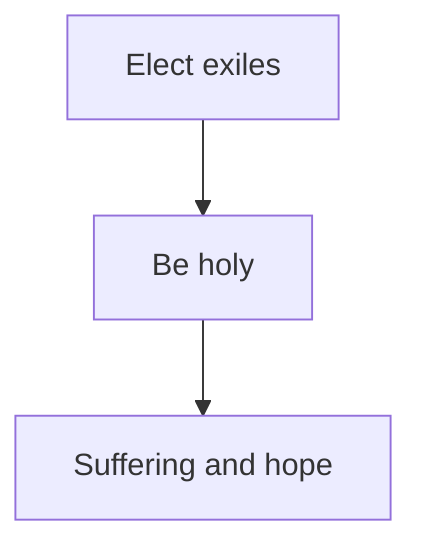

# 1 Peter

**Name and meaning.** The First Letter of Peter, addressed to "elect exiles of the Dispersion" in five provinces of Asia Minor. It is a baptismally flavored exhortation to a mostly Gentile community to live hopefully and honorably under pressure, with Christ the suffering and risen stone as their pattern.

**Prerequisites:** [early church](../../../stories/08-early-church.md) and [Isaiah](../../../../old-testament/books/major-prophets/isaiah.md) (the letter is soaked in Isaiah's stone and servant language).

## Dating and authorship

The letter claims to be from Peter in "Babylon" (almost certainly a cipher for Rome), with Silvanus as a possible scribe (5:12). Traditional reading accepts apostolic authorship, which would require a date in the 60s, before Peter's traditional martyrdom under Nero. Many modern scholars, noting polished Greek, a Pauline-sounding theology, and a situation of more general social harassment than of Nero's fire, date it later (70s–90s) and treat it as a Petrine tradition letter. Both views are current; the book is pastoral either way.

## Context

The readers are experiencing "various trials" and being slandered as evildoers. The advice is not revolt. It is holy conduct among the Gentiles, honor toward the emperor, a distinctive household ethic, and a willingness to suffer for doing good rather than for doing evil. "Exile" and "Dispersion" are theological descriptions of a Gentile church that has inherited Israel's language of sojourning.

## Outline

- **1:1–2:10.** Blessing for a living hope through the resurrection; a call to holiness; love; the living stone and a chosen people, a royal priesthood.
- **2:11–3:12.** Honor among the Gentiles; the household code (emperor, slave-masters, husbands and wives); a blessing for those who bless.
- **3:13–4:19.** Suffering for righteousness; a difficult passage about Christ preaching to the spirits in prison; baptism as an appeal; love and hospitality in the end of all things; judgment beginning with the household of God.
- **5.** Exhortation to elders and to the young; humility; resistance to the devil; greetings from "Babylon."

## Key passages and ideas

1:3–9 is a compact gospel of new birth, inheritance, and tested faith. 2:9–10 applies Hosea's "not my people" language to this Gentile-majority community — a daring reuse that should be taught alongside [Hosea](../../../../old-testament/books/minor-prophets/hosea.md) and [Romans](../pauline-epistles/romans.md) 9. 2:21–25, the example of Christ's suffering, quotes and echoes Isaiah 53. 3:15, being ready to account for the hope, is a classic text for later apologetics, and in context it is about a gentle, respectful answer under intimidation, not about winning arguments for sport.

3:18–22 remains one of the hardest New Testament paragraphs (the spirits in prison, the days of Noah, baptism now saving as an antitype of the flood). Later doctrine of the "descent to the dead" used it; historical-critical reconstructions vary. It is better to admit the difficulty than to pretend a single obvious meaning.

The letter's Greek is more polished than some would expect of a Galilean fisherman, which is one reason Silvanus is often named as a scribe, and one reason critics prefer a later Petrine school. Style does not, by itself, settle authorship, but it should be noticed. So should the letter's use of the Septuagint: this is a church already living in Greek scripture. The "fiery ordeal" of chapter 4 may be local harassment rather than an empire-wide persecution; that historical caution actually makes the letter more useful, not less, because most later Christian suffering has also been local, social, and confused, not cinematic.

## Themes and reception

Themes include hope, exile, holiness, suffering, priesthood of the people, and a distinctive public life. The letter has been a resource for churches under persecution and for later debates about church and civil authority (2:13–17). The household instructions, as elsewhere, need historically careful teaching. "Babylon" as Rome is an early clue to a symbolic geography that [Revelation](../prophecy/revelation.md) will use at length.

## Where this leads

- Next: [2 Peter](2-peter.md)
- Glossary: [exile](../../../../glossary/exile.md), [baptism](../../../../glossary/baptism.md), [priesthood](../../../../glossary/priesthood.md), [Peter](../../../../glossary/peter.md)
