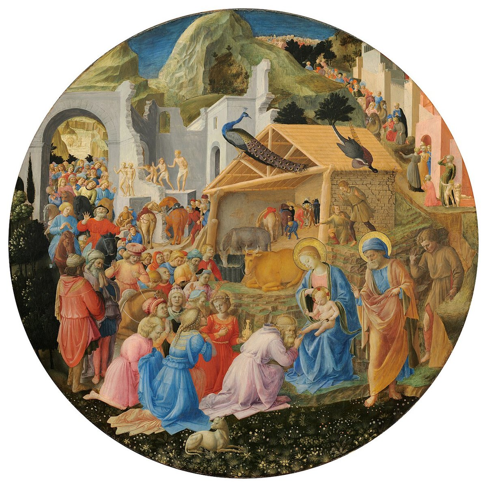

# 2 John

*adoration of the Magi Credit: Fra Angelico and Fra Filippo Lippi (1395 - 1455) – painter (Italian) Born in Italy, Mugello, Vicchio. Died in Italy, Rome. Details on Google Art Project. License: Public domain. Source: [File:Fra Angelico, Fra Filippo Lippi, The Adoration of the Magi.jpg](https://commons.wikimedia.org/wiki/File:Fra_Angelico,_Fra_Filippo_Lippi,_The_Adoration_of_the_Magi.jpg).*
**Name and meaning.** The Second Letter of John is a brief note from "the elder" to "the elect lady and her children" — almost certainly a church and its members, though a particular woman of standing is not impossible. It repeats the first letter's concern: love one another, and do not welcome those who do not confess Jesus Christ come in the flesh.

**Prerequisites:** [1 John](1-john.md).

## Dating and authorship

See [1 John](1-john.md). The self-designation "the elder" (also in 3 John) has been taken as the apostle in old age, or as a different Johannine leader (sometimes called John the Elder, a figure mentioned by Papias). The three letters are usually dated together, late in the first century. 2 and 3 John were slower than 1 John to be universally received as canonical, partly because of their brevity.

## Context

Traveling teachers need hospitality; hospitality is also the way false teaching spreads. The elder is glad that some of the "children" are walking in the truth, and he warns the church not to receive into the house or even greet a teacher who "does not abide in the teaching of Christ." He hopes to speak face to face rather than write with paper and ink.

The situation is therefore the ordinary early Christian problem of itinerant authority, seen also in the Didache and in 3 John from another angle. Here the danger is doctrinal hospitality; there, the danger will be a local leader who refuses legitimate visitors.

## Outline

Because the letter is only thirteen verses, the movement is simple:

- Greeting to the elect lady and her children, in the language of truth and love.
- Thanksgiving and the commandment "that we love one another," which is also a commandment heard "from the beginning."
- Warning about many deceivers; the antichrist as one who will not confess Jesus Christ come in the flesh; a caution not to lose "what we have worked for."
- Instruction not to welcome such a teacher into the house.
- A hope of a visit, and a greeting from "the children of your elect sister."

## Key passages and ideas

The identification of love with walking in the commandments (vv. 5–6) keeps "love" from becoming a vague warmth. The refusal of hospitality (vv. 10–11) has had a long and sometimes harsh afterlife in later policies of exclusion. In its first setting it is about not giving a platform and provision to a Christological denial that is already splitting the community. Later churches have had to decide, without the elder in the room, what counts as an analogous case. A first-principles reading states the first-century issue clearly and does not pretend the later applications have been obvious or always just.

The "elect lady" as a church is supported by the "elect sister" at the end and by the corporate "children." The letter then becomes a window on sister-churches in a Johannine network, writing short, sharp notes to one another.

## Themes and reception

Themes include truth, love, incarnation, and the ethics of hospitality. With 3 John it is a reminder that some of the New Testament is occasional correspondence, not a treatise, and that doctrine was already a matter of who ate at whose table. Read the two short letters as a pair, after 1 John, and then compare the hospitable severity of 2 John with the hospitable complaint of 3 John.

The brevity is itself instructive. A complete Johannine warning can be written in a few lines because a longer homily (1 John) already exists, and because the elder expects to come in person. Not every biblical book is trying to say everything.

## Where this leads

- Next: [3 John](3-john.md)
- Glossary: hospitality, [elder](../../../glossary/terms/elder.md), antichrist
