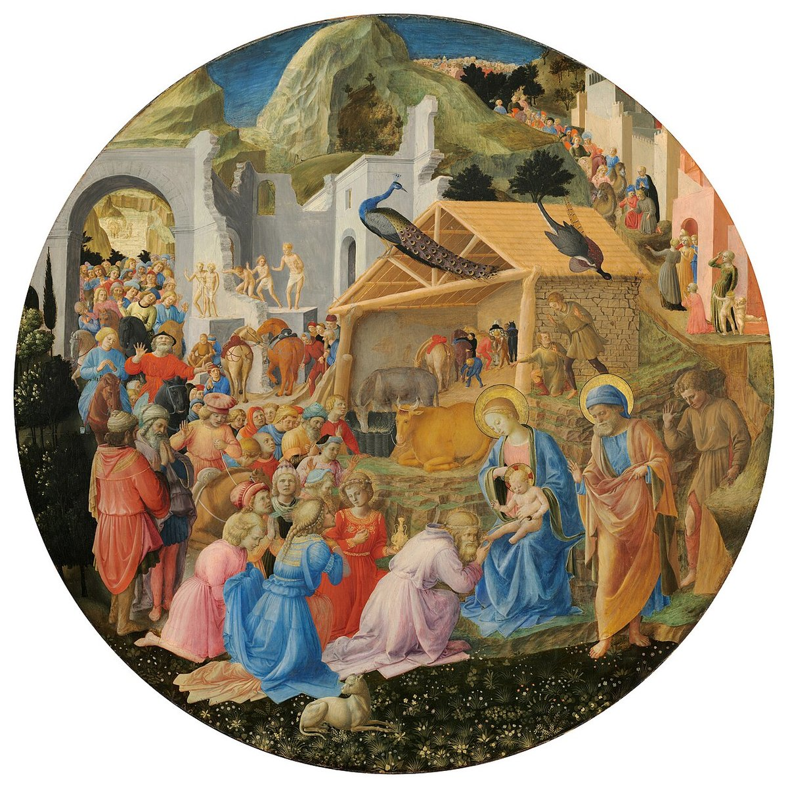

# 3 John

*adoration of the Magi Credit: Fra Angelico and Fra Filippo Lippi (1395 - 1455) – painter (Italian) Born in Italy, Mugello, Vicchio. Died in Italy, Rome. Details on Google Art Project. License: Public domain. Source: [File:Fra Angelico, Fra Filippo Lippi, The Adoration of the Magi.jpg](https://commons.wikimedia.org/wiki/File:Fra_Angelico,_Fra_Filippo_Lippi,_The_Adoration_of_the_Magi.jpg).*
**Name and meaning.** The Third Letter of John, the shortest book in the New Testament, is a personal note from "the elder" to Gaius, praising him for hospitality to traveling "brothers," condemning Diotrephes who "likes to put himself first" and refuses the elder's people, and commending Demetrius.

**Prerequisites:** [2 John](2-john.md) and [1 John](1-john.md).

## Dating and authorship

See [1 John](1-john.md) and [2 John](2-john.md). The same "elder" writes, in the same late first-century Johannine network. 3 John names names and does not argue the incarnation explicitly; it is about authority and hospitality on the road. Its canonical reception, like that of 2 John, was slower than that of the first letter, again partly because of its size.

## Context

Early Christian missionaries depended on local houses. Gaius has received them "in a manner worthy of God." Diotrephes, apparently a local leader, will not acknowledge the elder's authority, spreads "false charges," refuses the visitors, and expels those who want to welcome them. The elder will come and "bring up what he is doing." The letter is therefore the other side of 2 John's problem: there the danger was welcoming the wrong teacher; here the danger is a strong local man shutting out the right ones.

This is first-principles church politics, already in the New Testament: itinerant and local authority, reputation, and the question of who "loves to be first." It is also evidence that "the elder" could not simply command at a distance. He writes, he names, and he promises a visit.

## Outline

- Greeting to Gaius, with a wish for health "just as it is well with your soul."
- Joy at the brothers' testimony that Gaius walks in the truth.
- Praise of his hospitality, even though the visitors are "strangers"; a sentence that "we ought to support such people, so that we may become coworkers with the truth."
- The complaint against Diotrephes.
- A note not to imitate evil but good; a testimonial for Demetrius.
- A hope of a face-to-face visit; peace, and greetings of "the friends."

## Key passages and ideas

Verse 11, "whoever does good is from God," is a characteristically Johannine moral test, now applied to a conflict about welcome. The language of "friends" and "coworkers with the truth" shows a network, not a lone house. The elder's restraint — he will not put everything in ink (v. 13), as in 2 John — suggests both the limits of a short letter and the residual hope of personal presence as the proper form of authority.

Diotrephes has been variously identified as a proto-monarchical bishop, a schismatic, or simply an overbearing host. The letter does not give enough to close the case, and later confessional readings have sometimes over-read him. What is clear is that love of precedence is already named as a pastoral vice.

The wish that Gaius "may be in good health, just as it is well with your soul" (v. 2) later became a convenient proof-text for some modern prosperity teaching. In the letter it is a courteous opening, not a theory of wealth. What the elder actually praises is not Gaius's prosperity but his open door. Demetrius, who is "well spoken of by everyone — and even by the truth itself," may be the bearer of the letter, another reminder that these notes traveled with people, not as detached tracts.

## Themes and reception

Themes include hospitality, truth, local versus itinerant authority, and ambition. The letter is a small, sharp window on real names in a real conflict, and it should be allowed to stay small. Together with 2 John it balances the Johannine love command: love is not credulity, and it is not control.

Later readers have used Diotrephes as a type of the tyrannical churchman, and Gaius as a type of the generous lay host. Those typologies are possible only because the letter first cared enough to name two men and to take a side.

## Where this leads

- Next: [Jude](jude.md)
- Glossary: hospitality, [elder](../../../glossary/terms/elder.md), [house church](../../../glossary/terms/house-church.md)
