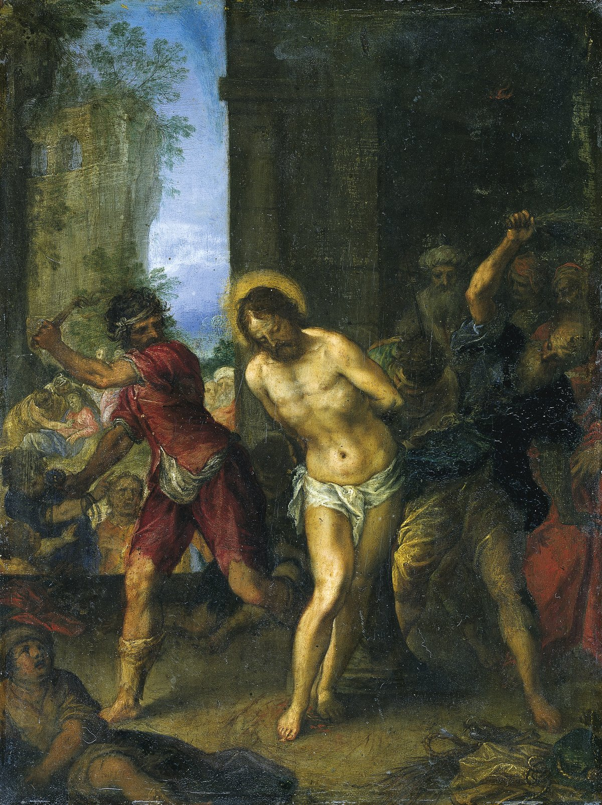

# Jude

*Flagellation of Christ Credit: Hans Rottenhammer. License: PDM-owner. Source: [File:The Flagellation (SM 2108).png](https://commons.wikimedia.org/wiki/File:The_Flagellation_(SM_2108).png).*
**Name and meaning.** The Letter of Jude, a short, vivid warning "to those who are called" against certain people who "have stolen in" and are turning the grace of God into licentiousness and denying "our only Master and Lord, Jesus Christ." The author identifies himself as "Jude, a servant of Jesus Christ and brother of James."

**Prerequisites:** [2 Peter](2-peter.md) (which appears to reuse much of this letter) and the survey of [general epistles](README.md).

## Dating and authorship

If the James named is the Lord's brother, then Jude is another of Jesus' brothers (see Mark 6:3), and a relatively early date is possible (often mid-to-late first century). Some scholars date the letter later, seeing a more settled "faith once for all entrusted to the saints" as a second-generation formula. Traditional reading accepts the family attribution. The book quotes or alludes not only to the Hebrew scriptures but also to 1 Enoch and to a tradition about the archangel Michael and Moses' body (often connected with the Assumption of Moses). That use of non-canonical Jewish literature is a first-principles fact about the letter and was already discussed in antiquity.

## Context

The opponents are accused of sexual immorality, rejection of authority, slander of "glorious ones," grumbling, flattery, and being shepherds who feed only themselves. The imagery is rapid: Cain, Balaam, Korah, hidden reefs at love-feasts, waterless clouds, wandering stars. The tone is closer to apocalyptic warning than to a calm philosophical refutation.

## Outline

- Opening identification and a change of plan: the author had meant to write about "the salvation we share," but now must appeal for a struggle for the faith.
- The accusation, with typological examples of judgment (Egypt, angels who left their proper dwelling, Sodom).
- Woe, Enoch's prophecy of the Lord's coming with holy ones, and a portrait of the infiltrators.
- A closing pastoral strategy: remember the apostles' predictions; keep yourselves in the love of God; have mercy, with distinction, on those who doubt or are already stained; a famous doxology.

## Key passages and ideas

The delayed purpose (v. 3) is a rare glimpse of an author changing course. The citation "Enoch, the seventh from Adam, prophesied" (vv. 14–15) shows a first-century Jewish-Christian writer treating 1 Enoch as a prophetic voice; later canonical decisions did not include 1 Enoch in most Bibles (the Ethiopian church is a notable exception). The Michael tradition (v. 9) is another such window.

The closing doxology (vv. 24–25) — to the one who is able to keep you from falling — has been used constantly in Christian worship. It should not be detached from the severity of the letter: the God who keeps is the God in whose love the community must also keep itself, while practicing a careful mercy toward the wavering.

## Themes and reception

Themes include contention for the faith, judgment, the use of older stories (canonical and not), and a mercy that is not naive. The literary relationship with 2 Peter is the main scholarly issue: most conclude that 2 Peter adapted Jude, which, if true, is an instance of early Christian rewriting, not a problem to be hidden. The letter's harshness has made it a rarer preaching text; its doxology has made it a common one. Read both.

Because the book is short, it is easily treated as a footnote to 2 Peter. It is worth reading first and on its own, so that its own opening, its own use of Enoch, and its own closing mercy are heard before they are compared.

## Where this leads

- The general epistles end; the New Testament closes with [Revelation](../prophecy/revelation.md)
- Glossary: [faith](../../../glossary/terms/faith.md), doxology, [James](james.md)
