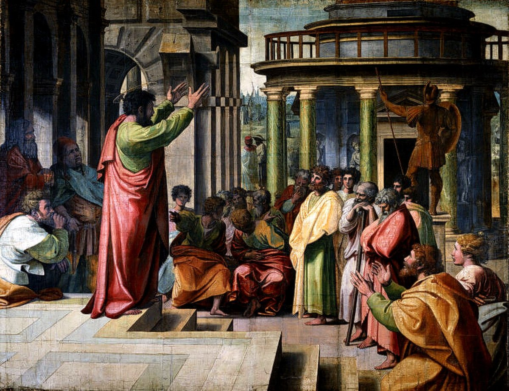

# Acts

*Raphael, St Paul Preaching in Athens Credit: Raphael. License: Public domain. Source: [File:V&A - Raphael, St Paul Preaching in Athens (1515).jpg](https://commons.wikimedia.org/wiki/File:V&A_-_Raphael,_St_Paul_Preaching_in_Athens_(1515).jpg).*
**Name and meaning.** The Acts of the Apostles, the second volume of Luke–Acts, addressed again to Theophilus. The English title overpromises: after the first chapters, the book is mainly the acts of Peter, then of Paul, and of the Spirit who drives the witness from Jerusalem to Rome. It is the only canonical narrative of the earliest church.

**Prerequisites:** [Luke](../gospels/luke.md), [Second Temple Judaism and Rome](../../01-second-temple-judaism-and-rome.md), and the survey [Acts](../../04-acts.md). Story companions: [early church](../../stories/08-early-church.md) and [Paul's journeys](../../stories/09-pauls-journeys.md).

## Dating and authorship

See [Luke](../gospels/luke.md). The same debates apply. The book ends with Paul under a kind of house arrest in Rome, preaching "without hindrance," and does not narrate his death. Some have dated Acts early for that reason (before Paul's execution); many date it later, with Luke, in the 80s or 90s, and take the ending as a theological close rather than a date-stamp. The "we" passages (16:10–17; 20:5–15; 21:1–18; 27:1–28:16) are the main internal argument for a companion-author. Critics have also argued that they are a literary device or a source. The relationship between Acts and the undisputed [Pauline letters](../pauline-epistles/README.md) is a standing issue: there is overlap, and there are tensions (for example, in the number and purpose of Paul's Jerusalem visits, and in how the law is negotiated).

## Context

The setting is the Jewish diaspora and the Roman eastern Mediterranean, from the 30s into the 50s or 60s CE. The book is not a modern minutes of the church. It is a narrative of witness: "you will be my witnesses in Jerusalem, in all Judea and Samaria, and to the end of the earth" (1:8). That verse is the plot.

## Outline

- **1–7.** Ascension, the choice of Matthias, Pentecost, life in common, conflict and signs, Stephen's speech and death — the Jerusalem church.
- **8–12.** Samaria, the Ethiopian official, Saul's call, Cornelius and the opening to the Gentiles, the Antioch church, Peter's escape, Herod's death.
- **13–20.** Paul's missionary journeys, with the Jerusalem council of chapter 15 as the hinge; speeches in synagogues and in civic spaces (Athens in chapter 17).
- **21–28.** Paul's arrest in Jerusalem, hearings before the Sanhedrin, Felix, Festus, and Agrippa, the appeal to Caesar, the shipwreck, and arrival in Rome.

## Key passages and ideas

Pentecost (chapter 2), with the Spirit, the languages, and Peter's use of [Joel](../../../old-testament/books/minor-prophets/joel.md), is the book's birth scene. The early summaries (2:42–47; 4:32–35) have shaped later ideas of Christian community, sometimes too idealistically, sometimes too dismissively. Stephen's long speech is a rereading of Israel's story that ends in a charge against the present leadership and in the first martyrdom; Saul is standing by.

The conversion of Cornelius (10–11) and the council of Jerusalem (15) are the theological center of the Gentile question: God has given the Spirit first, and the church must catch up. Paul's speech on the Areopagus (17) is a model of preaching in a Greek philosophical setting, using an altar "to an unknown god" and even a poet's line, then announcing resurrection — at which point the audience splits. The trial speeches show Christianity on trial before Jewish and Roman authorities, and they insist that the movement is not a political revolt but a hope of Israel fulfilled.

The speeches, which occupy a large fraction of the book, are not stenographic records in the modern sense, and ancient historians did not pretend that they were. They are the author's way of interpreting events: Peter's Pentecost sermon, Stephen's history of Israel, Peter's speech to Cornelius, James at the council, and Paul's defenses. Together they argue that the way of Jesus is the fulfillment of Israel's hope, not a novelty invented in Antioch, and that it can be explained to synagogue, Sanhedrin, philosopher, and Roman official. Whether every legal and nautical detail is precise is a matter of ongoing historical debate; the shipwreck of chapters 27–28 is unusually vivid and has often been judged to rest on close knowledge. The theological close is clearer than the biographical one: the gospel has reached the capital, and the last word is a preaching that is not shut up.

## Themes and reception

Themes include the Holy Spirit, witness, the inclusion of the nations, the innocence of the apostles before Rome, prayer, and the unhindered word. Acts has been used as a church-growth manual, a defense of apostolic succession, a charter for pentecostal experience, and a historical source. All of those uses should be tested against the book's own shape. It does not tell everything (it is silent on most of the other apostles), and it is theologically driven. It remains the indispensable narrative of how a Jewish messianic movement became, without ceasing to argue from Moses and the prophets, a mission among the Gentiles.

## Where this leads

- Next section: [Pauline epistles](../pauline-epistles/README.md), beginning with [Romans](../pauline-epistles/romans.md)
- Story path: [early church](../../stories/08-early-church.md), [Paul's journeys](../../stories/09-pauls-journeys.md)
- Glossary: [Pentecost](../../../glossary/terms/pentecost.md), [Holy Spirit](../../../glossary/terms/holy-spirit.md), [apostle](../../../glossary/terms/apostle.md), [Gentile](../../../glossary/terms/gentile.md)
