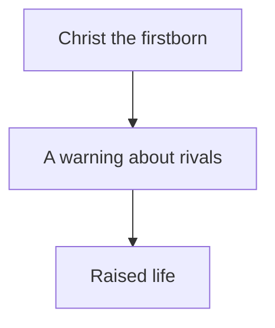

# Colossians

**Name and meaning.** The Letter to the Colossians, written to a church in the Lycus valley of Asia Minor that Paul probably did not found (Epaphras did). It presents a high view of Christ as the image of the invisible God, in whom all things hold together, and it opposes a local "philosophy" of regulations, elemental spirits, and visionary religion.

**Prerequisites:** [Paul's letters](../../../05-pauls-letters.md) and [Ephesians](ephesians.md).

## Dating and authorship

Traditional attribution is Pauline, from prison, often grouped with Ephesians and Philemon (the same circle of names appears). Many modern scholars regard Colossians as coming from a Pauline disciple, because of style, a more developed cosmic Christology, and a church order that feels later; others defend Paul's hand, perhaps with a secretary. Dates, accordingly, range from the 50s or early 60s to the later first century. The authorship debate should be reported alongside the letter's content.

## Context

The "Colossian heresy" (a modern label) is reconstructed from the author's warnings: food and festival regulations, self-abasement, worship of angels, visions, and "elemental spirits of the world." It seems to have been a syncretistic mix, possibly with Jewish and local pagan elements, not a simple replay of the Galatian crisis. The answer is not a better technique. It is a fuller Christ.

## Outline

- **1–2.** Thanksgiving and prayer; the Christ hymn (1:15–20); Paul's labor; a warning against the philosophy; fullness in Christ; dying and rising with him.
- **3–4.** The things above; putting to death the old self; a household code; exhortations and greetings, including a note about a letter to Laodicea and about Onesimus (the link to [Philemon](philemon.md)).

## Key passages and ideas

The hymn of 1:15–20 — Christ as firstborn of all creation and firstborn from the dead, the one in whom the fullness of God was pleased to dwell, and through whom all things are reconciled, whether on earth or in heaven, making peace by the blood of his cross — is a cosmic counterpart to the humility hymn of Philippians. Together they have shaped later creeds. 2:8–15, the warning against captivity to philosophy, includes a striking image of a legal record nailed to the cross and of a triumph over rulers and authorities. Baptism is here, as in Romans 6, a dying and rising with Christ.

The household code (3:18–4:1) is shorter than Ephesians' and raises the same interpretive issues. 3:11, "there is no longer Greek and Jew… but Christ is all and in all," shows the social reach of the letter's Christology.

The practical lists of chapter 3 (anger, slander, lies, and then compassion, kindness, humility, and forgiveness) are the letter's test of its high Christology. A cosmic Lord who is not allowed to govern the tongue is, in this author's view, not yet known. The command to let the word of Christ dwell richly, with psalms and hymns and thankfulness, suggests a worshiping community already singing its theology — quite possibly including the hymn of chapter 1. Colossians is therefore not only a polemic against a local error. It is a window on how Christological truth was taught: by hymn, by warning, and by household instruction together.

## Themes and reception

Themes include the supremacy of Christ, fullness, a polemic against religious supplements, and a practical holiness of the "new self." The letter has been crucial for later Christology and for debates about philosophy and tradition. Whether or not Paul wrote every word, it stands in a clearly Pauline stream and should be read with Philemon and Ephesians.

## Where this leads

- Next: [1 Thessalonians](1-thessalonians.md)
- Related: [Philemon](philemon.md)
- Glossary: [Christ](../../../../glossary/christ.md), [fullness](../../../../glossary/fullness.md), [baptism](../../../../glossary/baptism.md)
