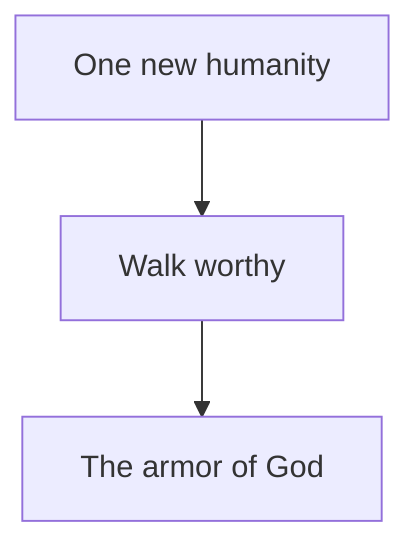

# Ephesians

**Name and meaning.** The Letter to the Ephesians, a sweeping meditation on the cosmic Christ, the church as his body, the unity of Jew and Gentile, and a life worthy of the calling. In some early manuscripts the words "in Ephesus" are missing, which has led many to read it as a circular letter.

**Prerequisites:** [Paul's letters](../../../05-pauls-letters.md) and [Colossians](colossians.md), its closest relative.

## Dating and authorship

Traditional attribution is Pauline, written from prison (3:1; 4:1; 6:20), often placed at Rome in the early 60s. A large body of modern scholarship regards Ephesians as the work of a later Pauline disciple (perhaps in the 80s), because of its style (long, ornate sentences), its more developed church theology, its lack of personal greetings, and its close literary relationship to Colossians. Other scholars still defend Pauline authorship and explain the differences by a different scribe, occasion, or mood. The letter is canonical either way; the authorship question should be reported, not evaded.

## Context

If it is a circular letter to churches in Asia, it addresses a mainly Gentile Christian audience that needs to remember that they were once "strangers to the covenants of promise" and have been brought near. The tone is less crisis-driven than Galatians or 1 Corinthians. It is more of a liturgical and doctrinal reminder: who you are, what has been accomplished, how then to walk.

## Outline

- **1–3.** Blessing God for every spiritual blessing in Christ; a prayer for revelation; salvation by grace through faith; the breaking of the dividing wall and the one new humanity; Paul as prisoner of the mystery; a second prayer, and a doxology.
- **4–6.** A call to unity; gifts for building up the body; the old and new self; household instruction (wives and husbands, children and parents, slaves and masters); the armor of God; a closing word about Tychicus.

## Key passages and ideas

1:3–14 is a single, cascading blessing (in Greek, one long sentence in part) that has shaped later trinitarian and predestinarian language: chosen, adopted, redeemed, sealed with the Spirit. 2:8–10, grace through faith, "not the result of works," with the added "created in Christ Jesus for good works," is a balanced Pauline (or post-Pauline) statement often quoted only in its first half. 2:11–22 is the social center: the cross has made peace and one new humanity, a holy temple.

The household code (5:21–6:9) begins, in many readings, at "be subject to one another" and then particularizes that in ways that later readers have found both culturally limited and, in the husband's call to love as Christ loved the church, potentially self-giving. Teaching should not pretend the passage is simple, or that its history of use has been harmless.

The prayers in chapters 1 and 3 are as important as the arguments. The author wants the readers to have "the eyes of the heart" enlightened, to know a hope, an inheritance, and a power already at work in the raising of Christ. That is why the later ethical material can be so ordinary — speaking truth, putting away bitterness, making the most of the time. The letter does not think that a cosmic Christ makes daily speech unimportant. It thinks the opposite: the one who has filled all things now fills a people whose words and tables and households are the place the unity is proved or denied.

## Themes and reception

Themes include election, grace, the church, unity, cosmic reconciliation, and a distinctive Christian walk. The letter has been central to ecclesiology and to discussions of predestination, marriage, and spiritual warfare (the armor of chapter 6). Whether written by Paul or by a student, it is one of the New Testament's most influential accounts of what the church is for.

## Where this leads

- Next: [Philippians](philippians.md)
- Glossary: [church](../../../../glossary/church.md), [grace](../../../../glossary/grace.md), [household codes](../../../../glossary/household-codes.md)
