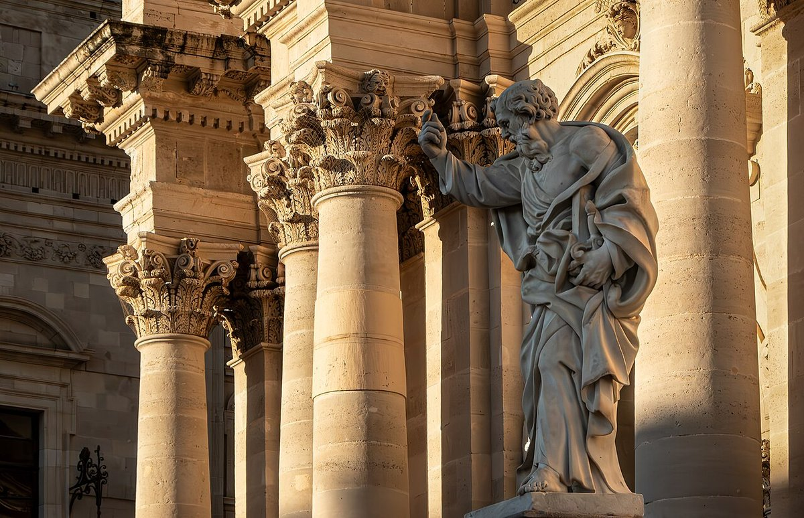

# Galatians

*Statue of Saint Paul by Ignazio Marabitti and Syracuse Cathedral's baroque façade Credit: Julian Lupyan. License: [CC0](http://creativecommons.org/publicdomain/zero/1.0/deed.en). Source: [File:Statue of Saint Paul by Ignazio Marabitti and Syracuse Cathedral's Baroque Facade.jpg](https://commons.wikimedia.org/wiki/File:Statue_of_Saint_Paul_by_Ignazio_Marabitti_and_Syracuse_Cathedral's_Baroque_Facade.jpg).*
**Name and meaning.** The Letter of Paul to the Galatians, a fierce argument that Gentile believers must not be required to take on circumcision and the works of the law as a condition of belonging to Abraham's family. It is shorter than Romans and, in some respects, the rawer version of the same theology.

**Prerequisites:** [Romans](romans.md) (or read Galatians first, then Romans), [Acts](../history/acts.md) 15, and [Paul's journeys](../../stories/09-pauls-journeys.md).

## Dating and authorship

Undisputed Paul. The date depends on whether "Galatia" means the ethnic region in the north or the Roman province in the south (the churches of Acts 13–14), and on how Galatians 2 relates to the Jerusalem council of Acts 15. Proposed dates range from the late 40s to the mid-50s. The North/South Galatia debate is unsettled; it affects chronology more than the letter's argument.

## Context

After Paul had founded these churches, other teachers (often called "the agitators" or, in older Christian polemic, "Judaizers") have urged Gentile converts to be circumcised. Paul regards this as another gospel, not a valid completion of his. He defends his independent apostleship, narrates a confrontation with Peter at Antioch, and then argues from Abraham, from the law's temporary role, and from life in the Spirit.

## Outline

- **1–2.** No other gospel; Paul's call and his independence of Jerusalem; the Antioch incident; justification not by works of the law.
- **3–4.** The Spirit received by faith; Abraham; the law as a pedagogue; one in Christ, no longer Jew or Greek, slave or free, male and female; the allegory of Hagar and Sarah.
- **5–6.** Freedom; the works of the flesh and the fruit of the Spirit; bearing burdens; a closing in Paul's own large letters, and a boast only in the cross.

## Key passages and ideas

2:15–21, including "I have been crucified with Christ," is a dense statement of justification and union with Christ. 3:28 is among the most revolutionary social sentences in the New Testament, and also one of the most argued-over in its scope (does it reach beyond baptismal status into social roles?). The Hagar–Sarah allegory (4:21–31) is a daring rereading of Genesis and has had a painful afterlife when used to denigrate Jews; in the letter it is aimed at a specific intra-Christian debate about circumcision. Teach it carefully.

5:13–25 prevents any reading of "freedom" as license: the alternative to the law as a covenant requirement is not chaos but walking by the Spirit, whose fruit is listed with a precision that has shaped Christian ethics ever since.

Paul's autobiographical chapters are doing theology, not padding a résumé. If his gospel came "through a revelation of Jesus Christ" and was later acknowledged, not rewritten, by the "pillars" in Jerusalem, then the agitators cannot claim a higher apostolic franchise. The Antioch confrontation with Peter (Cephas), who withdrew from Gentile tables when "certain people from James" arrived, is told because table fellowship is the test of the gospel in practice. If Peter can be "condemned" in public, no later Christian should be surprised that this letter still starts arguments. It was meant to.

 The closing autograph in large letters (6:11) and the scarred body of the apostle (6:17) are the letter's last evidence: this gospel has already cost him something, and he will not trade it for a quieter life in someone else's good opinion.

## Themes and reception

Themes include gospel, apostleship, justification, Abraham, law and promise, freedom, and the Spirit. Galatians was a favorite of Luther and of every later movement that has feared a return to "works." The New Perspective has again asked what "works of the law" were (boundary markers such as circumcision, or meritorious good works, or both). Read the letter in its mid-first-century crisis, then listen to the later uses.

## Where this leads

- Next: [Ephesians](ephesians.md)
- Glossary: [justification](../../../glossary/terms/justification.md), [law](../../../../../../../philosophy/glossary/general/law.md), [circumcision](../../../glossary/terms/circumcision.md), [freedom](../../../../../../../philosophy/glossary/general/freedom.md)
