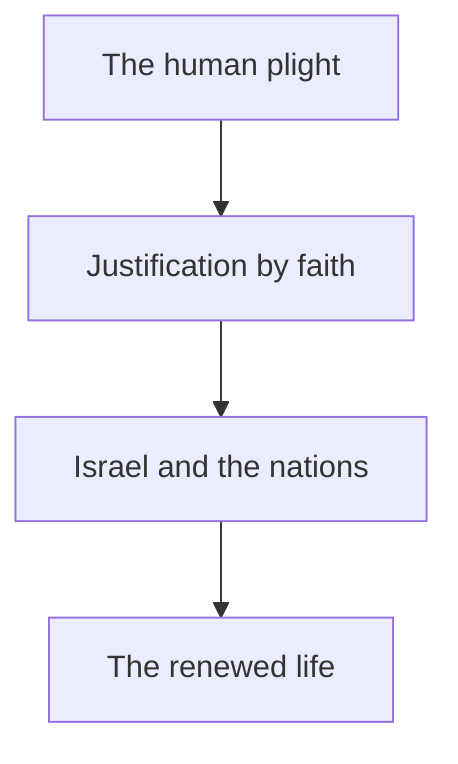

# Romans

**Name and meaning.** The Letter of Paul to the Romans, the longest and most systematic of the Pauline epistles, written to a church Paul had not founded and had not yet visited. It is a sustained argument about the gospel, the righteousness of God, Jew and Gentile, and the life that follows from mercy.

**Prerequisites:** [Paul's letters](../../../05-pauls-letters.md), [Acts](../history/acts.md), and [Paul's journeys](../../../stories/09-pauls-journeys.md). Helpful: [Habakkuk](../../../../old-testament/books/minor-prophets/habakkuk.md) 2:4, and [Genesis](../../../../old-testament/books/law-torah/genesis.md) on Abraham.

## Dating and authorship

Romans is universally accepted as authentic Paul, almost always dated to the mid-to-late 50s CE, written from Greece (often Corinth) near the end of the third missionary journey, as Paul prepares to take a collection to Jerusalem and then hopes to go to Spain by way of Rome (15:22–29). Chapter 16, a long list of greetings, is sometimes thought to have been a separate note to Ephesus, but many scholars keep it as part of the letter. The book is not a timeless treatise first of all; it is a letter to particular house-churches in the capital, some Jewish, some Gentile, in a period after Jews had been expelled from Rome under Claudius and had later returned (a history often connected with Suetonius and with Acts 18:2).

## Context

Paul needs the Roman churches as partners for a western mission, and he needs them to live together after a period of disruption. He also seems to be clarifying his gospel in advance of Jerusalem, where the collection may not be welcome and his view of the law is already controversial. The letter is both diplomacy and theology.

## Outline

- **1:1–17.** Greeting, thanksgiving, the thesis: the gospel is the power of God for salvation, the righteousness of God revealed from faith to faith.
- **1:18–3:20.** The human plight, Gentile and Jewish, ending "there is no one righteous."
- **3:21–4:25.** The righteousness of God apart from the law, through faith in (or the faithfulness of) Jesus Christ; Abraham as the father of all who believe.
- **5–8.** Peace with God; Adam and Christ; baptism into death and life; the struggle with sin; life in the Spirit; no condemnation; nothing able to separate us from the love of God.
- **9–11.** The mystery of Israel: God's faithfulness, a remnant, the olive tree, and the hope that "all Israel will be saved."
- **12–15.** A living sacrifice; gifts; love; the weak and the strong; the collection and travel plans.
- **16.** Commendation of Phoebe, greetings, a closing doxology.

## Key passages and ideas

The thesis of 1:16–17, with its citation of Habakkuk, became the engine of Reformation readings of the letter. "The righteousness of God" can be heard as a status God grants, as God's own covenant faithfulness, or as both; the modern debate (including the so-called New Perspective on Paul) is about that phrase, about "works of the law," and about whether the letter is mainly about how an individual is saved or about how Gentiles are included in the people of God. A first-principles reading should learn the debate and also read the letter whole: it is about both justification and the mercy that holds Jew and Gentile in one body.

Chapters 9–11 must not be skipped. They are not an appendix. Paul's grief for his own people, his refusal to say that the word of God has failed, and his warning to Gentile believers not to boast over the branches are load-bearing. After the Shoah especially, Christian teaching of Romans has had to unlearn certain supersessionist shortcuts. The text itself is more careful than some of its later uses.

The ethical section begins not with rules but with "therefore" and the mercies of God (12:1). The weak and the strong in chapters 14–15 (food, holy days) are a practical test of that theology in a mixed church.

## Themes and reception

Themes include gospel, righteousness, faith, grace, the law, Adam and Christ, the Spirit, Israel, and a life of embodied worship. Romans has been the most argued-over letter in Christian history: Augustine, Luther, Wesley, Barth, and the New Perspective all found a center of gravity here, not always the same center. Jewish readers have had their own reasons to contest later Christian uses of the letter. Read it as a first-century argument before making it a system.

## Where this leads

- Next: [1 Corinthians](1-corinthians.md)
- Glossary: [justification](../../../../glossary/justification.md), [faith](../../../../glossary/faith.md), [grace](../../../../glossary/grace.md), [law](../../../../glossary/law.md), [Israel](../../../../glossary/israel.md)
