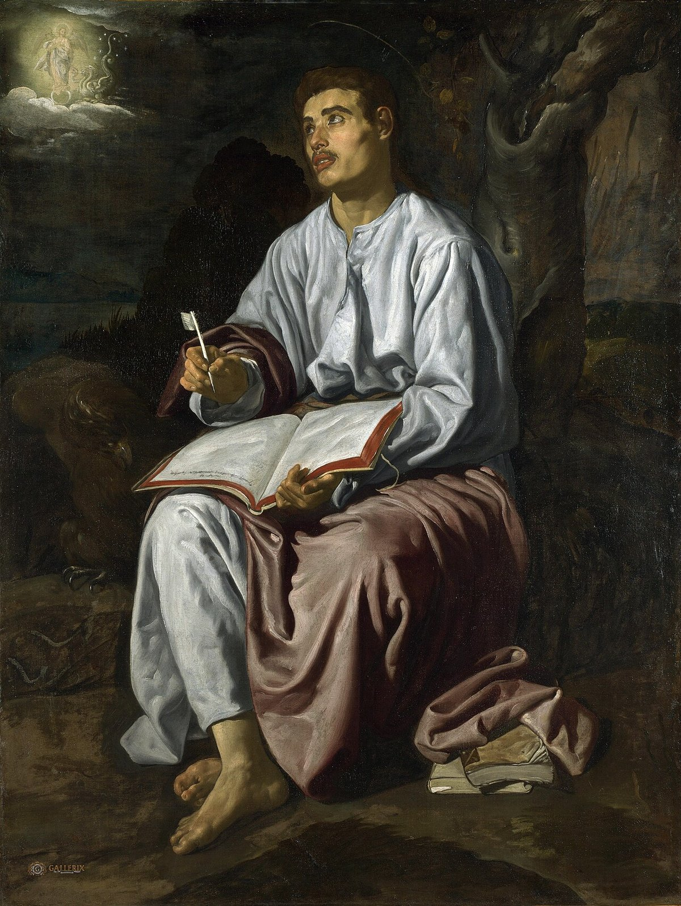
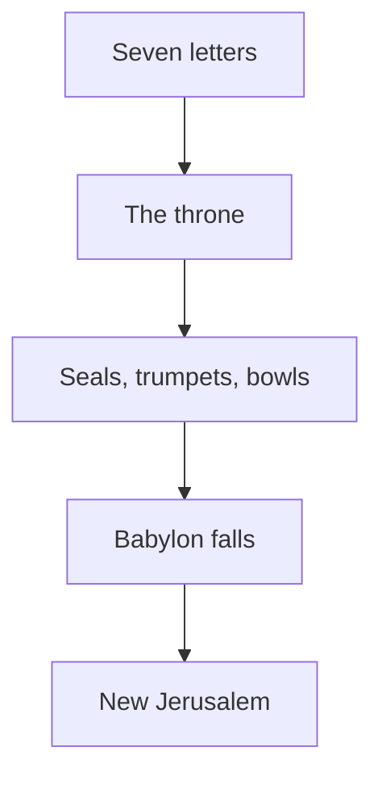

# Revelation

*Saint John on the island of Patmos Credit: Diego Velázquez. License: Public domain. Source: [File:Diego Velázquez 018 (John the Evangelist from Patmos).jpg](https://commons.wikimedia.org/wiki/File:Diego_Velázquez_018_(John_the_Evangelist_from_Patmos).jpg).*
**Name and meaning.** The Revelation (or Apocalypse) to John, the New Testament's only full-scale apocalypse: a letter, a prophecy, and a visionary book addressed to seven churches in Asia, announcing what "must soon take place," centering on the slain and standing Lamb, and ending with a new heaven, a new earth, and a new Jerusalem.

**Prerequisites:** [Daniel](../../../old-testament/books/major-prophets/daniel.md), [Ezekiel](../../../old-testament/books/major-prophets/ezekiel.md), [Isaiah](../../../old-testament/books/major-prophets/isaiah.md), and the survey [Revelation](../../06-revelation.md). Helpful: [Second Temple Judaism and Rome](../../01-second-temple-judaism-and-rome.md).

## Dating and authorship

The writer is "John," a servant and a prophet on the island of Patmos "because of the word of God and the testimony of Jesus." Tradition identifies him with John the apostle, the author of the Fourth Gospel. Many modern scholars distinguish this John from the Gospel's author, because the Greek style and the theology feel different, and date the book to the end of Domitian's reign (about 95–96 CE), following Irenaeus; a minority prefer a date in the 60s, under Nero. The authorship and date questions should be reported together: they affect how one reads "Babylon" and the imperial cult, but they do not determine whether the book is a Christian prophecy.

## Context

The seven churches (Ephesus, Smyrna, Pergamum, Thyatira, Sardis, Philadelphia, Laodicea) are real urban congregations under social, economic, and sometimes lethal pressure to accommodate the religious claims of Rome. The book is not a coded timetable of the twenty-first century first of all. It is resistance literature and worship: a unveiling of who actually rules, issued as a circular to churches tempted by fear and by comfort.

## Outline

- **1.** Title, blessing, a vision of the risen one among seven lampstands.
- **2–3.** Seven messages: commendation, rebuke, a call to conquer, a promise.
- **4–5.** The heavenly throne; the sealed scroll; the Lamb who was slain and is worthy to open it.
- **6–11.** Seals and trumpets; interlude of the 144,000 and a great multitude; the two witnesses.
- **12–14.** The woman, the dragon, and the beasts; the 144,000 again; announcements of judgment, including the fall of Babylon.
- **15–16.** Bowls of wrath.
- **17–18.** The harlot Babylon and her fall; a dirge of merchants and kings.
- **19–20.** The rider on the white horse; the binding of the dragon; a thousand years; a last rebellion; the last judgment.
- **21–22.** New heaven and earth; the new Jerusalem; the river and the tree of life; a closing warning and "Come, Lord Jesus."

## Key passages and ideas

The throne-and-Lamb vision (chapters 4–5) is the theological center. Worthiness belongs to the slaughtered Lamb, not to the beast. The number of the beast (13:18), "666," has been identified with Nero (via Hebrew or Greek gematria) and with many later figures; the Nero identification is the most historically serious first-century proposal, but the symbol was already built to travel. Babylon the great is, in the first instance, Rome, as 17:9's seven hills strongly suggests, and the type has been reused whenever a later empire has claimed what belongs to God.

The millennium of chapter 20 has generated premillennial, amillennial, and postmillennial schemes in later Christianity. The text should be read first as a vision among visions, not as a bare schedule. The last two chapters, a city without a temple because the Lord and the Lamb are its temple, and a tree of life whose leaves are for the healing of the nations, close the Christian Bible with an echo of Genesis and of Ezekiel 47. "Come, Lord Jesus" (*Maranatha* in earlier tradition) is the last prayer.

Art, music, and political reading have probably done as much as commentary to keep this book alive: Dürer's woodcuts, African-American spirituals, Blake, and a long tradition of under-empire protest have heard the Lamb's victory when official theology was cautious or obsessed with timetables. That reception is not an optional extra. It is evidence that the book was always meant to be seen and sung, not only decoded.

## Themes and reception

Themes include worship, witness, empire, judgment, endurance, and new creation. The book's path into the canon was contested, especially in the East. Its afterlife has included liturgy, art, political resistance, and a long history of predictive systems, some of them destructive. A first-principles approach learns the genre (apocalyptic symbolism, not newspaper prose), the first-century setting, and the pastoral aim: to keep the churches faithful to the Lamb. Then, and only then, it asks what the visions still unveil.

The seven messages remain the most straightforward entry point: they are letters to named places, with local color (white stones, a synagogue of Satan as a bitter inner-Jewish or inner-Christian slur that must be taught carefully, lukewarm Laodicea). Start there, then enter the throne room.

## Where this leads

- The New Testament book path ends here. For the Old Testament's closest companion, see [Daniel](../../../old-testament/books/major-prophets/daniel.md)
- Survey: [Revelation](../../06-revelation.md)
- Glossary: [apocalyptic](../../../glossary/terms/apocalyptic.md), Lamb, [Babylon](../../../glossary/places/babylon.md), millennium, new Jerusalem
