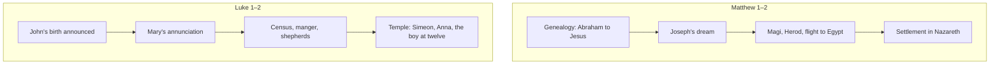

# Birth narratives

**Prerequisites:** [The four Gospels](../02-the-four-gospels.md) and the overviews of [Matthew](../books/gospels/matthew.md) and [Luke](../books/gospels/luke.md). Helpful: [Isaiah](../../old-testament/books/major-prophets/isaiah.md) 7 and [Micah](../../old-testament/books/minor-prophets/micah.md) 5.

**Key ideas:** Only Matthew and Luke tell infancy stories, and they are not the same story; Mark and John begin without a nativity; each evangelist is already doing theology, not only reportage; later Christmas harmony should not erase the differences.

Matthew and Luke both say that Jesus was born in Bethlehem in the days of Herod, of a mother named Mary, and that Joseph was of the line of David. Almost everything else in the two opening cycles is distinct, and a first-principles reading starts there, not with a school pageant.

## Two stories, not one

Matthew's account (chapters 1–2) opens with a genealogy from Abraham through David and the exile, naming four women with complicated stories, and then tells of a discovery: Mary is found to be with child, Joseph resolves to dismiss her quietly, and an angel tells him that the child is from the Holy Spirit and shall be named Jesus, "for he will save his people from their sins." A formula quotation of Isaiah 7:14 (the young woman / virgin and Immanuel) follows. Magi from the east come to Herod, asking for the "king of the Jews"; the chief priests cite Micah on Bethlehem; the magi offer gifts and go home another way; Herod kills the children of Bethlehem; Joseph flees to Egypt and later settles in Nazareth, each move tagged with scripture.

Luke's account (chapters 1–2) is longer and starts earlier, with the aged priest Zechariah and Elizabeth and the announcement of John, and with Gabriel's announcement to Mary in Nazareth. Mary visits Elizabeth; the Magnificat and the Benedictus are sung. A census under "Quirinius" brings the couple to Bethlehem; the child is laid in a manger; shepherds, not magi, receive an angelic announcement; the child is circumcised, presented in the temple, and greeted by Simeon and Anna. At twelve he stays behind in the temple among the teachers. Luke's genealogy is saved for chapter 3 and runs back to Adam.

None of this is in Mark, which begins at the Jordan, or in John's prologue, which begins with the Word. Christmas as a single blended narrative is a later devotion. It can be loved; it should not be used to flatten the sources.

## Historical questions

The census of Quirinius is a famous difficulty: Josephus dates Quirinius's census of Judea to 6 CE, after Herod's death (usually 4 BCE). Harmonizations have been proposed; many historians judge that Luke has telescoped or displaced a memory of imperial enrollment. Herod's massacre is not attested outside Matthew. The virginal conception is a claim of faith in both Gospels, not a report that a modern historian can confirm by the usual means. Traditional reading takes the events as historical. Critical reading treats the infancy cycles as theologically shaped narratives, perhaps with a historical core (birth in the Herodian period, a Davidic claim, a Nazareth upbringing) and with midrashic and scriptural embroidery. This lesson reports both approaches and does not pretend the debate is over.

What is not in serious dispute is the purpose of the stories as they stand. Matthew presents a new exodus and a king greater than Herod, already drawing Gentiles, already in conflict with Jerusalem's power. Luke presents a child of the poor and of Israel's pious remnant, whose birth is good news of great joy for all the people, and a light for the nations.

## Where this leads

- Next: [Baptism and temptation](02-baptism-and-temptation.md)
- Book path: [Matthew](../books/gospels/matthew.md), [Luke](../books/gospels/luke.md)
- Glossary: [virgin birth](../../glossary/virgin-birth.md), [Bethlehem](../../glossary/bethlehem.md), [Herod](../../glossary/herod.md), [Immanuel](../../glossary/immanuel.md)
