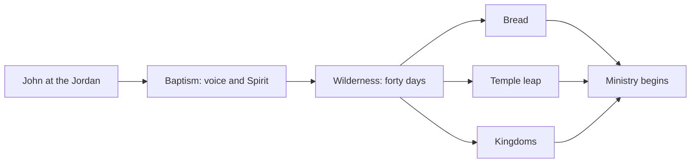

# Baptism and temptation

**Prerequisites:** [Birth narratives](01-birth-narratives.md) and [The four Gospels](../02-the-four-gospels.md). Helpful: [Malachi](../../old-testament/books/minor-prophets/malachi.md) on the messenger, and [Isaiah](../../old-testament/books/major-prophets/isaiah.md) 40.

**Key ideas:** All four Gospels attach Jesus to John the Baptist; baptism is a scene of identification and of a heavenly voice; the Synoptics follow it with a wilderness testing; the Spirit and the scripture of Israel are already the field of the story.

## John, and the Jordan

John appears in the wilderness preaching a baptism of repentance for the forgiveness of sins, clothed like a prophet, and announcing one stronger than himself. Josephus also mentions John as a teacher who practiced baptism and was killed by Herod Antipas, which is independent confirmation of the man's importance. In the Gospels, John's role is to prepare the way (Isaiah 40; Malachi's messenger and Elijah, in some of the telling).

Jesus comes to be baptized. Matthew records John's protest and Jesus' "to fulfill all righteousness." Mark is brief and vivid: the heavens torn, the Spirit as a dove, a voice. Luke adds that Jesus was praying, and places a genealogy immediately after. John the Gospel has no direct description of the baptism; it has the Baptist's testimony that he saw the Spirit descend and remain. The voice's wording varies slightly among the Synoptics (Mark and Luke closer to "you are my beloved Son"; Matthew "this is…"). Psalm 2 and Isaiah 42 are commonly heard in the background: royal and servant language together.

Why does the one announced as the coming one undergo a repentance baptism? The Gospels do not write a later textbook answer, but they insist on the scene. Traditional theology has spoken of identification with sinners, of an anointing for ministry, of a revelation of the Trinity (voice, Son, Spirit). Those are receptions of a scene that, historically, also ties Jesus firmly to John's movement. Jesus' first public act, in the Synoptics, is not a speech in his own temple. It is to stand in a line at the river.

## The wilderness

Mark says the Spirit "drove" him into the wilderness, forty days, tempted by Satan, with wild beasts and angels. Matthew and Luke elaborate three tests, in different order: stones into bread, a leap from the temple, and the kingdoms of the world in exchange for worship (Matthew's last is the kingdoms; Luke's last is the temple). Jesus answers from [Deuteronomy](../../old-testament/books/law-torah/deuteronomy.md) 6–8, the memory of Israel's wilderness. The tester quotes scripture too (Psalm 91). The point is not that scripture is useless, but that it can be used more than one way, and that Israel's own testing in the wilderness is being replayed and, in this telling, held.

John's Gospel has no temptation narrative. It moves from the Baptist's testimony to the calling of disciples and to Cana. The Synoptic testing should not be imported there as if it were missing.

Historically, a period of withdrawal after an encounter with John is plausible; the dialogue form of the three tests is already theological narrative. Traditional reading takes the testing as a real event. Either way, the church received a story in which the Son's obedience is tried at the start, not only at the end, and in which the same Deuteronomy that will be cited in the [Sermon on the Mount](03-sermon-on-the-mount.md) is already the weapon and the food of the wilderness.

## Where this leads

- Next: [The Sermon on the Mount](03-sermon-on-the-mount.md)
- Related: [John the Baptist](../../glossary/john-the-baptist.md), [Messiah](../../glossary/messiah.md)
- Old Testament: [Deuteronomy](../../old-testament/books/law-torah/deuteronomy.md), [Malachi](../../old-testament/books/minor-prophets/malachi.md)
