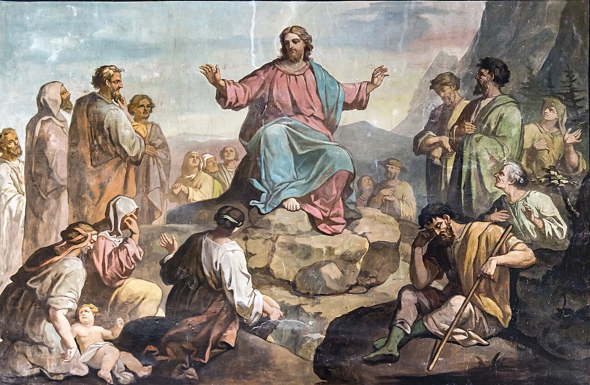
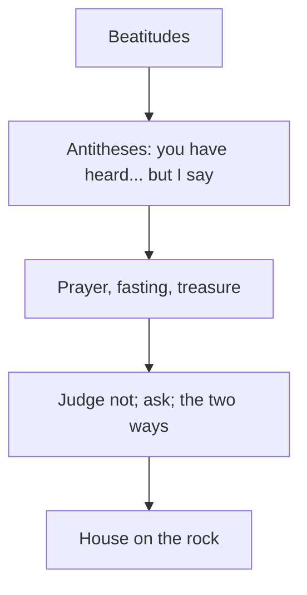

# The Sermon on the Mount

**Prerequisites:** [Baptism and temptation](02-baptism-and-temptation.md) and [Matthew](../books/gospels/matthew.md). Compare Luke's "Sermon on the Plain" (Luke 6).

**Key ideas:** Matthew gathers Jesus' teaching into a long discourse on a mountain; the Beatitudes, the antitheses, the Lord's Prayer, and the demand to love enemies are the load-bearing pieces; this is not a gentle add-on to the gospel of the cross, but a teaching about the kingdom's righteousness.

*Église Saint-Martin de Castelnau-d'Estrétefonds - Le Sermon sur la montagne par Robert Arsène IM31000073 Credit: Didier Descouens. License: [CC BY-SA 4.0](https://creativecommons.org/licenses/by-sa/4.0). Source: [File:Église Saint-Martin de Castelnau-d'Estrétefonds - Le Sermon sur la montagne par Robert Arsène IM31000073.jpg](https://commons.wikimedia.org/wiki/File:Église_Saint-Martin_de_Castelnau-d'Estrétefonds_-_Le_Sermon_sur_la_montagne_par_Robert_Arsène_IM31000073.jpg).*
## A discourse, and a plain

Matthew 5–7 is the first of the Gospel's five teaching blocks. Jesus goes up a mountain, sits (the posture of a teacher), and speaks to disciples with the crowds in earshot. Luke 6 has a shorter, related sermon on a "level place," with blessings and woes, the command to love enemies, and the tree and the house. A common scholarly view is that both evangelists used a shared sayings tradition and shaped it. Traditional reading takes both as memories of Jesus' preaching, possibly of more than one occasion. The student should read both, not only Matthew.

## Load-bearing units

The Beatitudes (5:3–12) bless the poor in spirit, mourners, the meek, those who hunger for righteousness, the merciful, the pure in heart, the peacemakers, and the persecuted. Luke's forms are more economically sharp ("blessed are you who are poor") and are paired with woes. Neither version is a personality test. They are announcements of the kingdom's reversal.

The antitheses (5:21–48) take up anger, lust, divorce, oaths, retaliation, and love of enemies. "You have heard… but I say to you" is not a casual contrast with Moses; Jesus speaks as one with authority over the received reading of the law, which is why the discourse ends with a crowd astonished at that authority. "Be perfect, as your heavenly Father is perfect" (Matthew) and "be merciful" (Luke) are the summit of the love-of-enemies command.

The Lord's Prayer (6:9–13; a shorter form in Luke 11) sits in a warning against performative piety: alms, prayer, and fasting are to be done in secret. Daily bread, forgiveness, and deliverance from evil are the petitions of a people who have a Father and also have enemies and hunger. The sayings about treasure, the eye, and two masters (6:19–24) and about anxiety (6:25–34) belong to the same field: the kingdom first.

The closing warnings (7:13–27) are severe: a narrow gate, false prophets known by fruit, a house on rock or sand. "Not everyone who says to me, 'Lord, Lord'" is already a judgment scene inside the teaching. A sermon this demanding cannot be reduced to kindness.

## Reception and use

The Sermon has been treated as a new law, as an impossible ideal meant to drive people to grace, as a mandate for a remnant, and as a charter for nonviolence and for the poor. Those later frames should be named after the text is heard, not before. Historical Jesus research generally grants that many of these sayings go back to Jesus, even when the mountain-length composition is credited to Matthew. The discourse is also one of the places where [James](../books/general-epistles/james.md) later sounds most like the Gospel tradition.

For this encyclopedia the first-principles yield is: the kingdom Jesus announces has a way of life, it rereads the law from the inside, and it ends in a crisis of hearing and doing, not in a suggestion.

## Where this leads

- Next: [Miracles](04-miracles.md)
- Related: [Matthew](../books/gospels/matthew.md), [James](../books/general-epistles/james.md)
- Glossary: [Beatitudes](../../glossary/terms/beatitudes.md), [kingdom of God](../../glossary/themes/kingdom-of-god.md), [Lord's Prayer](../../glossary/terms/lords-prayer.md)
