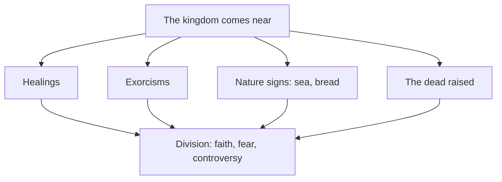

# Miracles

**Prerequisites:** [The four Gospels](../02-the-four-gospels.md) and [The Sermon on the Mount](03-sermon-on-the-mount.md).

**Key ideas:** The Gospels present healings, exorcisms, nature signs, and raisings of the dead as acts of the kingdom, not as entertainments; the Synoptics and John shape the same kind of material differently; later debates about "whether miracles happen" should not replace a first reading of what the stories claim.

## What the stories are doing

In Mark, Jesus' first day in Capernaum already includes an exorcism in the synagogue and the healing of Peter's mother-in-law; the crowd gathers at the door; Jesus withdraws to pray and then keeps moving. The kingdom is not only preached. It arrives as release for bodies and as a confrontation with "unclean spirits." The Synoptics group stilling the storm, the Gerasene demoniac, the woman with the hemorrhage, and Jairus's daughter as a cluster of power over chaos, death, and impurity. Feedings of five thousand (all four Gospels) and of four thousand (Mark and Matthew), walking on the sea, and a fig tree cursed (Mark and Matthew) belong to the same field.

John prefers the word "signs" and narrates fewer, more developed ones: water to wine, a royal official's son, a lame man at Bethesda, the feeding, walking on the sea, a man born blind, and the raising of Lazarus. The signs are meant to be read: they disclose glory, and they divide the hearers. A student should not merge John and the Synoptics into a single list without noticing the difference of style and purpose.

## Controversy, faith, and restraint

Miracle stories in the Gospels are often also controversy stories. Healing on the sabbath, declaring a paralytic's sins forgiven, touching a leper, or entering Gentile territory all raise questions of law and of Jesus' authority. Faith is sometimes a condition ("your faith has made you well"), sometimes almost absent (the disciples in the boat), and sometimes a third party's (the friends who lower the pallet, the Syrophoenician woman). The stories resist a single formula.

The Gospels also record restraint. Jesus refuses a sign on demand (in the Synoptics), silences some who are healed, and, in Mark especially, does not treat power as a path around the cross. John's "hour" delays the final sign-glory until the lifting up. A ministry of wonders that did not end in suffering would not be the ministry these books tell.

## History and later questions

Traditional reading takes the miracles as historical acts of the incarnate Son. Modern historical study ranges widely: some scholars credit a reputation as a healer and exorcist (which is among the more widely granted historical judgments about Jesus), while treating nature signs and raisings as later theologizing; others defend a more inclusive historical claim; still others read all the stories as symbolic. This lesson will not pretend to close that debate. It will insist that whatever one concludes historically, the first task is to hear the stories as the evangelists told them: as kingdom acts, as revelations of person and authority, and as invitations to trust, not as magic demonstrations for a crowd of tourists.

The Old Testament background matters: Elisha's feedings and healings, the sea in the exodus and in the psalms, the hope that the eyes of the blind will be opened (Isaiah). The Gospels are written in that memory, not in a vacuum.

## Where this leads

- Next: [Parables](05-parables.md)
- Book path: [Mark](../books/gospels/mark.md), [John](../books/gospels/john.md)
- Glossary: [miracle](../../glossary/miracle.md), [sign](../../glossary/sign.md), [exorcism](../../glossary/exorcism.md)
