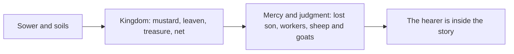

# Parables

**Prerequisites:** [Miracles](04-miracles.md) and [The four Gospels](../02-the-four-gospels.md).

**Key ideas:** A parable is a short narrative or extended comparison that does more than illustrate a point already known; Jesus' parables of the kingdom can conceal as well as reveal (Mark 4); the same story can be told to different effect in more than one Gospel; allegory is sometimes invited and sometimes over-applied by later readers.

## What a parable is

The Greek *parabole* covers a range from a proverb and a riddle to a short tale. In the Synoptics, Jesus' distinctive form is often a story of ordinary work — sowing, fishing, hiring laborers, baking bread, walking a road — that suddenly puts the hearer's world in question. "The kingdom of God is like…" is not the same as "here is a moral example." Some parables are examples (the good Samaritan, in part); many are more strange than that.

Mark 4, with the sower and the saying about speaking in parables so that "they may look and look and not perceive," is a hard passage. It has been read as a theory of rejection (Isaiah 6 already in the background), as later church explanation, and as a genuine feature of Jesus' riddling speech. Matthew 13 expands the parable chapter; Luke distributes parables along the journey to Jerusalem, including some of the most famous stories found only in that Gospel.

## A short map

- **Growth and hiddenness:** the sower, the seed growing secretly (Mark), mustard seed, leaven, treasure, pearl, net.
- **Mercy and the lost:** the lost sheep, lost coin, and lost (prodigal) son (Luke 15); the two debtors.
- **Neighbors and wealth:** the good Samaritan; the rich fool; the rich man and Lazarus; the dishonest manager.
- **Vineyards and judgment:** the wicked tenants; the laborers in the vineyard; the great banquet or wedding feast; the bridesmaids; the talents or pounds; the sheep and the goats (Matthew 25), which is a judgment scene as much as a parable.

The wicked tenants, in particular, is a place where later Christian anti-Jewish reading has done harm (the vineyard is already Isaiah's image for Israel). The parable should be taught as an inner-Jewish prophetic confrontation first, in the line of Isaiah 5, not as a charter for contempt.

Luke's special parables reward a slow second reading in their travel-narrative setting. The good Samaritan answers "who is my neighbor?" by refusing the question's wish for a boundary; the prodigal son is as much about the elder brother as about the younger; the rich man and Lazarus will not grant a sign to those who "do not listen to Moses and the prophets." These stories are not decorations on the way to Jerusalem. They are the theology of the road.

## How to read them

Later church interpretation often allegorized every detail (Augustine's treatment of the good Samaritan is the classic case). Modern study, especially after Jülicher and Jeremias, pushed back toward a single main point in a first-century setting. Both extremes miss something. Some parables, like the sower's interpretation in the Gospels themselves, already contain allegorical keys. Others are ruined if every goat and coin must be a doctrine. A first-principles method is: read the story whole, notice who would have been stung in the first hearing, compare the versions, and only then ask about later Christian use.

John's Gospel does not tell Synoptic parables; it has extended metaphors (the shepherd, the vine). That is a different pedagogy, and it should not be forced into this folder's form.

## Where this leads

- Next: [Passion week](06-passion-week.md)
- Book path: [Luke](../books/gospels/luke.md), [Matthew](../books/gospels/matthew.md)
- Glossary: [parable](../../glossary/parable.md), [kingdom of God](../../glossary/kingdom-of-god.md)
