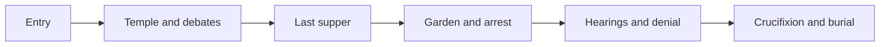

# Passion week

**Prerequisites:** [Parables](05-parables.md), [The four Gospels](../02-the-four-gospels.md), and [Passover](../../old-testament/books/law-torah/exodus.md) background in [Exodus](../../old-testament/books/law-torah/exodus.md).

**Key ideas:** The last week in Jerusalem is the narrative center of all four Gospels; entry, temple, last supper, arrest, hearings, crucifixion, and burial are told with both overlap and real differences; the death is interpreted, already in the sources, as Passover, as a covenant, as a ransom, and as a scandal.

## The week, in outline

The traditional "Holy Week" is a later liturgical map laid over the Gospels, which do not all count the days the same way (John's chronology of the last supper relative to Passover is the main crux). The shared plot is nonetheless clear.

Jesus enters Jerusalem on a donkey, in a gesture that echoes Zechariah 9:9; the crowd's palms and "Hosanna" are most explicit in some of the sources. He confronts the temple (a "cleansing" or a prophetic sign of judgment; John places a similar scene early). Debate with authorities follows: taxes to Caesar, resurrection, the first commandment, the widow's offering, an eschatological discourse. Judas arranges a betrayal. A last meal is eaten: in the Synoptics it is a Passover (or Passover-like) meal at which Jesus identifies bread and cup with his body and blood of the covenant; in John, the meal is earlier, and the distinctive act is the foot-washing, with a long farewell. In Gethsemane (or a garden), Jesus prays; the disciples fail to watch; he is arrested.

Hearings follow before the high priestly authorities and before Pilate (Luke adds a hearing before Herod Antipas). The charge that matters for Rome is kingship. Peter denies him. Pilate, in all four, is reluctant in the telling and still hands him over; historical judgment about Pilate's character should not be taken only from these scenes, given his reputation in other sources. Jesus is crucified outside the city under the inscription "king of the Jews," dies, and is buried in a tomb associated with Joseph of Arimathea.

## Differences that matter

The words from the cross differ: Mark and Matthew give the cry of Psalm 22; Luke gives words of forgiveness, of promise to the bandit, and of trust; John gives the care of the mother, thirst, and "it is finished." The torn curtain, the centurion's confession, the spear, the guard at the tomb, and the fate of Judas are not in every Gospel. Harmonizing them into a single seven-last-words drama is a devotional practice with a cost: it blurs four theologies of the death.

John's timing (Jesus dying as the Passover lambs are slain, in a common reading) is a theological chronology whether or not it can be reconciled with the Synoptics. Paul's tradition of the supper (1 Corinthians 11) is older as a written text than the Gospels and should be read with them.

## History and meaning

That Jesus was crucified under Pontius Pilate is one of the most secure facts in the study of Christian origins; Roman and Jewish sources outside the New Testament corroborate the execution, if not the details. The precise legal process, the role of the priestly authorities, and the wording of sayings are more debated. Traditional Christian confession adds: this death was "for us," in accordance with the scriptures. The Gospels already begin that interpretation, with psalms, with Isaiah's servant, with the blood of the covenant, and with the Passover. Later doctrines of atonement (satisfaction, substitution, victory, moral influence) are attempts to say that meaning systematically. They should not be retrojected as if one of them were simply "the" biblical theory.

Teaching this week also requires moral care: "the Jews" as a collective villain is a misreading with a long, lethal afterlife. The story is of a Jewish man, Jewish disciples, Jewish authorities under occupation, and a Roman cross.

## Where this leads

- Next: [Resurrection appearances](07-resurrection-appearances.md)
- Book path: the Passion chapters of all four Gospels; [Isaiah](../../old-testament/books/major-prophets/isaiah.md) 53; [Psalm 22](../../old-testament/books/wisdom-poetry/psalms.md)
- Glossary: [Passover](../../glossary/passover.md), [crucifixion](../../glossary/crucifixion.md), [atonement](../../glossary/atonement.md), [Pontius Pilate](../../glossary/pontius-pilate.md)
