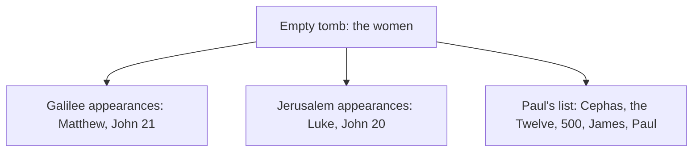

# Resurrection appearances

**Prerequisites:** [Passion week](06-passion-week.md) and [The four Gospels](../02-the-four-gospels.md). Helpful: [1 Corinthians](../books/pauline-epistles/1-corinthians.md) 15, the earliest written list of witnesses.

**Key ideas:** All four Gospels end with an empty tomb (Mark's earliest ending stops at the fear of the women); appearance stories differ in place (Galilee or Jerusalem), in who sees Jesus first, and in what is emphasized (a meal, a doubt, a commissioning); Christian proclamation begins here; historical study can describe the claims and their earliness, and cannot, by its own tools, settle the confession.

## Tomb and lists

Mark 16:1–8: women come at dawn, find the stone rolled back, hear a young man's announcement that Jesus has been raised and goes before them to Galilee, and flee, saying nothing to anyone, for they were afraid. Matthew adds an earthquake, an angel, a meeting with Jesus on the way, a guard and a rumor of theft, and a mountain commissioning in Galilee. Luke keeps the women in Jerusalem, adds Peter's running to the tomb (in some texts), the Emmaus road, an appearance to the Eleven with fish, a scripture lesson, and a blessing near Bethany. John has Mary Magdalene, two disciples at the tomb, Mary's recognition when her name is spoken, a locked-room appearance, Thomas a week later, and a later Galilee breakfast and the restoration of Peter (chapter 21).

Paul's list in 1 Corinthians 15, older as writing than the Gospels, names Cephas, the Twelve, more than five hundred, James, all the apostles, and last of all Paul himself. He does not mention the women or the empty tomb, which does not mean he had never heard of either; it means the tradition he recites is a formal list of official witnesses. A first-principles reading holds the list and the narratives together without forcing a single timetable.

## What the stories emphasize

The risen one is not a ghost in these tellings: he eats, he can be touched (though John 20:17, "do not hold on to me," complicates a simple picture), and he is also not always recognized at first (Emmaus, the shore, Mary's "gardener"). The stress falls on commissioning: go, make disciples, preach repentance, receive the Spirit, feed my sheep. The resurrection is not narrated as a private consolation only. It is the restart of a mission, and, in Luke–Acts, the hinge to the church's public life.

Differences of geography (Galilee in Mark's promise and in Matthew; Jerusalem in Luke, who does not want the witnesses to leave until Pentecost) are a real problem for a film-like harmony and a gift for theology: Matthew's mountain and Luke's city are two true claims about where the risen one meets a church — at the edge of the first ministry, and at the center of Israel's worship.

## History and confession

That the tomb was found empty, that women were the first witnesses (an unlikely later invention, many have argued, given the legal status of women's testimony), and that a wide range of people soon claimed to have seen Jesus, are among the data most historians of early Christianity try to explain. Explanations then diverge: the traditional confession that God raised Jesus; theories of visionary experience, of later legend, of a stolen body (already a rival story in Matthew). This lesson will not stage a courtroom. It will say that the Christian movement, on the evidence of Paul and the Gospels, is unintelligible without some such claims at its origin, and that the claim "God raised him" is a confession, not a laboratory result.

The appearances also include doubt (Thomas, and the "some doubted" of Matthew 28:17). The tradition is not embarrassed by that. A first-principles reader should not be either.

## Where this leads

- Next: [The early church](08-early-church.md)
- Book path: [Matthew](../books/gospels/matthew.md) 28, [Luke](../books/gospels/luke.md) 24, [John](../books/gospels/john.md) 20–21, [1 Corinthians](../books/pauline-epistles/1-corinthians.md) 15
- Glossary: [resurrection](../../glossary/resurrection.md), [Mary Magdalene](../../glossary/mary-magdalene.md), [Thomas](../../glossary/thomas.md)
