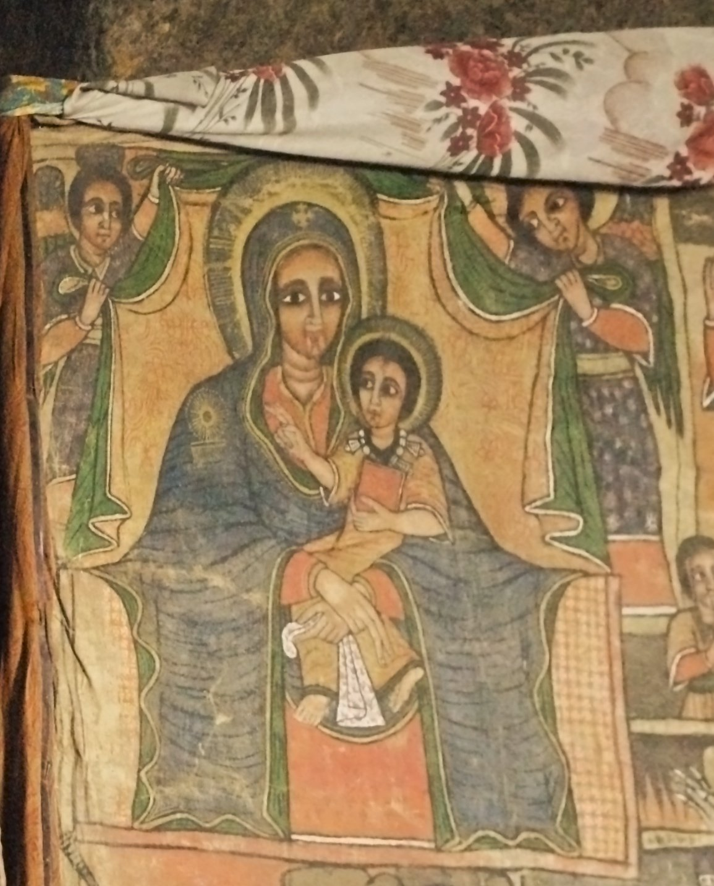
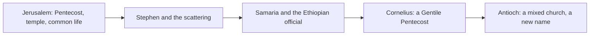

# The early church

**Prerequisites:** [Resurrection appearances](07-resurrection-appearances.md) and [Acts](../books/history/acts.md). Helpful: [Second Temple Judaism and Rome](../01-second-temple-judaism-and-rome.md).

**Key ideas:** Acts 1–12 tells how a Jerusalem community of Jews who confessed the risen Jesus became, through the Spirit, a public movement that crossed a Samaritan and then a Gentile threshold; the picture is theological narrative, not minutes of a meeting; later church order should not be read back too quickly.

*This is one corner of a larger canvas that depicts a number of biblical scenes that are important to the Ethiopian Christian Orthodox Church. The date and… Credit: A. Davey from Where I Live Now: Pacific Northwest. License: [CC BY 2.0](https://creativecommons.org/licenses/by/2.0). Source: [File:Painting of the Virgin Mary and the Infant Jesus in the Church of the Monastery of Na’akuto La’ab (3424334012).jpg](https://commons.wikimedia.org/wiki/File:Painting_of_the_Virgin_Mary_and_the_Infant_Jesus_in_the_Church_of_the_Monastery_of_Na’akuto_La’ab_(3424334012).jpg).*
## From a room to the street

Acts opens with a charge, an ascension, and the choice of Matthias to restore the Twelve after Judas. At Pentecost, the Spirit comes with wind and fire, and languages are heard; Peter interprets the scene from Joel and proclaims Jesus as risen Lord and Messiah. Three thousand are baptized, in the book's counting. The early summaries (2:42–47; 4:32–35) describe teaching, fellowship, the breaking of bread, prayers, a holding of goods in common, and daily presence in the temple. Those summaries are both historically precious and stylized; they have been over-used as a simple constitution and under-used as a standard against later self-satisfaction.

Conflict arrives quickly: a lame man healed at the Beautiful Gate, arrests, the honesty and the fear around Barnabas, Ananias, and Sapphira, and a complaint between Hellenists and Hebrews that leads to the appointment of seven, including Stephen. Stephen's speech and death are the first martyrdom, and the first large scattering. Saul stands among the coats.

## Thresholds

Philip in Samaria, and the Ethiopian official on the road, push the witness beyond a purely Judean audience. The more decisive threshold is Cornelius, a Roman centurion in Caesarea: a vision, a sheet of animals, the Spirit falling while Peter is still speaking, and a baptism that Peter has to explain later in Jerusalem. The council of Acts 15 (which this lesson leaves in part to [Paul's journeys](09-pauls-journeys.md)) will have to catch up with a work already done.

Antioch, where "the disciples were first called Christians," is the second center: a mixed church, a sending church, and the place from which Barnabas and Saul go out. Meanwhile Peter is imprisoned and released, and Herod Agrippa I dies. The narrative is already preparing to follow Paul more than Peter, without quite saying that the Twelve have become unimportant.

The appointment of the seven (Acts 6) is sometimes read too quickly as the origin of a permanent diaconate. In the narrative it is a practical response to a widow-support crisis and a linguistic divide, and two of the seven, Stephen and Philip, are then shown preaching, not waiting on tables only. The later office may grow from such moments; the text itself is more fluid. That fluidity is part of the lesson: the earliest community invents forms under pressure, and the Spirit's crossing of boundaries keeps running ahead of the forms.

## How to read this history

Traditional reading takes Acts as a reliable account of the Spirit's work. Historical-critical study notes the speeches as composed, the numbers as rounded, the harmony as sometimes smoother than Paul's letters suggest, and the Roman authorities as rather more even-handed than they may have been. Both frames can agree on a core: a Jerusalem origin, a rapid spread, conflict over the law and the Gentiles, and experiences interpreted as the Spirit's. The Didache, later letters, and the Pauline churches will show a less tidy map.

What should not be missed is the Jewishness of the beginning. The earliest church in Acts is in the temple, arguing from the scriptures of Israel, and reluctant, at first, to cross the Gentile threshold. A later Gentile majority should not tell the story as if it had always been their house.

## Where this leads

- Next: [Paul's journeys](09-pauls-journeys.md)
- Book path: [Acts](../books/history/acts.md) 1–12
- Glossary: [Pentecost](../../glossary/terms/pentecost.md), [apostle](../../glossary/terms/apostle.md), [baptism](../../glossary/terms/baptism.md), [Stephen](../../glossary/people/stephen.md)
