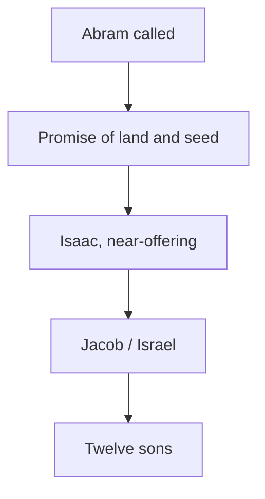

# Abraham, Isaac, and Jacob

**Prerequisites:** [Cain and Abel, the Flood, and Babel](02-cain-abel-flood-babel.md)
**Key ideas:** a particular family is called; covenant, promise, and land; testing and blessing; Jacob becomes Israel; the stories are family narratives with moral ambiguity, not stained-glass portraits.

At Genesis 12 the camera narrows. From "all the earth" the story follows one man, Abram, and the people that will come from him.

## Abraham

The Lord tells Abram to leave his country, his kindred, and his father's house for a land that will be shown him. The promises are sprawling: a great nation, a great name, blessing for him, and blessing (or cursing) for others depending on how they treat him — "in you all the families of the earth shall be blessed" (translations of the last clause vary). Abram goes, with Sarai his wife and his nephew Lot, from Haran into Canaan.

The following chapters are a cycle, not a straight line. Abram is sometimes courageous and sometimes not (he twice passes Sarai off as his sister to protect himself). He and Lot divide land; Abram rescues Lot; he is blessed by Melchizedek, a king-priest of Salem. The promise of offspring looks impossible: Sarai is barren. Abram's first heir-plan involves his servant, then a son, Ishmael, born to Hagar, Sarai's enslaved Egyptian. The Lord nonetheless promises a son through Sarai. Names are changed: Abram becomes Abraham ("father of a multitude"), Sarai becomes Sarah. Circumcision is given as the sign of the covenant. Hospitality to three visitors precedes the announcement that Sarah will bear a son, and a tense bargaining in which Abraham pleads for Sodom, where Lot now lives. Sodom and Gomorrah are destroyed; Lot escapes.

The most severe episode is the **binding of Isaac** (the *Aqedah*). God tests Abraham: take your son, your only son, whom you love, and offer him as a burnt offering. Abraham goes; Isaac asks where the lamb is; Abraham says God will provide. At the last moment an angel stops him; a ram is offered instead; the promise is confirmed again. Traditional Jewish and Christian readings treat this as the great test of trust (and, for many Christians, as a typological foreshadowing of a beloved son offered). The story is also morally terrifying, and later interpreters have not all been comfortable with it. Ishmael, earlier sent away with Hagar, receives his own promise of a nation. He is not written out of blessing, even as the covenant line is traced through Isaac.

## Isaac

Isaac is the child of promise, and yet he is the quietest of the three patriarchs. His near-sacrifice is the center of his youth. Later he marries Rebekah, who, like Sarah, is at first barren, then bears twins. During a famine Isaac is told to remain in the land and is given the same blessing. He repeats a "she is my sister" deception about Rebekah. The twins already struggle in the womb: two nations, the elder to serve the younger. Esau, the first, is a hunter; Jacob stays in tents. Esau sells his birthright for a meal. The less said of Isaac as a moral ideal, the more he functions as a link — and as a father who can be deceived.

## Jacob

Jacob is a grasper, which is what his name suggests. Disguised in Esau's clothes, he takes the blessing Isaac meant for Esau. He flees Esau's anger to Haran, and on the way dreams of a ladder (or ramp) between earth and heaven, with the Lord standing above it and renewing the promise. In Haran he is himself deceived by Laban: he serves for Rachel, is given Leah first, then serves again. The household is a tangle of rival sisters, enslaved women, and children. From this messy domestic economy come the twelve sons (and a daughter, Dinah) who will name the tribes of Israel.

On the way back, Jacob wrestles at night with a mysterious "man," is wounded in the hip, and is renamed **Israel** — "one who strives with God," or a related etymology the text itself offers. He meets Esau and survives the meeting. The family is not yet at peace (Dinah's story, and the violence of Simeon and Levi, is grim; later, Joseph's brothers will act out the same fraternal pattern as Cain). But the name Israel is now in the story, attached not first to a land or a state, but to a person who has cheated, dreamed, labored, and wrestled.

Traditional reading treats the patriarchs as historical founders. Scholarly estimates of their "historicity" vary widely; many historians treat these chapters as ancestral sagas, shaped over time, encoding later Israel's sense of itself (relations with Edom, Aram, Moab, Ammon, and Egypt are already in the family tree). The first-principles point does not require settling that debate. It requires seeing what the text is claiming: God has tied a promise to a particular, flawed family, by covenant, and the future of the nations is somehow bound to them.

## Where this leads

- Next: [Joseph](04-joseph.md), which carries the family into Egypt
- Abraham as a shared figure: [Abrahamic traditions](../../../README.md)
- The promise of blessing for the families of the earth will be reread in [the New Testament](../new-testament/README.md)
