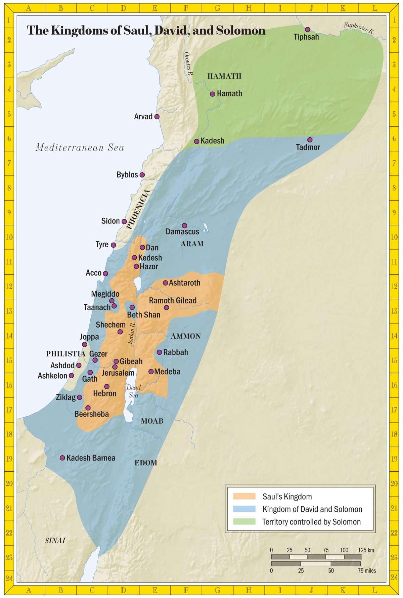
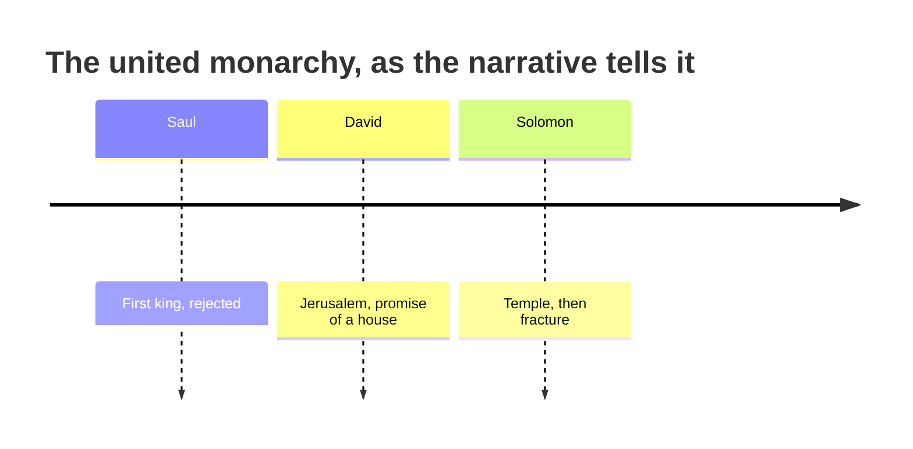

# Saul, David, and Solomon

**Prerequisites:** [Joshua and Judges](06-joshua-and-judges.md)
**Key ideas:** the rise of kingship as a theological problem, not only a political one; Saul's anointing and rejection; David as chosen, flawed, and promised an enduring house; Solomon as wisdom, temple, and the seeds of division.

*A map f the kingdoms of Saul, David, and Solomon. Credit: Biblica, Inc, and Biblica Open Study Bible Resources. License: [CC BY-SA 4.0](https://creativecommons.org/licenses/by-sa/4.0). Source: [File:Biblica Open Bible Map 06 The Kingdoms of Saul David and Solomon.png](https://commons.wikimedia.org/wiki/File:Biblica_Open_Bible_Map_06_The_Kingdoms_of_Saul_David_and_Solomon.png).*
Israel's neighbors have kings. In 1 Samuel the people ask Samuel, the last great judge and a prophet, for a king "like other nations." The request is treated as a rejection of the Lord's kingship. Samuel warns them what a king will take: sons, daughters, fields, a tenth. The Lord tells him to listen to the people anyway. Kingship enters the story under a cloud, and also as a tool God will use.

## Saul

Saul, a Benjaminite, is anointed by Samuel and later acclaimed after a military success. He is tall, initially reluctant, and capable in war, especially against the Ammonites and Philistines. The relationship with Samuel breaks. In two episodes — an unauthorized sacrifice, and a failure to carry out a ban against Amalek to the letter — Saul is told that the kingdom will not continue in his line. "To obey is better than sacrifice."

The spirit of the Lord departs from Saul; an evil spirit torments him. David is brought to play the lyre and to soothe him, and then to fight. After David kills Goliath, the Philistine champion (in the most famous version of a story that has some textual complexity), Saul's jealousy grows. David becomes a fugitive. Saul, consulting a medium at Endor after the Lord will not answer him, falls in battle with his sons on Mount Gilboa. The first king ends in tragedy more than in villainy. The books are unusually interested in his inner unraveling.

## David

David, a shepherd from Bethlehem, is anointed by Samuel while still a youth, in his father's house. The public rise is slower: court musician, armor-bearer, giant-slayer, Jonathan's friend, Saul's son-in-law, then outlaw, then king first of Judah at Hebron and later of a united Israel. He takes Jerusalem, a Jebusite city, as his capital, and brings the ark there. When he wants to build a house (a temple) for the Lord, the prophet Nathan delivers a reversal: the Lord will build *David* a "house." The **Davidic covenant** promises that David's line and throne will endure. This promise becomes a pillar of later hope, including messianic hope.

The same books refuse to make David a simple hero. He commits adultery with Bathsheba and arranges the death of her husband, Uriah, in battle. Nathan confronts him with a parable ("You are the man"). The child dies; Solomon will later be born to Bathsheba. Violence runs through David's house: Amnon rapes Tamar; Absalom kills Amnon, rebels, and is killed. David is a magnificent lamenter (the elegy for Saul and Jonathan; the cry over Absalom). Many **Psalms** are attributed to him. Traditional reading often takes that attribution quite literally; scholarship often treats "of David" as a mix of authorship, patronage, and later ascription. Either way, the association of David with Israel's prayer book is tight.

Historically, a "house of David" is attested outside the Bible (notably the Tel Dan inscription, ninth century BCE), which is stronger evidence for a dynastic David than we have for many earlier biblical figures. The scale of a united empire as the books describe it remains a matter of archaeological and historical debate.

## Solomon and the split

Solomon, established after a succession struggle, asks in a dream for a listening heart to govern, and is granted wisdom, with wealth and honor besides. He judges famously (the two women and the child). He builds the **Temple** in Jerusalem, and the dedication prayer in 1 Kings 8 is a high point of the royal theology: even the highest heaven cannot contain God, yet this house is a place toward which Israel may pray.

The same narrative records a turn. Solomon loves many foreign women, builds high places for their gods, and the Lord declares that the kingdom will be torn, leaving only a lamp for David's sake. After Solomon's death the northern tribes, under Jeroboam, break from Rehoboam, Solomon's son, over forced labor and heavy rule. Two kingdoms result: **Israel** in the north (Samaria as its later capital) and **Judah** in the south (David's line in Jerusalem). The books of Kings evaluate each ruler chiefly by one standard: fidelity to the Lord, or the worship of other gods and the tolerance of illicit shrines.

The united kingdom is short. The ideas it deposits — a chosen city, a temple, a promised dynasty — last much longer, into exile, return, and the New Testament's arguments about a "son of David."

## Where this leads

- Next: [the prophets](08-prophets.md), who speak into this royal world and its failures
- Then: [exile and return](10-exile-and-return.md)
- Davidic hope is part of the backdrop to [the Gospels](../new-testament/02-the-four-gospels.md)
