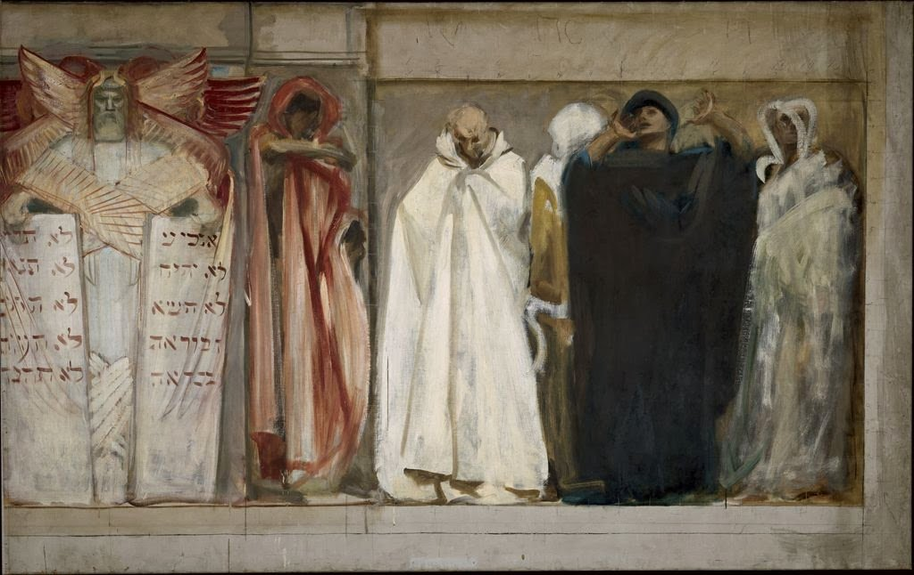

# The prophets

**Prerequisites:** [Saul, David, and Solomon](07-saul-david-solomon.md)
**Key ideas:** a prophet is a messenger in a covenant lawsuit more than a fortune-teller; former and latter prophets; judgment and hope; classical voices (Amos, Hosea, Isaiah, Jeremiah, Ezekiel) as a first map.

*Джон Сінгер Сарджент, фриз Християнські пророки, ескіз, бл. 1895 р. Credit: Джон Сінгер Сарджент. License: Public domain. Source: [File:345John Singer Sargent, Study for “Frieze of Prophets”, Boston Public Library, 1894-95.jpg](https://commons.wikimedia.org/wiki/File:345John_Singer_Sargent,_Study_for_“Frieze_of_Prophets”,_Boston_Public_Library,_1894-95.jpg).*
In English, "prophecy" often means prediction. In the Bible, a *navi* is someone who speaks for God into a public situation. Prediction can be part of that speech — a coming exile, a coming restoration, a coming day of the Lord — but the center is usually **covenant**: you were brought out, you were given a law, you are now doing this, and here is what that means.

## Where the prophets sit in the library

In the Tanakh, the **Former Prophets** are the narrative books of Joshua, Judges, Samuel, and Kings (already on this path). They are "prophetic" in part because they interpret history theologically, and because figures like Deborah, Samuel, Nathan, Elijah, and Elisha drive the plot. Elijah and Elisha, in Kings, are the great northern wonder-working prophets: drought and rain, a contest with the prophets of Baal on Mount Carmel, care for the poor, confrontation with kings.

The **Latter Prophets** are the books named for prophets: Isaiah, Jeremiah, Ezekiel, and the Book of the Twelve (Hosea through Malachi — "minor" only in length). Christian Bibles place these, plus Daniel, at the end of the Old Testament. Daniel, in the Tanakh, is among the Writings and is in important ways [apocalyptic](../04-genres.md) as well as prophetic.

## A first map of voices

**Amos**, a southerner speaking in the north in the eighth century BCE (in the book's own setting), is almost a definition of the ethical edge: worship without justice is rejected; "let justice roll down like waters." The wealthy who trample the poor are in his sights. **Hosea** uses the imagery of marriage and infidelity for Israel's relationship to the Lord, including the unforgettable command to take a wife of whoredom, so that the prophet's life becomes a sign.

**Isaiah** is a long, richly layered book. The first part is rooted in the eighth-century Judah of king Hezekiah and the Assyrian threat, including a temple vision ("Holy, holy, holy") and the political crisis of a child-sign named Immanuel. Later chapters (especially 40–55, often called Second Isaiah in scholarly usage) speak comfort to exiles: a highway in the wilderness, a servant who suffers, the declaration that the Lord is the only God and that Cyrus, the Persian, can be his anointed tool. Traditional reading typically treats the book as the vision of one eighth-century prophet, foreseeing far ahead. The dominant scholarly view sees a tradition that grew over more than a century, with a historical Isaiah and later voices in his school. The theological unity some readers still hear, and the historical layering others emphasize, can be studied together without pretending the debate is settled.

**Jeremiah** is the prophet of Jerusalem's last days before the Babylonian destruction: he warns of disaster, is accused of treason, laments, and also promises a "new covenant" written on the heart. **Ezekiel**, a priest among the exiles, sees the glory of the Lord depart the temple, then, later, a vision of dry bones and a restored sanctuary. His imagery is intense, sometimes bizarre, and closely tied to holiness and presence.

The Twelve add, among other things, Jonah's comic-serious mission to Nineveh (a story about a reluctant prophet and a wide mercy), Micah's pairing of judgment with "what does the Lord require of you but to do justice, love kindness, and walk humbly," and later post-exilic voices (Haggai, Zechariah, Malachi) that address a small community trying to rebuild.

## Judgment and hope

Prophetic books rarely offer only doom or only consolation. The pattern is often: accusation, warning, sometimes a historical blow, then a promise that goes beyond the blow — a remnant, a restored Davidic shoot, a pilgrimage of nations, a new heart. Christians have read many of these hopes as fulfilled in Jesus. Jewish reading has generally kept them attached to Israel's ongoing life and to a still-future redemption. The texts themselves are older than that argument, and they earn a reading in their own setting first: as speeches toward kings, priests, and people who already knew [the covenant of Sinai](05-moses-exodus-and-sinai.md) and the pretensions of [Zion and dynasty](07-saul-david-solomon.md).

## Where this leads

- Next: [wisdom literature](09-wisdom-literature.md), a different way of speaking about God and the good life
- Then the historical sequel many prophets addressed: [exile and return](10-exile-and-return.md)
