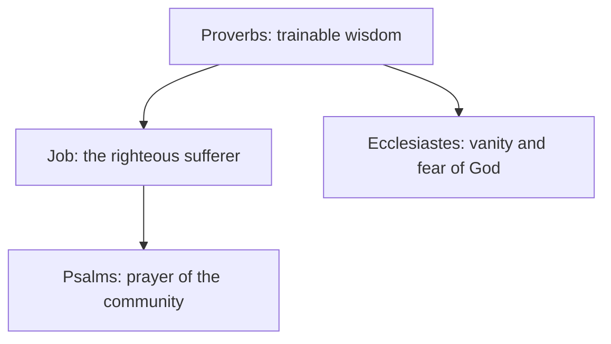

# Wisdom literature: Job, Psalms, Ecclesiastes

**Prerequisites:** [Genres](../04-genres.md). Helpful: [the prophets](08-prophets.md), as a contrast in voice.
**Key ideas:** wisdom as skill in living, not only as information; Proverbs' confidence and the protests of Job and Ecclesiastes; Psalms as Israel's prayer book; attribution and setting matter less, at first, than the kind of speech.

Not all of the Hebrew Bible is story or law or prophetic lawsuit. A set of books asks how to live well in the world as it is — and what to do when the world does not repay the righteous. This is **wisdom**. It has cousins elsewhere in the Ancient Near East (Egyptian instruction texts, Mesopotamian skeptical literature). In the Christian Old Testament the core is Proverbs, Job, and Ecclesiastes, with the Song of Songs nearby, and the Psalms as the great book of prayer that often overlaps wisdom. (Sirach and the Wisdom of Solomon belong here too in Catholic and Orthodox canons.)

## Proverbs and the default picture

Proverbs is largely a collection of short sayings and a few longer poems, traditionally associated with Solomon. It teaches a grain of the world: fear of the Lord is the beginning of knowledge; the diligent eat; the lazy sleep; the loose tongue ruins; Wisdom is pictured as a woman calling in the streets, present when God ordered creation. This is not a promise that no good person ever suffers. It is a confident pedagogy: life is not random, and character tends to have consequences.

Job and Ecclesiastes exist, in part, because that confident picture is not the whole truth of experience.

## Job

Job is "blameless and upright." In a heavenly scene the adversary (*hasatan*, a title more than the later devil of Christian imagination, in the book's opening) challenges the Lord: Job is pious because he is protected. Permission is given to strip him of property, children, and health. Three friends come to comfort him and instead argue that suffering must be punishment for sin. Job refuses that accounting, demands a hearing, and curses the day of his birth without, the prologue says, cursing God.

A fourth speaker, Elihu, appears; then the Lord answers Job from the whirlwind, not with a theory of suffering but with a tour of a wild creation Job did not make and does not govern. Job yields. Fortunes are restored. The ending has satisfied some readers and troubled others.

The book is a theodicy and a rejection of easy theodicy at once. Traditional attribution to Moses or to an early sage is not strongly controlled by the text; scholarly dating often places the poetic dialogue in the exile or after, without consensus. Genre (a framed wisdom debate, perhaps with a folktale opening and close) matters more than a date for a first reading. The first-principles yield is that the Bible contains, inside its own canon, a sustained argument against the idea that you can read a person's guilt off their wounds.

## Psalms

The book of Psalms is 150 poems (the numbering differs slightly between Hebrew and Greek traditions): hymns of praise, communal and individual laments, thanksgivings, royal psalms, wisdom psalms, and songs of Zion and of ascent. Many headings say "of David," or refer to a liturgical use. As noted in the [David](07-saul-david-solomon.md) lesson, those headings are variously read as authorship, dedication, or tradition.

What matters immediately is function. This is a book meant to be *prayed*. Lament is a legitimate form of speech to God: protest, complaint, and the turn toward trust often live in the same psalm (22 is a famous example, and later appears on Jesus' lips). Psalm 23 is a pastoral trust-poem; 51 is a confession associated with David's sin; 137 is an exilic cry of grief and rage beside Babylon's rivers. Reading the Psalms only as a treasury of calm comfort misses their range.

## Ecclesiastes

Qoheleth ("the Teacher" or "Assembler"), traditionally Solomon, tests pleasure, work, wisdom, and wealth, and finds *hevel* — vapor, vanity, a chasing of wind. The righteous and the wicked die alike. There is a season for everything, and there is no guarantee that you will be there to enjoy the season you prefer. The counsel is modest and sharp: enjoy the simple portion you are given, fear God, remember that many words increase vanity. The book's epilogue (which some scholars hear as a later frame) points the student back to commandments and to a coming judgment.

If Proverbs says "this is how the world generally works," Ecclesiastes says "do not confuse that general grain with a bargain God owes you." Together with Job, it keeps biblical wisdom from becoming a slogan.

## Where this leads

- Next: [exile and return](10-exile-and-return.md), the historical crisis many of these books were read in or after
- For philosophical cousins on suffering, fortune, and a settled mind, see [Hellenistic schools](../../../../../philosophy/history/ancient/greek/06-hellenistic-schools.md) and [Zhuangzi](../../../../../philosophy/history/ancient/chinese/05-zhuangzi.md)
