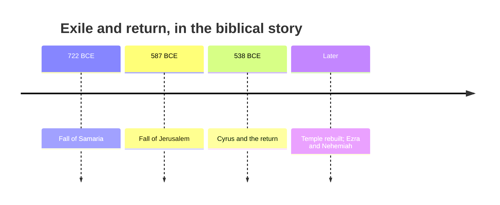

# Exile and return

**Prerequisites:** [Saul, David, and Solomon](07-saul-david-solomon.md) and [the prophets](08-prophets.md)
**Key ideas:** the northern kingdom falls to Assyria; Judah falls to Babylon; exile as theological crisis; Cyrus and the return; Second Temple beginnings; Ezra and Nehemiah as rebuilding of wall, temple, and Torah community.

If Exodus is the story of being brought out, exile is the story of being thrown out — and then of learning how to be a people with no king and, for a time, no temple.

## Two falls

The northern kingdom, Israel, falls to **Assyria** in 722 BCE. Kings presents this as the outcome of persistent idolatry. Deportations follow; foreign populations are moved in; the later figure of the "Samaritan" has one of its roots in this mixed, painful history.

Judah lasts longer, sometimes reforming (Hezekiah, Josiah — the latter associated with a law-book found in the temple, which many scholars connect to Deuteronomy). In 597 and then decisively in **586 BCE**, **Babylon** under Nebuchadnezzar takes Jerusalem, burns the temple, and deports much of the elite. The Davidic king is dethroned. This is the catastrophe around which large parts of the prophetic corpus and of the final shaping of earlier books appear to turn.

The theological problem is acute. If the Lord is bound to Zion and to David's house, what does the ruin mean? Has the Lord been defeated by Marduk? Has Israel been abandoned? The answers the literature gives are mostly not "God lost." They are: this is judgment, consistent with the covenant curses; and this is not the end. Lamentations sits in the ashes and refuses cheap comfort. Psalm 137 will not sing a song of Zion on command. Ezekiel and Second Isaiah, in different registers, promise presence and a road home.

## Cyrus and the return

Babylon falls to the Persians. In 538 BCE **Cyrus** issues a decree allowing exiles to return and rebuild the temple (so Ezra; a Persian policy of local restoration is historically plausible, and the Cyrus Cylinder shows related imperial rhetoric, though it does not mention Judah by name). A first return under Sheshbazzar and/or Zerubbabel (the sources are compressed and not easy to align) leads, after delays and local opposition, to a rebuilt temple, dedicated around 516 BCE. This is the beginning of the **Second Temple** period, the world in which, centuries later, the [New Testament](../new-testament/README.md) will take place.

The return is not a full reversal. Many Jews remain in diaspora (Babylon itself becomes a lasting center of Jewish life). The restored community is small, under imperial permission, without a king of the old kind (Zerubbabel, a Davidic governor, appears and then fades from the record). Haggai and Zechariah push the people to build; their hopes sometimes outrun the modest reality.

## Ezra and Nehemiah

In the fifth century (the conventional dating; some details are disputed), **Ezra**, a priest and scribe, and **Nehemiah**, a cupbearer to a Persian king who becomes governor, reshape the community. Nehemiah rebuilds Jerusalem's wall in the face of hostility. Ezra is depicted as reading the Torah publicly, with interpretation, so that the people weep and then feast. Mixed marriages are a flashpoint: the books describe a policy of separation that is harsh to modern ears and that the text presents as a defense of a fragile people's identity and worship. This is one of the moments where a community under empire decides what it must hold in order to remain itself.

Chronicles, retelling the history from Adam to the exile with an emphasis on Judah, the temple, and David, ends (in the Tanakh's order) with Cyrus's charge: whoever among you is of his people, let him go up. It is a closing that is also an opening.

Traditional reading takes these books as a straightforward continuation of sacred history. Scholarship discusses Persian-period politics, the slow canonization of Torah as the community's center, and the way earlier stories may have been edited in light of exile. For the path into the New Testament, the first-principles facts are these: by the late sixth century there is again a temple in Jerusalem; there is no independent Davidic kingdom; scripture and communal practice are becoming, more and more, what holds the people together; and the promises of prophets and of David's house are now hopes under foreign rule. That is the situation [Second Temple Judaism](../new-testament/01-second-temple-judaism-and-rome.md) inherits.

## Where this leads

- This completes the Old Testament path. Go to the [New Testament](../new-testament/README.md)
- First NT lesson: [Second Temple Judaism and Rome](../new-testament/01-second-temple-judaism-and-rome.md)
- For the library these returning communities were already reading, return to [canon](../02-canon-and-hebrew-bible-vs-old-testament.md)
