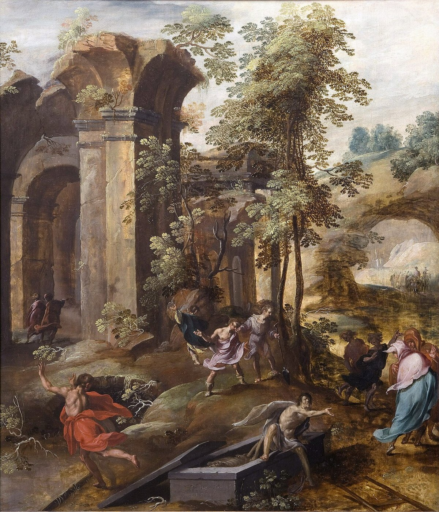

# 2 Kings

*The dead man, who was thrown in Elisha's tomb, comes back to life (2 Kings 13:21) oil on panel 69.1 x 60.1 cm signed: J Nagel fc... 1596 Credit: Jan Nagel. License: Public domain. Source: [File:The Miracle at the Grave of Elisha by Jan Nagel (d 1602).jpg](https://commons.wikimedia.org/wiki/File:The_Miracle_at_the_Grave_of_Elisha_by_Jan_Nagel_(d_1602).jpg).*
**Name and meaning.** The second half of the book of Kings, from the close of Elijah's work through the fall of Samaria (722/721 BCE) and the fall of Jerusalem (586 BCE). It is the narrative explanation, in Deuteronomistic terms, of why both kingdoms ended in exile.

**Prerequisites:** [1 Kings](1-kings.md), [the prophets](../../08-prophets.md), and [Exile and return](../../10-exile-and-return.md).

## Dating and authorship

See [1 Kings](1-kings.md). The book ends in exile, with Jehoiachin released from prison in Babylon (25:27–30), a small, ambiguous note of hope. The final edition is therefore exilic or slightly later. Earlier prophetic legends (especially Elisha) and royal annals are among the materials.

## Context

The ninth to sixth centuries BCE: Aram, then Assyria, then Babylon as the overpowering empires. The northern kingdom disappears as a political entity. Judah survives as a vassal, reforms under Hezekiah and Josiah, and is finally destroyed. Prophets move through the court and the countryside; this narrative is the spine on which [Isaiah](../major-prophets/isaiah.md), [Jeremiah](../major-prophets/jeremiah.md), [Hosea](../minor-prophets/hosea.md), [Amos](../minor-prophets/amos.md), and others can be hung.

## Outline

- **1–8.** Elijah's departure and Elisha's succession; Elisha stories (oil, the Shunammite, Naaman, floating axe-head, siege of Samaria).
- **9–17.** Jehu's revolt and the end of Ahab's house; Athaliah and Joash in Judah; a sequence of kings; the fall of Samaria and a theological verdict on the north, including the origin of the mixed population later called Samaritans.
- **18–21.** Hezekiah, the Assyrian crisis, and Isaiah; Manasseh's long, condemned reign; Amon.
- **22–23.** Josiah's reform and the finding of the book of the law; Josiah's death at Megiddo.
- **24–25.** The last kings of Judah; the two deportations; the destruction of the temple; Gedaliah's brief governorship; Jehoiachin in Babylon.

## Key passages and ideas

Elisha's cycle extends Elijah's prophetic power into more domestic and almost folkloric scenes, alongside political ones (Jehu is anointed at Elisha's instruction). Naaman the Aramean (chapter 5) is a foreign leper healed in the Jordan, a story Jesus will cite in [Luke](../../../new-testament/books/gospels/luke.md) 4 as a warning about Israel's boundaries.

The fall of Samaria in chapter 17 is given a long sermon: the north is lost because it worshiped other gods and walked in the way of Jeroboam. The fall of Judah, despite Hezekiah and Josiah, is attributed especially to Manasseh's sins and to the people's refusal to hear the prophets. Josiah's discovery of the law book (chapter 22) is the narrative hook for [Deuteronomy](../law-torah/deuteronomy.md) in historical-critical reading.

The last chapter is stripped and grim: famine, the king's flight, the temple burned, the pillars broken up, the people led away. The small notice about Jehoiachin's release is almost the only light.

Two reformations structure the Judah narrative and also show the book's severity. Hezekiah trusts the Lord in the Assyrian crisis (Sennacherib's invasion, reported also in Isaiah 36–37 and in Sennacherib's own inscriptions, which boast of shutting Hezekiah in Jerusalem "like a bird in a cage" but do not claim the city's capture). Josiah's reform is still more thorough, and yet it cannot cancel the announced judgment. The book refuses cheap optimism: even the best kings cannot unwind a history of covenant breach at will. That severity is why the last lines about Jehoiachin's allowance in Babylon have been read so carefully — as a faint Davidic ember, or as merely a historical footnote. The narrator does not explain them.

## Themes and reception

Themes include prophetic succession, imperial power, reform and its limits, the theology of exile, and the fate of the Davidic house. The book trained later generations to read disaster as covenant lawsuit, not as the Lord's defeat.

Chronicles will retell the southern story with a different emphasis (and almost no northern history). The New Testament assumes this plot whenever it speaks of exile, the temple, or the hope of a restored Davidic king. Modern historiography uses Assyrian and Babylonian chronicles alongside Kings; the dates of 722/721 and 586 are among the most secure in biblical history.

## Where this leads

- Next: [1 Chronicles](1-chronicles.md), a retelling from a later vantage
- Story path: [Exile and return](../../10-exile-and-return.md)
- Glossary: [Elisha](../../../glossary/people/elisha.md), [Hezekiah](../../../glossary/people/hezekiah.md), [Josiah](../../../glossary/people/josiah.md), [exile](../../../glossary/themes/exile-and-return.md), [Babylon](../../../glossary/places/babylon.md)
