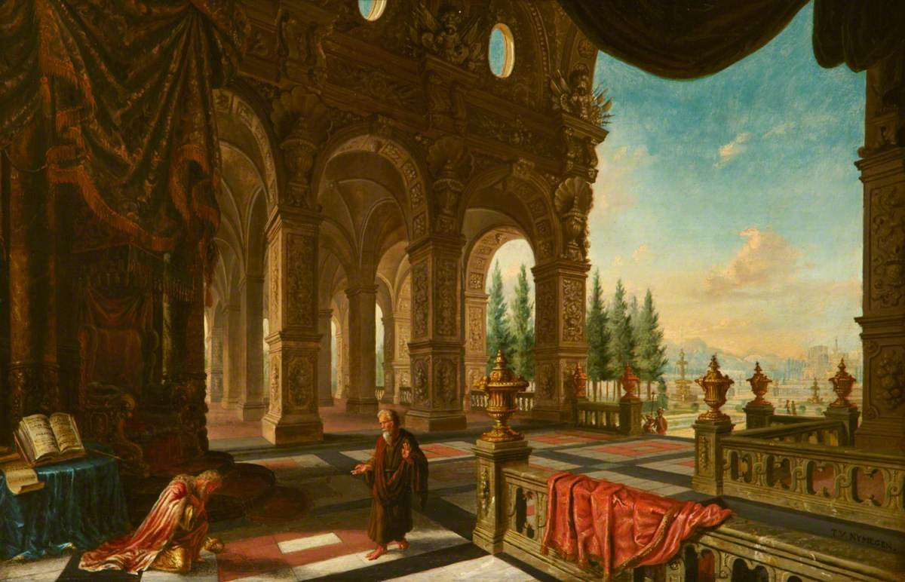
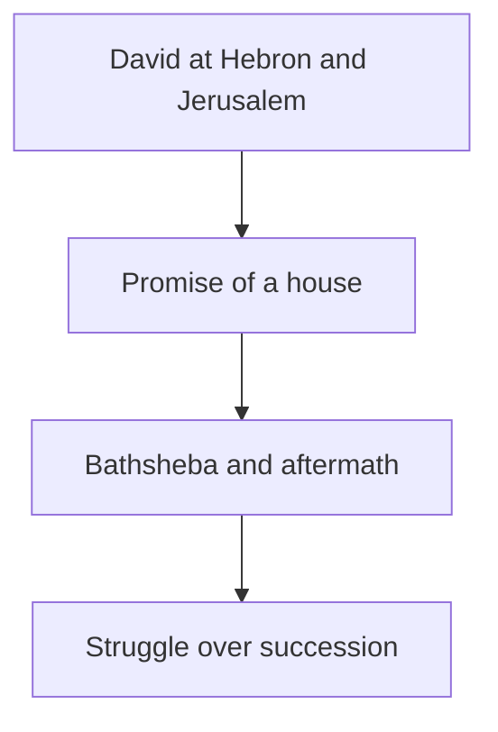

# 2 Samuel

*David kneeling in his Palace before the Prophet Nathan Credit: Tobias van Nijmegen. License: Public domain. Source: [File:Tobias van Nijmegen (b.c.1665) - David Kneeling in His Palace before the Prophet Nathan - 1530122.1 - National Trust.jpg](https://commons.wikimedia.org/wiki/File:Tobias_van_Nijmegen_(b.c.1665)_-_David_Kneeling_in_His_Palace_before_the_Prophet_Nathan_-_1530122.1_-_National_Trust.jpg).*
**Name and meaning.** The continuation of the Hebrew book of Samuel, now focused almost entirely on David: his kingship over Judah and then all Israel, the promise concerning his house, his crime and its consequences, and the last political tremors of his reign.

**Prerequisites:** [1 Samuel](1-samuel.md) and [Saul, David, and Solomon](../../07-saul-david-solomon.md).

## Dating and authorship

See [1 Samuel](1-samuel.md) for the compositional picture. 2 Samuel includes material often called the Succession Narrative or Court History (roughly chapters 9–20, plus 1 Kings 1–2), admired for its political and psychological realism. Whether that block is an early source or a later literary unity is debated. The Davidic promise in chapter 7 became a pillar of later messianic hope.

## Context

After Saul's death, David is made king at Hebron, then, after war with Saul's house, king in Jerusalem. The Philistine threat recedes; a capital, an ark, and a hoped-for temple come into view. The second half of the book is largely domestic and political crisis inside the court.

## Outline

- **1–8.** Lament over Saul and Jonathan; kingship in Hebron; capture of Jerusalem; the ark brought up; Nathan's oracle (the Davidic covenant); victories and officials.
- **9–10.** Kindness to Mephibosheth; war with Ammon.
- **11–12.** David and Bathsheba; Uriah's death; Nathan's parable; the child's death; the birth of Solomon.
- **13–20.** Amnon and Tamar; Absalom's exile, return, revolt, and death; David's return; Sheba's revolt.
- **21–24.** An appendix: famine and the Gibeonites; lists of warriors; David's song of deliverance; last words; the census, plague, and the threshing floor of Araunah, future site of the temple.

## Key passages and ideas

2 Samuel 7 is the theological center: David wants to build a house (temple) for the Lord; the Lord instead promises to build David a house (dynasty). The promise of a lasting throne, a son who will build the temple, and a father–son relation between God and the king, will be read by later generations through exile, through the failure of the monarchy, and eventually — in Christian reading — through [Jesus](../../../glossary/people/jesus.md) as son of David. Jewish messianic hope also works this text hard, without that Christian conclusion.

The Bathsheba episode (11–12) refuses to let the "man after God's heart" remain an uncomplicated hero. Nathan's parable forces David to judge himself. The rest of the book shows the sword at work in his own house, as Nathan had said. Absalom's revolt is written with heartbreaking detail, including David's cry over his dead son.

The appendix is not an afterthought. The census and the purchase of Araunah's threshing floor link David's reign to the future temple of [1 Kings](1-kings.md) and [1 Chronicles](1-chronicles.md).

The political map matters. David first rules only Judah at Hebron for seven years, while Ish-bosheth, Saul's son, is propped up in the north by Abner. The civil war, Abner's defection, and the murders of Abner and Ish-bosheth (which David ostentatiously mourns) are the messy path to a united throne. Jerusalem, a Jebusite city, becomes a capital not identified with a single tribe — a political stroke as well as a theological one when the ark arrives. The later revolt of Sheba son of Bichri ("we have no portion in David") shows that the north–south fault line of 1 Kings 12 is already cracking here. The promise of chapter 7 does not erase the kingdom's fragility; it is spoken over it.

## Themes and reception

Themes include covenant promise, the holiness of the ark, royal justice and royal crime, succession, and the cost of power. The book has been a school for political realism in both religious and secular reading (from rabbinic midrash to modern novels and political theory).

Chronicles will retell David's reign with different emphases (less Bathsheba, more temple preparation). The Psalms are later tied to his name. The New Testament's "son of David" language is unintelligible without this book.

## Where this leads

- Next: [1 Kings](1-kings.md)
- Story path: [Saul, David, and Solomon](../../07-saul-david-solomon.md)
- Glossary: [David](../../../glossary/people/david.md), [covenant](../../../glossary/themes/covenant.md), [Messiah](../../../glossary/themes/messiah.md), [Jerusalem](../../../glossary/places/jerusalem.md)
