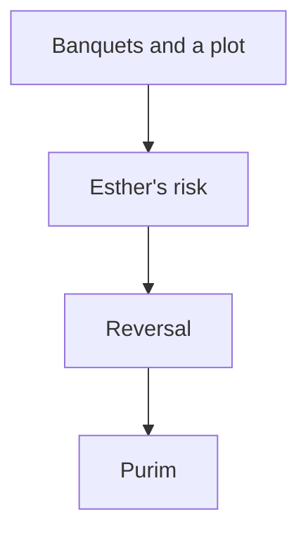

# Esther

**Name and meaning.** Named for Esther (Hebrew *Hadassah*), a Jewish woman who becomes queen of a Persian king usually identified as Xerxes I (Ahasuerus). The book explains the origin of the festival of Purim. In the Tanakh it is among the Writings and is one of the Five Scrolls; in Christian Bibles it closes the historical books. The Hebrew book does not mention God by name. The Greek [Additions to Esther](../../../deuterocanon/additions-to-esther.md) insert prayers and explicit theology.

**Prerequisites:** [Exile and return](../../10-exile-and-return.md) and [genres](../../../04-genres.md). Helpful: [Ezra](ezra.md) and [Nehemiah](nehemiah.md) as a contrast in how Jewish life in the empire is imagined.

## Dating and authorship

The book is anonymous. It is set in the Achaemenid court at Susa, in the fifth century BCE. Scholarly dates for composition range from the later Persian to the Hellenistic period (often fourth or third century BCE). The story has been read as historical, as historical fiction, and as festival legend. No external Persian source confirms Esther, Mordecai, or this particular plot, which does not by itself settle the genre question. Traditional Jewish and Christian reading has generally taken the events as historical. The overview reports the tale and the debate.

## Context

Unlike Ezra–Nehemiah, Esther is about Jews who remain in the diaspora, in the heart of the empire, not about return to Jerusalem. There is no temple, no Torah citation, and no divine name. Survival comes through court intrigue, courage, and — the narrator implies without saying — a hidden providence. The festival of Purim (named from *pur*, "lot") is the book's liturgical destination.

## Outline

- **1–2.** Vashti is deposed; a search for a new queen; Esther is chosen; Mordecai uncovers a plot against the king.
- **3–4.** Haman, enraged at Mordecai's refusal to bow, obtains a decree to destroy the Jews; Mordecai persuades Esther to risk an uninvited approach to the king ("if I perish, I perish").
- **5–7.** Esther's banquets; Haman's gallows; the king's sleepless night and the honor paid to Mordecai; Haman's fall.
- **8–10.** A counter-decree; the Jews defend themselves; the institution of Purim; Mordecai's eminence.

## Key passages and ideas

Mordecai's challenge to Esther in 4:13–14 — that relief may come from another place, but perhaps she has come to royal position "for such a time as this" — is the theological center, precisely because it is tentative. The book teaches providence by narrative irony: lots, coincidences, reversals, and the use of the empire's own irrevocable-decree system against the persecutor.

The violence of chapters 8–9, in which the Jews kill large numbers of their enemies, is part of the book and of Purim's memory (sometimes carnivalized, sometimes troubling to later readers). A fair reading does not erase it. The Greek additions, treated in the [deuterocanon](../../../deuterocanon/README.md), show that some ancient readers wanted the theology said out loud.

The book's silence about God has been read as a literary strategy (providence hidden in "chance") and as a problem (which is why the Greek additions speak the divine name out loud). Either way, the festival of Purim is the community's interpretive decision: this story is to be remembered with feasting, gifts to the poor, and the public reading of the Megillah. The encyclopedia's later [deuterocanon](../../../deuterocanon/README.md) file on the additions should be read as a second, more explicit theological edition of the same tale, not as a simple replacement.

## Themes and reception

Themes include diaspora identity, hiddenness, courage, reversal, and the origin of a feast. The Megillah is read aloud at Purim, including the raucous treatment of Haman's name. Christian reception was for a long time thinner (Luther's unease is often cited); modern Christian and literary reading has been more attentive. Feminist interpretation has debated whether Esther is a model of agency or a figure constrained by a harem tale. All of that is reception. The book's own purpose is to underwrite Purim and to tell how a threatened people survived in a foreign court.

## Where this leads

- The historical books end; the poetic books begin with [Job](../wisdom-poetry/job.md)
- Deuterocanon companion: [Additions to Esther](../../../deuterocanon/additions-to-esther.md)
- Glossary: [Purim](../../../glossary/purim.md), [diaspora](../../../glossary/diaspora.md), [providence](../../../glossary/providence.md)
