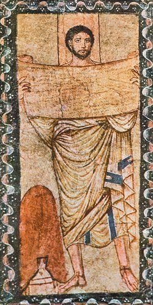

# Ezra

*Ezra Reads the Law l Credit: Credit as given on Wikimedia Commons. License: Public domain. Source: [File:Ezra Reads the Law l.jpg](https://commons.wikimedia.org/wiki/File:Ezra_Reads_the_Law_l.jpg).*
**Name and meaning.** Named for Ezra the priest and scribe. In Hebrew tradition Ezra and Nehemiah were long treated as one book. In Christian Bibles they are two, and they follow Chronicles (2 Chronicles even ends on the same sentence with which Ezra begins: Cyrus' decree). They narrate the return from Babylon, the rebuilding of the temple, and a later reform of the community around Torah.

**Prerequisites:** [2 Chronicles](2-chronicles.md), [2 Kings](2-kings.md), and [Exile and return](../../10-exile-and-return.md).

## Dating and authorship

The book is a compilation: Cyrus' decree and other Persian-period documents (some in Aramaic, chapters 4–6), lists of returnees, and a first-person "Ezra memoir." Traditional reading associates the writing with Ezra himself. Scholarly dates for the book's compilation cluster in the fifth to fourth centuries BCE. The chronology of Ezra and Nehemiah (who came first, and under which Artaxerxes) is a famous problem; many scholars place Nehemiah in the mid-fifth century (Artaxerxes I) and debate whether Ezra arrived in 458, 428, or 398 BCE.

## Context

The Persian Empire permitted and sometimes funded local cults. The return is not a mass emptying of Babylon; it is waves of migrants rebuilding a modest Yehud around Jerusalem and the Second Temple, completed, according to the book, in the reign of Darius I (dedicated in 516/515 BCE). Later, Ezra is commissioned to teach and enforce the law of the God of heaven. Conflict with "the people of the land" and with Samarian opponents is part of the story.

## Outline

- **1–2.** Cyrus' decree; the first return under Sheshbazzar / Zerubbabel; the list of returnees.
- **3–6.** Altar and temple foundation; opposition; the work halted and resumed under Haggai and Zechariah's urging (see those [minor prophets](../minor-prophets/README.md)); the temple finished.
- **7–10.** Ezra's arrival with a letter from Artaxerxes; his genealogy as a priest; the crisis of intermarriage; public confession and a policy of sending away foreign wives.

## Key passages and ideas

Ezra 7 presents Ezra as a scribe skilled in the Torah of Moses, authorized by a Persian king. The model of Judaism as a people of a book, gathered to hear and do the law, is being formed here and in [Nehemiah](nehemiah.md) 8. The Aramaic official correspondence in chapters 4–6 is a rare biblical window on imperial administration.

Chapters 9–10 are hard reading. Ezra's grief over marriages with the "peoples of the lands" and the resulting divorces have been received as necessary holiness, as ethnic exclusion, or as a post-exilic identity struggle. The book itself frames the issue as covenant faithfulness and the "holy seed." A fair overview must state that frame and also note how [Ruth](ruth.md) and [Isaiah](../major-prophets/isaiah.md) 56 pull in another direction. The tension is inside the canon, not only in modern ethics.

The first six chapters and the last four are almost two movements. The temple is finished before Ezra appears. The prophets [Haggai](../minor-prophets/haggai.md) and [Zechariah](../minor-prophets/zechariah.md) belong to that first movement; Ezra belongs to a later generation concerned with law, genealogy, and the purity of the assembly. The book therefore already contains a historical lesson: restoration is not a single event. Altar, temple, and Torah come in stages, under different leaders, with opposition at each stage. The lists of returnees and of those implicated in mixed marriages are part of that lesson. They say, this is a real population with names, not a symbol. Later Jewish memory that Ezra "restored the Torah" grows out of chapters 7–10 more than out of the temple narrative.

## Themes and reception

Themes include restoration, temple, Torah, identity, and empire as an unexpected instrument (Cyrus as the Lord's anointed in Isaiah 45 is the theological backdrop). Jewish tradition honors Ezra as a second Moses, a restorer of the law. Christian reading has used the book for narratives of rebuilding and, sometimes uncritically, for marriage policy. Historical study of the Persian period has become one of the most active fields in Hebrew Bible scholarship.

## Where this leads

- Next: [Nehemiah](nehemiah.md)
- Related prophets: [Haggai](../minor-prophets/haggai.md), [Zechariah](../minor-prophets/zechariah.md), [Malachi](../minor-prophets/malachi.md)
- Glossary: [exile](../../../glossary/themes/exile-and-return.md), [Second Temple](../../../glossary/terms/second-temple.md), [Torah](../../../glossary/terms/torah.md), [Cyrus](../../../glossary/people/cyrus.md)
