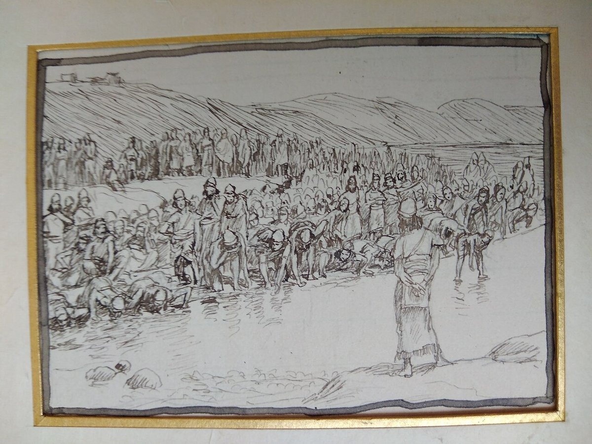
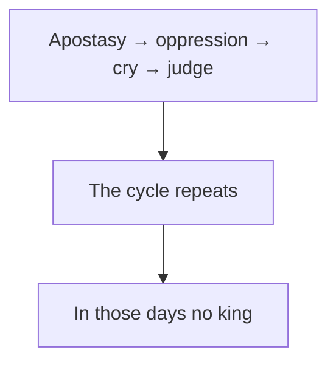

# Judges

*Pen and ink sketch by James Tissot for his painted illustrations of the Old Testament; one of 200 worked up by other artists after his death and published… Credit: James Tissot. License: Public domain. Source: [File:Tissot Drawing 207 Gideon chooses the three hundred (Judges 7 6) for Brunoff 194 Gédéon choisit les trois cents.jpg](https://commons.wikimedia.org/wiki/File:Tissot_Drawing_207_Gideon_chooses_the_three_hundred_(Judges_7_6)_for_Brunoff_194_Gédéon_choisit_les_trois_cents.jpg).*
**Name and meaning.** *Judges* translates Hebrew *Shoftim*, leaders who "judge" in the sense of delivering and governing, not only of hearing lawsuits. The book covers the period between Joshua's death and the rise of monarchy. In the Tanakh it is the second of the Former Prophets.

**Prerequisites:** [Joshua](joshua.md) and [Joshua and Judges](../../06-joshua-and-judges.md).

## Dating and authorship

Traditional ascriptions sometimes name Samuel. Scholarly consensus treats the book as a collection of tribal hero stories set in a Deuteronomistic editorial frame, probably shaped in the late monarchy and exile. The repeated refrain "in those days there was no king in Israel" (especially in chapters 17–21) can be read as a justification of monarchy, as a lament, or as both. Individual stories may be much older than the frame.

## Context

The book assumes a loosely confederated set of tribes in the hill country, surrounded by Canaanite cities, Midianites, Moabites, Ammonites, and, later in the period, Philistines. Central sanctuary and central government are weak. The theological cycle is stated in chapter 2: Israel forgets the Lord, is oppressed, cries out, is sent a deliverer, has rest, and forgets again.

## Outline

- **1–2.** Incomplete conquest; the angel at Bochim; the editorial cycle explained.
- **3–5.** Othniel; Ehud and Eglon; Deborah, Barak, and Jael; the song of Deborah.
- **6–8.** Gideon (also called Jerubbaal) and Midian; Gideon's ephod; the brief, violent rule of Abimelech in chapter 9.
- **10–12.** Jephthah and the Ammonites; Jephthah's vow; conflict with Ephraim.
- **13–16.** Samson and the Philistines: birth, exploits, Delilah, and death.
- **17–21.** Two closing stories without a "judge" in the heroic sense: Micah's idol and the Danite migration; the outrage at Gibeah, civil war against Benjamin, and the abduction of wives. The refrain about having no king is the last word.

## Key passages and ideas

Deborah's story (chapters 4–5) is a prose-and-song pair, with a woman prophet and a woman, Jael, who finishes the battle Sisera survives. Gideon's reduction of his army and his request for signs, then his refusal of a crown followed by a household shrine, show the book's interest in both faith and failure. Jephthah's vow, which costs him his daughter, is left morally raw; the narrator does not praise it. Samson is a Nazirite whose strength is tied to his hair and whose life is a sequence of broken boundaries with the Philistines.

Chapters 17–21 are among the darkest in the Bible. They are not a children's coda. They show a society in which hospitality, priesthood, and tribal loyalty all collapse. The book's answer, at the editorial level, is that kingship is coming. [1 Samuel](1-samuel.md) will immediately complicate that answer.

The book's structure is itself an argument. The early judges are treated more briefly and, in some cases, more cleanly (Othniel is almost a type of the "good" deliverer). As the cycle repeats, the heroes become more compromised, and the stories lengthen into moral ambiguity. Abimelech is not a deliverer at all but a king-like killer of his brothers, an inner-Israelite version of the violence the book otherwise attributes to foreign oppression. By the time of Samson, the judge barely knows he is a judge; he is driven by appetite and grievance, and his victories are personal before they are national. The final chapters then drop the judge-cycle altogether. That downward literary slope is how the book teaches, not just what it reports.

## Themes and reception

Themes include the cycle of apostasy and deliverance, the Spirit of the Lord rushing upon unlikely figures, the incomplete conquest, gendered violence, and the question of political order. Later readers have moralized the heroes, feminist and literary critics have attended to the women of the book (Deborah, Jael, Jephthah's daughter, Delilah, the Levite's concubine), and historians have used it, cautiously, as a window on pre-monarchic Israel. The book resists simple hero-worship.

## Where this leads

- Next: [Ruth](ruth.md), a counter-picture of loyalty in the same era, then [1 Samuel](1-samuel.md)
- Story path: [Joshua and Judges](../../06-joshua-and-judges.md)
- Glossary: [judge](../../../glossary/terms/judge.md), [Philistines](../../../glossary/terms/philistines.md), [Israel](../../../glossary/terms/israel.md)
