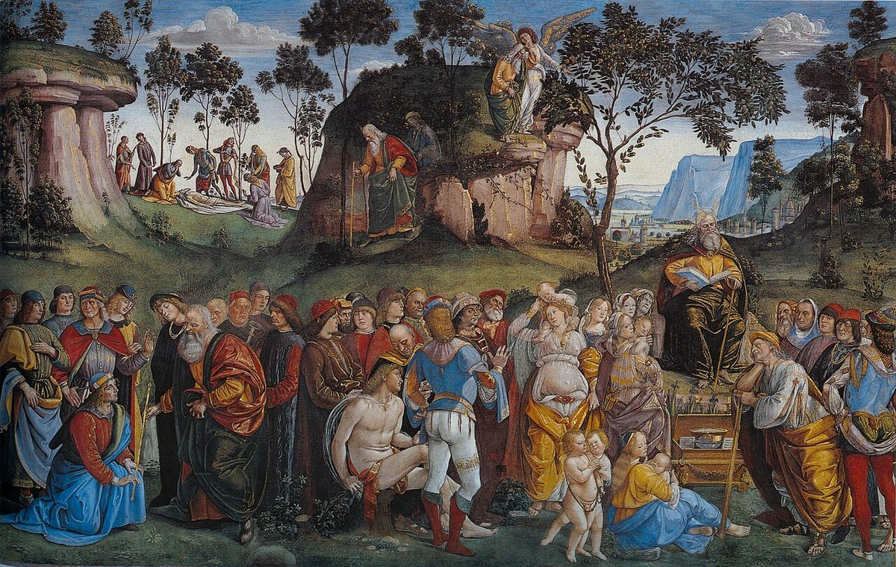
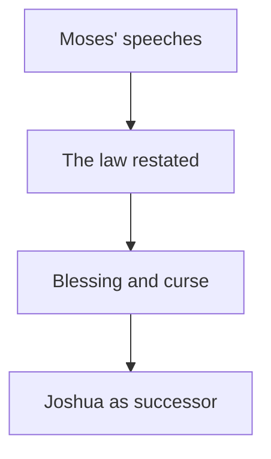

# Deuteronomy

*Testament and Death of Moses и смъртта… Credit: Luca Signorelli. License: Public domain. Source: [File:Signorelli, Luca - Moses's Testament and Death - 1481-82.jpg](https://commons.wikimedia.org/wiki/File:Signorelli,_Luca_-_Moses's_Testament_and_Death_-_1481-82.jpg).*
**Name and meaning.** *Deuteronomy* comes from a Greek phrase meaning "second law," after a line in the book about writing a copy of the law. In Hebrew it is *Devarim*, "Words," from the opening "these are the words that Moses spoke." It is the fifth book of the Torah: Moses' long farewell on the plains of Moab, restating the covenant for a generation that did not stand at Sinai as adults.

**Prerequisites:** [Exodus](exodus.md) and [Numbers](numbers.md). Helpful: [canon](../../../02-canon-and-hebrew-bible-vs-old-testament.md), because Deuteronomy shapes so much of what follows.

## Dating and authorship

Traditionally these are Moses' own last speeches, written down before his death (with 34:1–12, the death notice, often allowed as a later hand even in conservative traditional reading). Scholarly study has long connected Deuteronomy with the "book of the law" found in the temple in the reign of [Josiah](../../../glossary/people/josiah.md) (2 Kings 22–23), around 622 BCE, and with the reform that centralized worship in Jerusalem and moved against outlying high places. In the classic Documentary Hypothesis, D is a distinct source; many scholars now speak of a Deuteronomic school or of Deuteronomistic editing that extends into Joshua–Kings (the "Deuteronomistic History"). Proposed dates for an early core range from the eighth to the seventh century BCE, with later expansions in the exile. Traditional reading hears Moses. Historical-critical reading hears a later covenantal movement speaking in Moses' voice. The book itself presents the speeches as Mosaic address.

## Context

The narrative setting is a month on the east side of the Jordan, after the wilderness generation has died and before the crossing under Joshua. Moses cannot enter the land. He can only speak. The book is therefore Torah as preaching: law is given again, motivated, warned, and sung.

Its covenant form has been compared with ancient Near Eastern suzerainty treaties: historical prologue, stipulations, witnesses, blessings and curses. Whether or not the form is borrowed, the theology is clear. Israel already owes loyalty to the Lord who brought them out of Egypt. The land is gift, not possession by right, and it can be lost.

## Outline

- **1–4.** Historical prologue: the journey from Horeb (this book's usual name for Sinai), the failure of the first generation, the conquest of trans-Jordan, a call to obey and to teach the children.
- **5–11.** The heart of the matter: the Decalogue restated; the Shema; warnings against forgetting; the love and fear of the Lord; the lesson of the golden calf remembered.
- **12–26.** The Deuteronomic law code: one sanctuary; holy years and festivals; officials, kings, priests, and prophets; cities of refuge; warfare; family and social law; firstfruits and tithes.
- **27–30.** Covenant ceremony, blessings and curses, and the choice of life and death set before the people.
- **31–34.** Joshua commissioned; the song of Moses; the blessing of the tribes; Moses' death on Mount Nebo; a closing epitaph.

## Key passages and ideas

Deuteronomy 6:4–5, the [Shema](../../../glossary/terms/shema.md) — "Hear, O Israel: the Lord is our God, the Lord is one" (or "the Lord alone"), followed by the command to love the Lord with all the heart, soul, and might — becomes the daily confession of Jewish life and, in the [Gospels](../../../new-testament/books/gospels/README.md), Jesus' first great commandment. The book insists that words are to be taught, bound, written on doorposts, talked about at home and on the road. Religion here is memory practiced in ordinary time.

Chapter 12 commands the centralization of sacrifice at "the place the Lord will choose," later read as Jerusalem. Combined with the law of the king in chapter 17 (a king who writes a copy of this law and does not multiply horses, wives, or gold) and the tests of prophecy in chapter 18, Deuteronomy offers a constitution for life in the land. The blessings and curses of chapters 27–28 become the moral plot of [Kings](../history/1-kings.md): obedience and security, or disobedience and exile.

Moses' death in chapter 34 is deliberately unfinished business. He sees the land and does not enter it. The closing lines say there has not since arisen a prophet in Israel like Moses, whom the Lord knew face to face. Later Jewish and Christian hopes for a prophet like Moses (18:15–18) start here.

## Themes and reception

Themes include covenant loyalty (*hesed* and love as allegiance), memory versus forgetting, centralized worship, law as teaching (*torah*), social protection for the poor, the widow, the orphan, and the stranger, and the land as contingent gift. The book's style is recognizable: repetitive, hortatory, "today," "with all your heart."

Jewish life is steeped in Deuteronomy: the Shema, the mezuzah, the command to teach children. The Former Prophets (Joshua through Kings) are often read as a Deuteronomistic narrative. Jesus and the early church quote Deuteronomy constantly (including in the wilderness temptations). Modern political reading has sometimes treated it as a kind of constitution or as a dangerous program of conquest; both responses are to a text that really does legislate cherem warfare and also really does constrain the king and defend the weak. Read the book whole.

## Where this leads

- The Torah ends; the land path begins in [Joshua](../history/joshua.md) and the lesson [Joshua and Judges](../../06-joshua-and-judges.md)
- The same theology judged the monarchy in [1–2 Kings](../history/1-kings.md)
- Glossary: [covenant](../../../glossary/themes/covenant.md), [Shema](../../../glossary/terms/shema.md), [Torah](../../../glossary/terms/torah.md), [Josiah](../../../glossary/people/josiah.md)
