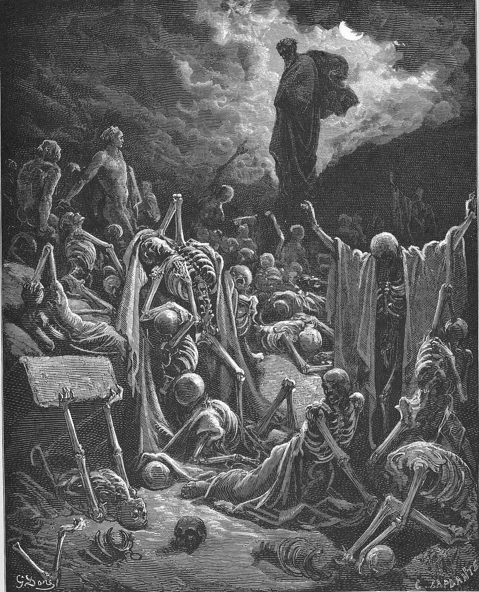

# Ezekiel

*Ezekiel’s Vision of the Valley of Dry Bones (Ez. 37:1-14) Credit: Gustave Doré. License: Public domain. Source: [File:127.Ezekiel’s Vision of the Valley of Dry Bones.jpg](https://commons.wikimedia.org/wiki/File:127.Ezekiel’s_Vision_of_the_Valley_of_Dry_Bones.jpg).*
**Name and meaning.** Named for Ezekiel son of Buzi (Hebrew *Yechezkel*, "God strengthens"), a priest deported to Babylon in 597 BCE, who received visions by the river Chebar. The book is famous for its strange, carefully dated visions: a mobile throne-chariot, a watchman, a valley of dry bones, and a detailed future temple.

**Prerequisites:** [Jeremiah](jeremiah.md), [2 Kings](../history/2-kings.md), [Leviticus](../law-torah/leviticus.md) (for priestly categories), and [Exile and return](../../10-exile-and-return.md).

## Dating and authorship

The book is unusually precise about dates, from the fifth year of Jehoiachin's exile (593) into the 570s BCE. Traditional reading takes Ezekiel as the author of his oracles and visions. Scholarly study has generally accepted a historical prophet in the Babylonian exile and has argued, in various degrees, for later priestly or "Ezekiel school" expansion, especially in the temple vision of chapters 40–48. Compared with many prophetic books, Ezekiel has a strong first-person voice and a relatively coherent plan. The Hebrew is often difficult; the Greek sometimes differs.

## Context

Ezekiel ministers to exiles who still hope, at first, that Jerusalem will survive. His early oracles insist that it will not. After 586, the message turns toward restoration: a new heart, a reunited people, a defeat of chaotic enemies, a reordered land and sanctuary. As a priest in exile, he thinks in terms of glory, purity, profanation, and the departure and return of the Lord's presence.

## Outline

- **1–3.** The throne-chariot vision (living creatures, wheels, a firmament, a figure of human likeness); the eating of the scroll; the watchman commission.
- **4–24.** Sign-acts and oracles of judgment against Judah and Jerusalem (the siege acted out, the departure of glory from the temple in chapters 8–11, oracles against false prophets, individual responsibility in chapter 18, the death of Ezekiel's wife as a sign).
- **25–32.** Oracles against the nations (Ammon, Moab, Edom, Philistia, Tyre, Egypt).
- **33–39.** After the city's fall: the watchman again; shepherds of Israel; the new heart; the valley of dry bones (37); the reuniting of Joseph and Judah; Gog of Magog (38–39).
- **40–48.** A vision of a new temple, a returning glory, priestly ordinances, a river from the sanctuary, and a reallotment of the land, with a city named "the Lord is there."

## Key passages and ideas

Chapter 1 is the fountainhead of later Jewish *merkavah* (chariot) mysticism and of much Christian visionary imagery. The glory of the Lord is not tied to one building; it can leave, and it can appear in a foreign land. Chapter 18's insistence that a person is not fatally trapped in the parents' guilt — "the soul who sins shall die" — is a sharp intervention in a proverb the exiles were quoting ("the parents have eaten sour grapes…"). It is not a full modern theory of the individual, but it is a pastoral and legal turning point.

The valley of dry bones (37) is a vision of national resurrection: "these bones are the whole house of Israel." Later Christian reading also heard bodily resurrection here, a meaning the image easily carries but is not the only one. The temple vision (40–48) is architectural theology. Some read it as a blueprint still awaiting fulfillment; some as a symbolic vision; some as a program that the Second Temple only partly resembled. The closing name of the city, *YHWH Shammah* ("the Lord is there"), is the book's last word on exile.

## Themes and reception

Themes include glory and presence, priestly holiness, responsibility, judgment beginning among the people of God, and restoration that is as concrete as a floor plan. The prophet's sign-acts (lying on his side, shaving his head, not mourning his wife in public) make the body a text.

Jewish mystical and liturgical traditions have treated Ezekiel with a mixture of fascination and caution (some restrictions on expounding the chariot). Christian typological reading has connected the shepherd of chapter 34 with later "good shepherd" language, and the temple river with living water. Historical study uses the dates and the priestly idiom to locate an exilic theology of presence. The book's strangeness should not be tamed too quickly.

## Where this leads

- Next: [Daniel](daniel.md)
- Related: [Leviticus](../law-torah/leviticus.md), [Revelation](../../../new-testament/books/prophecy/revelation.md)
- Glossary: [glory](../../../glossary/terms/glory.md), [exile](../../../glossary/themes/exile-and-return.md), [temple](../../../glossary/themes/temple.md), [resurrection](../../../glossary/terms/resurrection.md)
