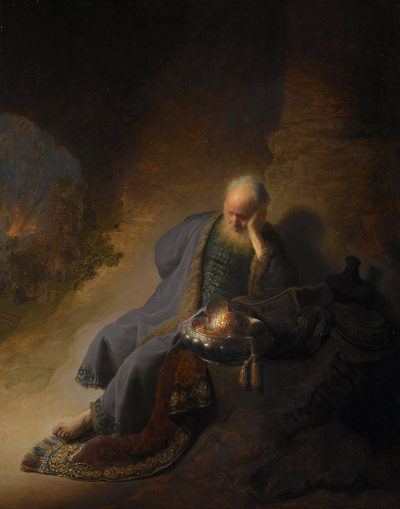
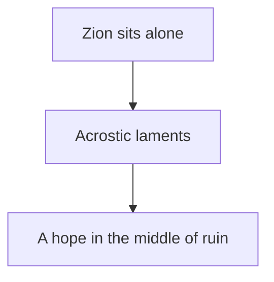

# Lamentations

*Jérémie pleurant la destruction de Jérusalem Jeremiah Lamenting the Destruction of Jerusalem pleurant la destruction de… Credit: Rembrandt. License: Public domain. Source: [File:Rembrandt Harmensz. van Rijn - Jeremia treurend over de verwoesting van Jeruzalem - Google Art Project.jpg](https://commons.wikimedia.org/wiki/File:Rembrandt_Harmensz._van_Rijn_-_Jeremia_treurend_over_de_verwoesting_van_Jeruzalem_-_Google_Art_Project.jpg).*
**Name and meaning.** In Hebrew the book is *Eikhah*, "How," the first word of the first poem ("How lonely sits the city"). The English title describes the genre. Five poems mourn the fall of Jerusalem in 586 BCE: a ruined city, starving inhabitants, a defeated king, and a God who has become an enemy and yet remains the only hope.

**Prerequisites:** [Jeremiah](jeremiah.md), [2 Kings](../history/2-kings.md), and [Exile and return](../../10-exile-and-return.md). Helpful: [Psalms](../wisdom-poetry/psalms.md) on lament as a biblical speech-form.

## Dating and authorship

Tradition ascribes the book to Jeremiah, which is why Christian Bibles place it after his scroll (the Septuagint and Vulgate already make that link). The Hebrew Bible places it among the Writings, as one of the Five Scrolls, and does not name an author in the text. Scholarly consensus dates the poems soon after 586, or at least in the exilic period, when the memory of the siege was raw; multiple authors are possible. The acrostic artistry (see the outline) suggests careful composition, not raw diary notes, but art and immediacy are not enemies here.

## Context

The poems assume the Babylonian destruction: the temple burned, walls broken, leaders exiled or executed, famine during the siege. They are liturgy as well as literature. In Jewish life they are read on the Ninth of Av (*Tisha B'Av*), the fast that remembers the destruction of both temples. The book gives a community words when praise would be a lie and silence would be another kind of death.

## Outline

- **Chapter 1.** An acrostic (each verse beginning with the next letter of the Hebrew alphabet): Jerusalem personified as a widow and as a woman who has been violated; "is it nothing to you, all you who pass by?"
- **Chapter 2.** A second acrostic: the Lord as an enemy who has swallowed Israel; a call to cry out.
- **Chapter 3.** A triple acrostic (three verses per letter), with a more individual voice: "I am the man who has seen affliction"; a central passage of hope about the Lord's mercies being new every morning; then a return to complaint and a call for justice.
- **Chapter 4.** A fourth acrostic: the siege's horrors, including the unthinkable suffering of children; the end of the Davidic king, "the breath of our nostrils."
- **Chapter 5.** A communal prayer, not a full acrostic (22 verses, but not alphabetically ordered in the same way): "Restore us to yourself, O Lord… unless you have utterly rejected us." The book ends with a question, not a resolution.

## Key passages and ideas

The poetry refuses to choose between confession of sin and protest at the scale of suffering. Judah's unfaithfulness is acknowledged; so is the feeling that punishment has gone beyond what can be borne. Chapter 3's "great is your faithfulness" is genuine, and it is surrounded by darkness. To quote only the hopeful verses is to misread the book.

Personification of the city as Daughter Zion is a major literary and theological device: the catastrophe is not only strategic but personal. The silence of chapter 2, where the speaker tells Zion to weep, and the almost unsparing images of chapter 4, belong to the truth-telling of lament.

## Themes and reception

Themes include grief, guilt, the hidden or hostile face of God, memory, and a hope that is more plea than possession. The book has taught Jewish and Christian communities how to remain with disaster without premature cheer. Christian Holy Week liturgies have sometimes used it; the primary living context remains Tisha B'Av. Literary study of the acrostics and of trauma has been especially fruitful. Historical reconstruction of 586 should be done, but not in place of praying the poems.

## Where this leads

- Next: [Ezekiel](ezekiel.md), another witness of the same catastrophe, from exile
- Glossary: [lament](../../../glossary/terms/lament.md), [exile](../../../glossary/themes/exile-and-return.md), [Zion](../../../glossary/places/zion.md), [temple](../../../glossary/themes/temple.md)
