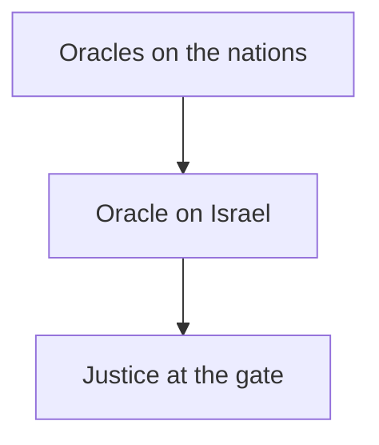

# Amos

**Name and meaning.** Named for Amos, a shepherd and dresser of sycamore figs from Tekoa in Judah, who prophesied to the northern kingdom under Jeroboam II. The book is the classic prophetic indictment of social injustice wrapped in religious prosperity: "let justice roll down like waters."

**Prerequisites:** [The prophets](../../08-prophets.md) and [1 Kings](../history/1-kings.md) on the north. Read with [Hosea](hosea.md).

## Dating and authorship

The heading places Amos "two years before the earthquake," in the days of Uzziah of Judah and Jeroboam II of Israel — typically the 760s or 750s BCE, a generation or so before Samaria's fall. Traditional reading takes the oracles as Amos's. Scholarly study generally agrees on an eighth-century core; some see later editorial additions, especially in the closing promise to "David's booth" (9:11–15), which some critics have judged a Judahite appendix and others have defended as integral. The confrontation with Amaziah the priest of Bethel (chapter 7) is a key biographical scene.

## Context

The north is strong, the cult at Bethel is busy, and the poor are crushed. Amos, though from Judah, is sent north, and he refuses the title of professional prophet: "I am no prophet, nor a prophet's son." His oracles against the nations hook the hearers — and then land on Israel.

## Outline

- **1–2.** Oracles against Damascus, Gaza, Tyre, Edom, Ammon, Moab, Judah, and finally Israel, each opening "for three transgressions and for four."
- **3–6.** Oracles and woes: the lion has roared; cows of Bashan; empty festivals; "the day of the Lord" as darkness, not light; idle luxury in Samaria.
- **7–9.** Five visions (locusts, fire, plumb line, summer fruit, the Lord by the altar); the Amaziah episode; a closing judgment that none will escape, and a promise of restoration.

## Key passages and ideas

Amos 5:21–24, the rejection of feasts and songs if justice is absent, is one of the load-bearing texts of the prophetic tradition and of later civil-rights preaching. The "day of the Lord" in 5:18–20 turns a popular hope into a warning. The visions of chapter 7 show a prophet who first intercedes (and is heard) and then is told that the plumb line has been drawn; intercession has a limit.

The closing promise (9:11–15) of a rebuilt Davidic booth, a people planted on their land, is quoted in [Acts](../../../new-testament/books/history/acts.md) 15 in the debate about Gentile inclusion. Whether one takes it as Amos's own hope or as a later word, it is now part of the book, and it keeps judgment from being the last sound.

The Amaziah scene (7:10–17) is a first-principles lesson in the conflict between prophet and institution. The priest of Bethel tells Amos to flee south and earn his bread there; Amos answers that he was taken from the flock and that Amaziah's own household will bear the coming judgment. The book therefore does not only announce justice for the poor. It also shows what it costs to announce it in a royal sanctuary. The lion has roared; the prophet does not have the option of silence (3:8). That constraint, not professional zeal, is his authority.

## Themes and reception

Themes include justice (*mishpat*) and righteousness, the danger of liturgy without ethics, the Lord's sovereignty over other nations, and a day of the Lord that is not automatically comfort. Amos has been especially important for modern social ethics, Jewish and Christian. Historical study uses him as a window on eighth-century Israel. He should not be reduced to a social reformer; the book is theology about the Lord of Zion who roars from Jerusalem.

## Where this leads

- Next: [Obadiah](obadiah.md)
- Glossary: [justice](../../../glossary/justice.md), [day of the Lord](../../../glossary/day-of-the-lord.md), [prophet](../../../glossary/prophet.md)
