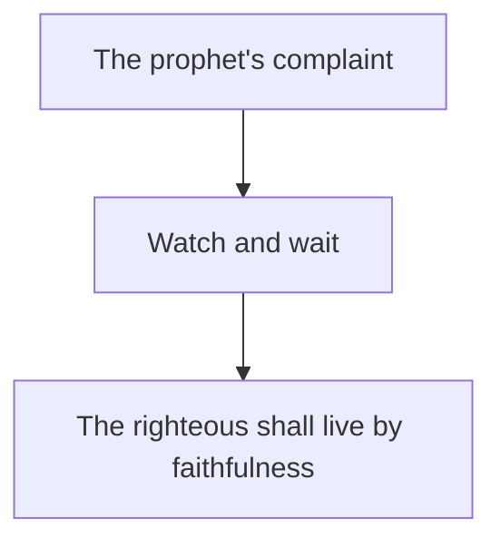

# Habakkuk

*The Prophet Habakkuk Credit: anonymous. License: Public domain. Source: [File:British (English) School - The Prophet Habakkuk - 1430496.24 - National Trust.jpg](https://commons.wikimedia.org/wiki/File:British_(English)_School_-_The_Prophet_Habakkuk_-_1430496.24_-_National_Trust.jpg).*
**Name and meaning.** Named for the prophet Habakkuk, otherwise almost unknown. The book is a dialogue: the prophet complains about violence and unanswered injustice in Judah, is told that the Babylonians (the Chaldeans) are the Lord's instrument, complains again that a wicked nation cannot be the final measure, and is told that "the righteous shall live by his faithfulness." A closing psalm waits for the Lord's coming in the midst of famine.

**Prerequisites:** [The prophets](../../08-prophets.md) and [2 Kings](../history/2-kings.md) on the end of Judah. Helpful: [Jeremiah](../major-prophets/jeremiah.md).

## Dating and authorship

The mention of the Chaldeans as a rising, terrifying power usually places the book in the late seventh century, between the decline of Assyria and the early Babylonian incursions (perhaps in Jehoiakim's reign, around the 600s BCE). Traditional reading takes Habakkuk as the author of both the oracles and the psalm. Scholarly study generally agrees on this window; some have questioned whether the psalm of chapter 3 was always part of the book, though it is in the canon and is given a musical superscription. A commentary on Habakkuk from Qumran (*Pesher Habakkuk*) shows how intensely later Jewish readers worked these chapters.

## Context

The prophet looks at a society of violence and perverted justice, then at an imperial army that is worse, and asks how the Holy One can look at both. This is prophecy as prayer and argument, closer to Job or to the laments than to a lawsuit against Israel alone.

## Outline

- **1:1–11.** First complaint: how long? The Lord's answer: I am raising up the Chaldeans.
- **1:12–2:1.** Second complaint: how can you look silently at a treacherous nation swallowing one more righteous than itself? The prophet stands at his watch.
- **2:2–20.** The answer: write the vision; it will not lie. "The righteous shall live by his faithfulness" (or "faith"). Five woes against the plunderer, ending "the Lord is in his holy temple; let all the earth keep silence."
- **3.** A psalm: a theophany from Teman and Mount Paran; the prophet trembles; yet he will rejoice in the Lord though the fig tree does not blossom.

## Key passages and ideas

Habakkuk 2:4 is one of the most consequential verses in the Bible's afterlife. In the [Pauline letters](../../../new-testament/books/pauline-epistles/romans.md) (Romans 1:17; Galatians 3:11) and in [Hebrews](../../../new-testament/books/general-epistles/hebrews.md) 10:38, it becomes a load-bearing text for living by faith. The Hebrew *emunah* is "faithfulness" or "fidelity" as well as "faith." Pauline reading is a genuine reception, not a simple dictionary equivalent; both the prophet's context (waiting for a vision in a time of imperial violence) and the apostle's argument should be heard.

Chapter 3's resolve — joy in God when agriculture has failed — is not optimism. It is a decision after a theophany that has not yet changed the facts on the ground. The book therefore teaches a piety of waiting that is not silence and not denial.

The five woes of chapter 2 (against plunder, unjust gain, violence that builds a town, shaming of neighbors, and trust in an idol) widen the charge beyond Babylon alone. The oppressor becomes a type, and the silence of the temple at the end of the chapter is a worldwide silence, not a local ceasefire. That is why the book could be reused at Qumran and in the New Testament without being ripped entirely from its roots: it was already teaching a way to live when the vision is slow and the facts are ugly. Waiting, here, is an ethical stance, not a blank calendar.

## Themes and reception

Themes include theodicy, imperial violence, waiting, faithfulness, and praise before the facts have turned. Paul and the Reformers made 2:4 central to justification debates. The Qumran pesher applied the book to its own enemies and teacher. Read it first as a late-monarchic conversation with God about history.

## Where this leads

- Next: [Zephaniah](zephaniah.md)
- Glossary: [faith](../../../glossary/terms/faith.md), [theodicy](../../../glossary/terms/theodicy.md), [Babylon](../../../glossary/places/babylon.md)
