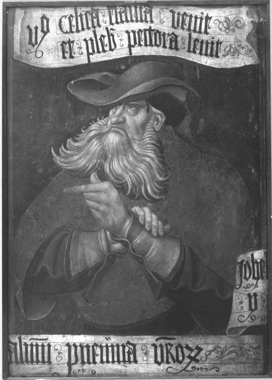

# Joel

*Der Prophet Joel Credit: anonymous. License: Public domain. Source: [File:Bayerisch um 1480 - Der Prophet Joel - 1356 - Bavarian State Painting Collections.jpg](https://commons.wikimedia.org/wiki/File:Bayerisch_um_1480_-_Der_Prophet_Joel_-_1356_-_Bavarian_State_Painting_Collections.jpg).*
**Name and meaning.** Named for Joel son of Pethuel (*Yoel*, "the Lord is God"). The book moves from a locust plague and drought to a promise of the Lord's spirit poured out on all flesh, and to a judgment of the nations in the "valley of decision." It is short, vivid, and difficult to date.

**Prerequisites:** [The prophets](../../08-prophets.md) and [genres](../../../04-genres.md).

## Dating and authorship

The book names no king. Traditional placement in the Twelve puts Joel after Hosea, which sometimes encouraged an early date. Scholarly proposals range from the monarchic period to the late Persian or even Hellenistic age. Many scholars favor a post-exilic date because of references to the temple and priests, the lack of a named king, and the book's reuse of earlier prophetic language (sometimes called "learned" or "scribal" prophecy). Certainty is not available. The "day of the Lord" and the locusts can be read as a real agricultural disaster, as a metaphor for invasion, or as both.

## Context

A community centered on the temple (offerings have been cut off; priests are told to lament) faces a catastrophe that strips the land. Joel calls for a fast and a rending of hearts, then announces the Lord's pity, the restoration of the years the locust has eaten, and a future outpouring of the spirit. The second major movement (chapter 3 in English; 4 in Hebrew) gathers the nations for judgment and promises refuge in Zion.

## Outline

- **1:1–2:17** (English). The locusts and drought; a call to the drunkards, farmers, and priests; the day of the Lord; a call to return "with all your heart," fasting, and a liturgy of communal prayer.
- **2:18–32.** The Lord's jealous pity; restoration of grain, wine, and oil; "I will pour out my spirit on all flesh," with signs in heaven and earth; "everyone who calls on the name of the Lord shall be saved."
- **3.** The nations in the valley of Jehoshaphat; Tyre, Sidon, and Philistia accused of selling Judahites; a fountain from the Lord's house; Judah and Jerusalem inhabited.

## Key passages and ideas

The call to "rend your hearts and not your garments" (2:13), with the confession that God is gracious and merciful, slow to anger, and abounding in hesed, quotes the ancient divine name formula of Exodus 34 and applies it to a public crisis. The promise of the spirit in 2:28–32 is the text [Peter](../../../glossary/people/peter.md) preaches at Pentecost in [Acts](../../../new-testament/books/history/acts.md) 2. Christian reading therefore hears the church's beginning here; Jewish reading keeps the text as an eschatological hope for Israel and the nations. Both receptions depend on the same words.

The locusts are described with military poetry, which is why some readers hear an army behind the swarm. The book does not force a choice if one allows prophetic language to be double-layered. The "day of the Lord," already a theme in Amos, is both darkness and, for those who call on the name, deliverance.

The book's reuse of earlier scripture is not a weakness. Joel 3 (English) echoes Isaiah's and Micah's language of plowshares and judgment, and the divine-name formula of Exodus 34 is quoted as a reason to repent now. A later prophet who lives inside the already-written word is still doing prophetic work: choosing, combining, and aiming those words at a present disaster. That is one reason a firm date is so hard to fix, and one reason the book traveled so easily into new settings, including a Pentecost sermon in Jerusalem centuries later.

## Themes and reception

Themes include catastrophe, repentance, liturgical response, the spirit, and the day of the Lord. Joel is a good first-principles example of a prophet who may be late and still be a genuine prophet: he lives in earlier scripture and speaks a new word. Pentecost is the New Testament's most famous use. Liturgical traditions of fasting and penitence have also lived here.

## Where this leads

- Next: [Amos](amos.md)
- Glossary: [day of the Lord](../../../glossary/terms/day-of-the-lord.md), [prophet](../../../glossary/terms/prophet.md), [Zion](../../../glossary/places/zion.md)
