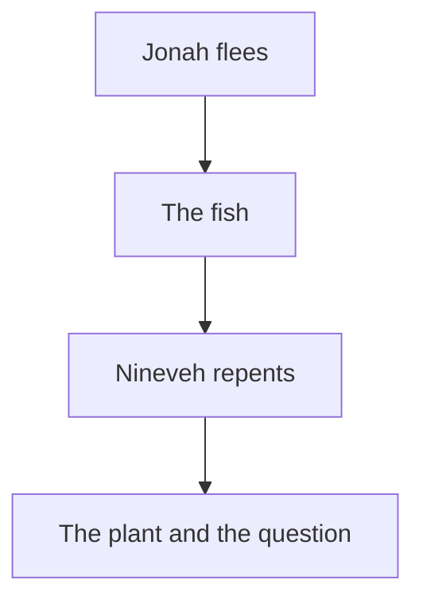

# Jonah

**Name and meaning.** Named for Jonah son of Amittai (*Yonah*, "dove"), a prophet mentioned in 2 Kings 14:25 in the time of Jeroboam II. Unlike the other books of the Twelve, this one is mostly a narrative about a prophet, not a collection of oracles. It is a story of flight, a storm, a great fish, a city's repentance, and a prophet's anger at God's mercy.

**Prerequisites:** [The prophets](../../08-prophets.md) and [genres](../../../04-genres.md). Helpful: [Nahum](nahum.md), which also concerns Nineveh.

## Dating and authorship

The historical Jonah lived in the eighth century. The book is anonymous and does not claim to be Jonah's memoir. Scholarly dates for the story as we have it are often post-exilic, because of language and because of its theological argument about the nations, though earlier dates are also defended. Genre proposals include historical narrative, didactic fiction, satire, and parable. Traditional reading has generally taken the events as historical, and Jesus refers to "the sign of Jonah" in the [Gospels](../../../new-testament/books/gospels/README.md). A first-principles overview can say: the story's claim about God's pity does not depend on first settling the genre, and the genre question should be named honestly.

## Context

Nineveh is the great city of Assyria, later destroyer of the northern kingdom — which makes a story of Nineveh's repentance and God's relenting especially sharp if told after 722, and still sharper after 586, when Assyria and Babylon had become types of empire. The book is also a quiet conversation with prophetic theology: what happens when the preaching of judgment "fails" because it succeeds, and the city turns?

## Outline

- **1.** The call to cry out against Nineveh; Jonah flees toward Tarshish; the storm; the sailors' fear and eventual piety; Jonah thrown overboard.
- **2.** Jonah's psalm from the belly of the fish; he is vomited onto dry land.
- **3.** The second call; Jonah's brief sermon; Nineveh's total repentance, from the king to the animals in sackcloth; God relents.
- **4.** Jonah's anger; the sukkah and the plant; the worm and the wind; the Lord's question about pity for the city and its many cattle.

## Key passages and ideas

Jonah's psalm in chapter 2 sounds like a thanksgiving psalm and can be read as sincere or as ironically misplaced piety, depending on the reader; the book allows the tension. The Ninevites repent at a one-line sermon, while the prophet, who has been saved from the sea, resents their salvation. The last word is a question from God, not a conversion scene for Jonah: should the Lord not pity a great city of people "who do not know their right hand from their left," and also many animals? The book's theology of mercy is wider than the prophet's.

The "three days and three nights" in the fish becomes, in Matthew and Luke, a sign of the [Son of Man](../../../glossary/son-of-man.md)'s burial and rising, and also, in Luke, a sign of Gentile repentance shaming unrepentant hearers. Those are receptions that the story can bear; they should not erase the Old Testament narrative's own ending.

## Themes and reception

Themes include flight from vocation, the piety of outsiders (sailors, Ninevites), repentance, the freedom of God to have pity, and the prophet's scandalized nationalism (or wounded justice). Jewish liturgy reads Jonah on Yom Kippur afternoon, a deep placing: it is a book about repentance and mercy. Christian reception has emphasized typology and mission. Literary readers have admired its irony. It is a short book that should be read slowly, all four chapters, including the question that is left open.

## Where this leads

- Next: [Micah](micah.md)
- Related: [Nahum](nahum.md)
- Glossary: [prophet](../../../glossary/prophet.md), [repentance](../../../glossary/repentance.md), [Nineveh](../../../glossary/nineveh.md)
