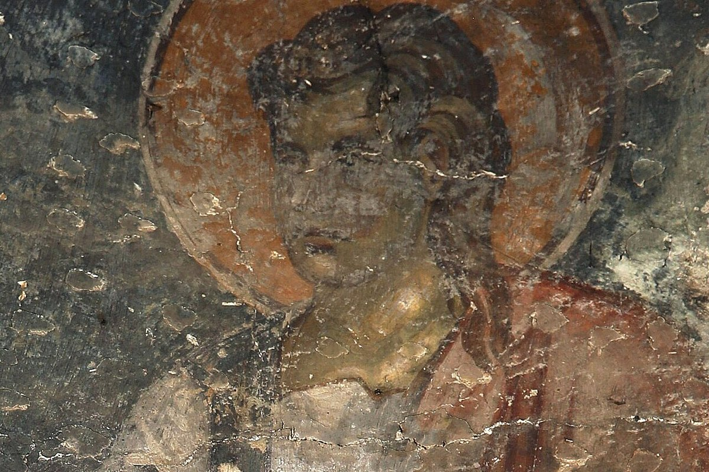

# Malachi

*Chruch of Theotokos of Ljeviš, Prizren, Fresco painting Credit: BLAGO Fund, Inc.. License: [CC BY 4.0](https://creativecommons.org/licenses/by/4.0). Source: [File:Prophet Malachi PRIZREN 2 IMG 5304-4.jpg](https://commons.wikimedia.org/wiki/File:Prophet_Malachi_PRIZREN_2_IMG_5304-4.jpg).*
**Name and meaning.** *Malachi* means "my messenger." It may be a proper name or a title (see 3:1, "I am sending my messenger"). The book is the last of the Twelve and, in Christian Old Testaments, the last book before the New Testament. It is a series of disputation speeches with a post-exilic community: about love, worship, marriage, justice, and the coming day.

**Prerequisites:** [Haggai](haggai.md), [Zechariah](zechariah.md), [Ezra](../history/ezra.md), and [Nehemiah](../history/nehemiah.md).

## Dating and authorship

The book assumes a standing Second Temple and a functioning (and disappointing) priesthood, and it does not name a Persian king. A common scholarly date is the fifth century BCE, roughly the world of Ezra and Nehemiah (issues of mixed marriage, tithes, and weary worship overlap). Traditional reading takes Malachi as a prophet of that restoration period. If "Malachi" is a title, the book is formally anonymous; that does not make it less prophetic.

## Context

The enthusiasm of the first return has faded. People say "how have you loved us?" and "what a weariness this is." Priests offer blemished animals. Divorce and marriages with foreign gods are in view. A coming messenger will prepare the way, and the Lord will come to his temple as a refiner. The book closes the Twelve by reopening expectation.

## Outline

- **1:1–5.** "I have loved you": the Lord's love for Jacob, set against Esau/Edom.
- **1:6–2:9.** A dispute with the priests: contempt for the Lord's table; a remarkable word about the Lord's name being great among the nations; the covenant with Levi.
- **2:10–16.** Faithlessness in marriage and, in a difficult text, hatred of divorce (or of covering violence with one's garment).
- **2:17–3:6.** "Where is the God of justice?" The messenger, and the Lord coming to his temple like a refiner's fire.
- **3:7–12.** Tithes and the storehouse; a challenge to test the Lord.
- **3:13–4:6** (Hebrew 3:13–21). Those who fear the Lord are remembered in a book; the day coming, burning like an oven; the sun of righteousness; the command to remember the Torah of Moses; the promise to send Elijah before the great and terrible day.

## Key passages and ideas

"I am sending my messenger to prepare the way before me" (3:1) and the Elijah promise (4:5–6) are foundational for New Testament pictures of [John the Baptist](../../../glossary/people/john-the-baptist.md) (see the [Gospels](../../../new-testament/books/gospels/README.md) and [baptism and temptation](../../../new-testament/stories/02-baptism-and-temptation.md)). Jewish expectation of Elijah's return before the day of the Lord is older than that Christian application and remains a living tradition (the Elijah cup at the Passover Seder is a related memory). Both should be taught.

The disputes are a method: an accusation or a divine claim, a hypothetical objection ("but you say…"), and an answer. It is prophecy as argument with a tired community. The "sun of righteousness" with healing in its wings (4:2) became a rich image in later hymnody. The last word of the Christian Old Testament, in this order, is a threat and a promise about a curse on the land unless hearts of parents and children are turned; the Tanakh, which does not end here, ends instead with Chronicles' "let him go up."

## Themes and reception

Themes include covenant love, corrupt worship, marriage, justice, a book of remembrance, and the coming messenger. Placement at the end of the Twelve and of the Christian Old Testament has shaped Advent and "intertestamental" imagination; historically, other Jewish writings continued, and the Tanakh's order tells a different last word. Read Malachi as a Persian-period disputation first, then as a hinge in Christian Bibles.

## Where this leads

- The Twelve and the Protestant Old Testament book path end here. Continue with [deuterocanon](../../../deuterocanon/README.md) or the [New Testament](../../../new-testament/README.md)
- Glossary: [John the Baptist](../../../glossary/people/john-the-baptist.md), [Elijah](../../../glossary/people/elijah.md), [day of the Lord](../../../glossary/terms/day-of-the-lord.md), messenger
