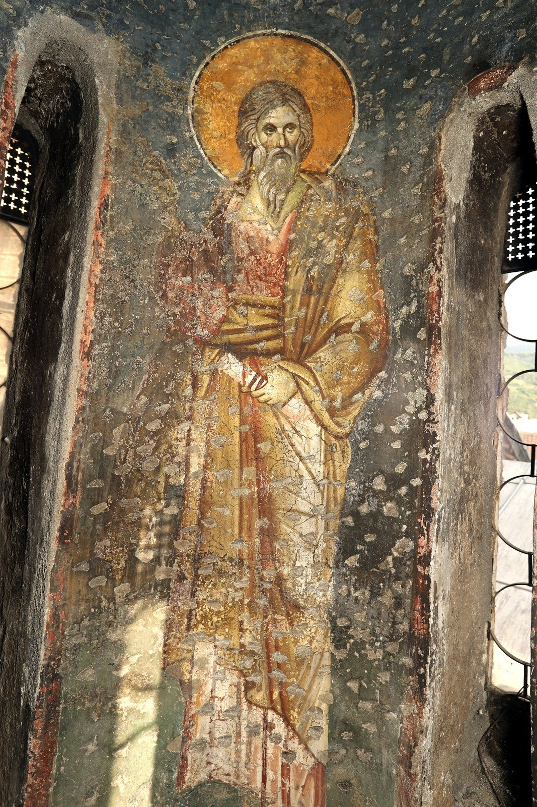
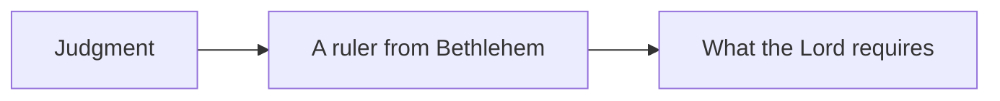

# Micah

*Chruch of Theotokos of Ljeviš, Prizren, Fresco painting Credit: BLAGO Fund, Inc.. License: [CC BY 4.0](https://creativecommons.org/licenses/by/4.0). Source: [File:Prophet Micah PRIZREN 2 IMG 5342-2.jpg](https://commons.wikimedia.org/wiki/File:Prophet_Micah_PRIZREN_2_IMG_5342-2.jpg).*
**Name and meaning.** Named for Micah of Moresheth (*Mikhah*, a short form of "who is like the Lord?"), an eighth-century prophet from the Judean countryside who spoke against Samaria and Jerusalem. The book alternates judgment and hope, and it contains two of the most quoted sentences in the prophets: a ruler from Bethlehem, and the triad "do justice, love kindness, walk humbly with your God."

**Prerequisites:** [The prophets](../../08-prophets.md), [Isaiah](../major-prophets/isaiah.md) (a near contemporary in Judah), and [Amos](amos.md).

## Dating and authorship

The heading places Micah in the days of Jotham, Ahaz, and Hezekiah — late eighth century, overlapping Isaiah of Jerusalem. Jeremiah 26:18 later recalls Micah's temple-judgment word as having been spoken in Hezekiah's time and not having cost the prophet his life, which is rare external confirmation of a prophetic book. Scholarly study generally accepts an eighth-century Micah for much of chapters 1–3; many see later additions in the hope oracles of 4–5 and in 6–7, while others defend more of the book as Micah's or as a close Micah tradition. As usual, the finished book is what the canon gives us.

## Context

Micah speaks from a village (Moresheth-gath) to the capital. Land-grabbing, corrupt courts, and prophets who preach for pay are his targets. The fall of Samaria is on the horizon or in view, and Jerusalem is not immune. Hope takes the form of a pilgrimage of nations to Zion, a shepherd-king of David's line from Bethlehem, and a remnant.

## Outline

- **1–3.** Judgment on Samaria and Judah; a lament; against those who devise wickedness on their beds and seize fields; against rulers who build Zion with blood; "Zion shall be plowed as a field."
- **4–5.** The mountain of the Lord's house (close to Isaiah 2); swords into plowshares; a promised ruler from Bethlehem; the remnant like dew and like a lion.
- **6–7.** A covenant lawsuit ("O my people, what have I done to you?"); 6:8; the corruption of the city; a lament; a closing hymn of the Lord's pardon, casting sins into the sea.

## Key passages and ideas

Micah 6:8 is a summary of covenant religion that should not be detached from the lawsuit in which it stands: the Lord has already told the people what is good, after a history of redemption from Egypt. Justice, hesed, and humility are not a replacement for worship; they are what the Lord requires in the context of a people already claimed. Micah 5:2 (5:1 in Hebrew), the ruler from Bethlehem whose origin is "from of old," is cited in [Matthew](../../../new-testament/books/gospels/matthew.md) 2 when Herod asks where the Messiah is to be born. Jewish and Christian messianic reading meet in this verse and then diverge in application.

The temple-judgment word (3:12) is shockingly concrete: the holy mountain can be plowed. Jeremiah's generation remembered that Micah had said it and lived. The juxtaposition of that word with the later "mountain of the house of the Lord established as the highest of the mountains" (4:1) is the book's characteristic rhythm: demolition, then pilgrimage.

Micah's village voice matters. He names towns in the Shephelah in a chain of wordplays in chapter 1, as if the disaster were already walking from door to door. The urban elites of Jerusalem are not allowed to think of judgment as something that happens to Samaria or to someone else's fields. That is why the book can hold both the plowed Zion of 3:12 and the magnet-mountain of 4:1 without simply canceling either image. A people can be judged in its holy place and still be promised that nations will one day stream to that same place to learn a different way of settling disputes.

## Themes and reception

Themes include rural protest against elite injustice, the vulnerability of Zion, messianic hope from a small town, and a religion summarized as justice, loyalty, and humility. Micah has been a staple of both Jewish ethical teaching and Christian Advent reading. Historical study uses him alongside Isaiah for eighth-century Judah. Read the judgment and the hope as one book.

## Where this leads

- Next: [Nahum](nahum.md)
- Glossary: [justice](../../../glossary/terms/justice.md), [hesed](../../../glossary/terms/hesed.md), [Messiah](../../../glossary/themes/messiah.md), [Zion](../../../glossary/places/zion.md)
