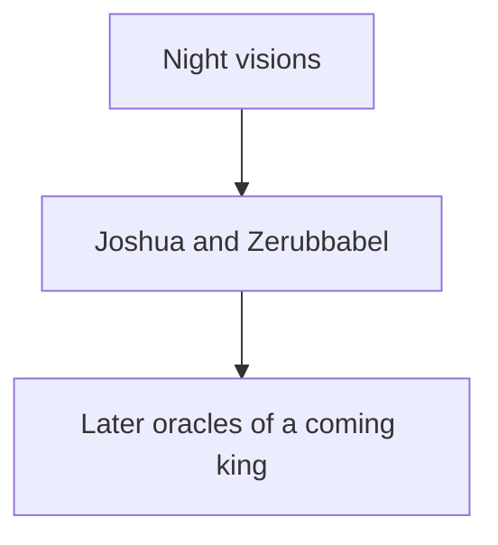

# Zechariah

**Name and meaning.** Named for Zechariah son of Berechiah son of Iddo, a prophet (and, in some notices, a priestly figure) who, with Haggai, encouraged the rebuilding of the temple in 520 BCE and after. The book has two large parts: night visions and oracles in chapters 1–8, and, in chapters 9–14, later-sounding oracles about kings, shepherds, a pierced figure, and the Lord's coming to the Mount of Olives. It is one of the most important prophetic sources for later messianic and apocalyptic imagination.

**Prerequisites:** [Haggai](haggai.md), [Ezra](../history/ezra.md), and [Exile and return](../../10-exile-and-return.md).

## Dating and authorship

Chapters 1–8 are dated, like Haggai, to the early reign of Darius I (520–518). Traditional reading attributes the whole book to this Zechariah. A widespread scholarly view distinguishes Second Zechariah (chapters 9–14), often itself divided (9–11, 12–14), as later Persian or Hellenistic prophecy attached to the scroll. The shift in style, the lack of dates, and a different historical atmosphere are the reasons. Both parts are canonical; this overview treats them as one book with a possible history of growth.

## Context

The first part shares Haggai's world: a small Yehud, a temple going up, Joshua the high priest, Zerubbabel the governor, and the question of whether the Lord's return to Zion is real. The visions answer with a busy heaven: horsemen, horns, a measuring line, a lampstand and olive trees, a flying scroll, a woman in a basket named Wickedness, and four chariots. The second part looks toward a more turbulent future: a humble king on a donkey, a worthless shepherd, a day of mourning as for an only child, and a final attack on Jerusalem after which living waters go out from the city.

## Outline

- **1–6.** A call to return; eight (or seven) night visions; the crowning of Joshua in a scene that also names "the Branch."
- **7–8.** A question about fasting; oracles of a city of truth and of nations grasping a Jew's garment to seek the Lord.
- **9–11.** An oracle: a coming king, humble and riding on a donkey; the shepherds; thirty pieces of silver.
- **12–14.** An oracle: Jerusalem a cup of reeling; "they will look on me whom they have pierced"; a fountain opened; the Lord's feet on the Mount of Olives; the Lord's kingship over all the earth.

## Key passages and ideas

The Branch (3:8; 6:12), already a Davidic image in Jeremiah and Isaiah, is here tied to temple building and to a priestly crowning that has generated much interpretation (one figure or two? priest and king together?). 9:9, the humble king on a donkey, is enacted in the [Gospels](../../../new-testament/books/gospels/README.md) at Jesus' entry into Jerusalem. 11:12–13, the thirty pieces of silver thrown to the potter (or into the temple treasury, in Matthew's reading), is taken up in the Passion story of Judas. 12:10 and 13:7 are likewise woven into New Testament Passion and mourning language. These receptions are central to Christian reading and should be taught as reception, with the Old Testament context kept first: a post-exilic and later Jewish hope for the Lord's reign and for a cleansed people.

## Themes and reception

Themes include return, temple, visions, priest and branch, a humble king, a stricken shepherd, and the Lord's universal rule. The book is dense and sometimes obscure (already in antiquity). It is also indispensable for Gospel readers. Jewish messianic interpretation has its own history with these chapters. Historical-critical division of 1–8 and 9–14 helps explain the texture; it should not prevent reading the scroll as the community received it.

## Where this leads

- Next: [Malachi](malachi.md)
- Story path: [Passion week](../../../new-testament/stories/06-passion-week.md)
- Glossary: [Branch](../../../glossary/branch.md), [Messiah](../../../glossary/messiah.md), [Second Temple](../../../glossary/second-temple.md), [Zerubbabel](../../../glossary/zerubbabel.md)
