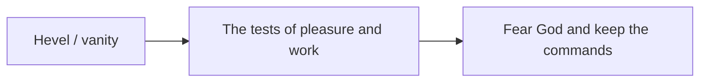

# Ecclesiastes

**Name and meaning.** *Ecclesiastes* is the Latin form of the Greek rendering of Hebrew *Qoheleth*, "the Gatherer" or "the Teacher" (sometimes "Preacher"), the voice who speaks almost throughout. The book is a searching, often disillusioned meditation on work, pleasure, wisdom, death, and the possibility of fearing God anyway. In the Tanakh it is among the Writings and is read during the feast of Booths; in Christian Bibles it stands among the wisdom books.

**Prerequisites:** [Proverbs](proverbs.md) and [Wisdom literature](../../09-wisdom-literature.md).

## Dating and authorship

The speaker is introduced as "son of David, king in Jerusalem" (1:1), which traditional reading takes as Solomon. Scholarly consensus dates the book much later, usually to the late Persian or Hellenistic period (fourth or third century BCE), on grounds of language (late Hebrew with Aramaic and possibly Persian influence) and of a philosophical mood that fits a world after the monarchy. The Solomonic royal persona is then a literary device: who better than the archetypal wise and wealthy king to say that wisdom and wealth cannot settle the account? A brief epilogue (12:9–14) speaks of Qoheleth in the third person and may be a later editorial frame, commending the Teacher and concluding, "fear God and keep his commandments."

## Context

The book's key word *hevel* — traditionally "vanity," also "vapor," "breath," or "futility" — names the slipperiness of human projects under the sun. Death comes to wise and fool. Toil is inherited by someone who may be a fool. Justice is crooked. There is a time for every matter (chapter 3), which can be heard as comfort or as a closed cycle. Alongside the bleak observations are counsels to enjoy bread, wine, work, and a life companion as gifts, and to remember the Creator before old age arrives.

## Outline

- **1–2.** The motto ("vanity of vanities"); the royal experiment with wisdom, pleasure, and projects; the same death for wise and fool.
- **3.** A time for every matter; a mystery about God putting eternity into human minds.
- **4–6.** Oppression; companionship; vows; the frustration of wealth.
- **7–11.** Proverb-like reflections that both use and undercut wisdom; the limits of righteousness; living with risk.
- **12:1–8.** The aging body in images; the end of the matter as *hevel*.
- **12:9–14.** Epilogue: the Teacher's words, the weariness of many books, the command to fear God.

## Key passages and ideas

The catalogue of times in 3:1–8 is among the most widely quoted poems in the Bible and should not be reduced to a poster. In context it leads to a claim that God has made everything suitable for its time, and that humans cannot find out the work of God from beginning to end. The counsel to enjoy life (2:24; 3:12–13; 9:7–10) is not hedonism in a cheap sense; it is a refusal to let death and injustice cancel ordinary gifts. The ending of chapter 12, with its images of fading light, trembling keepers, and a severed silver cord, is a great poem of mortality.

The epilogue has been read as a conservative lid placed on a dangerous book, or as a fair summary (the fear of God really is where Qoheleth arrives). Canonically, the book was debated; it is in the canon, and the epilogue is part of the book we have.

## Themes and reception

Themes include time, death, the limits of wisdom, the enjoyment of gifts, and the fear of God in a world that will not add up. The book is a necessary companion to Proverbs: wisdom is still better than folly, and it is not enough.

Jewish tradition assigned it to Sukkot, a festival of joy, which is a bold pairing. Christian preaching has sometimes flattened it into mere pessimism or mere "life without God is empty," which is less than the text says: God is present in the book, and the problem is not atheism but inscrutability. Modern existential reading has found a cousin here. Historical-critical work on the epilogue and on possible inner contradictions should be used to hear the book's voices, not to declare it a mess.

## Where this leads

- Next: [Song of Songs](song-of-songs.md)
- Companion: [Wisdom literature](../../09-wisdom-literature.md); [Job](job.md)
- Glossary: [wisdom](../../../glossary/wisdom.md), [hevel](../../../glossary/hevel.md)
