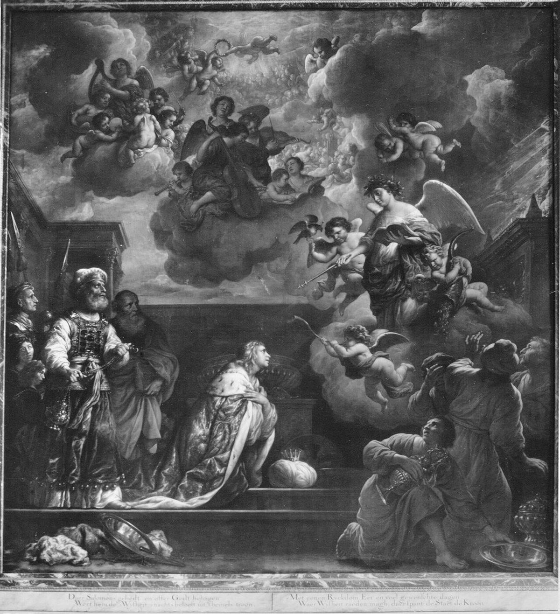
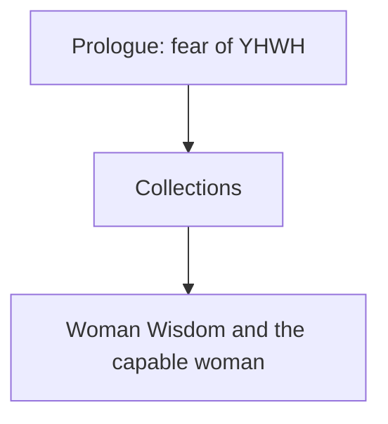

# Proverbs

*Solomon prays for wisdom Credit: This image is available from the Netherlands Institute for Art Historyunder digital ID 2792.. License: Public domain. Source: [File:Solomon prays for wisdom.jpg](https://commons.wikimedia.org/wiki/File:Solomon_prays_for_wisdom.jpg).*
**Name and meaning.** *Proverbs* translates Hebrew *Mishlei*, "proverbs of" (Solomon, in the opening title). The book is Israel's school of practical wisdom: short sayings, longer instructions, and poems that train a young person to fear the Lord, read the world, and walk a path of life rather than of ruin.

**Prerequisites:** [Wisdom literature](../../09-wisdom-literature.md). Helpful contrast: [Job](job.md) and [Ecclesiastes](ecclesiastes.md).

## Dating and authorship

The superscription "the proverbs of Solomon son of David, king of Israel" (1:1) and later headings (10:1; 25:1, "copied by the men of Hezekiah") are the book's own authorship claims. Traditional reading takes Solomon as the principal author, with later collection under Hezekiah and with two appendices attributed to Agur (30) and King Lemuel (31). Scholarly study agrees that the book is a collection spanning centuries: some sayings may be early monarchic, the Hezekiah notice is taken seriously as a scribal moment, and the opening poems (chapters 1–9) are often dated later (some would say Persian period) because of their developed figure of Woman Wisdom. Egyptian wisdom (especially the *Instruction of Amenemope*, close to Proverbs 22:17–24:22) shows that Israel participated in an international genre. None of this requires cynicism about a Solomonic wisdom tradition; it does require seeing the book as an edited anthology.

## Context

The typical addressee is "my son," in a household or court school. The social world includes fields, markets, royal courts, poor neighbors, and dangerous alliances. Wisdom (*hokhmah*) is skilled knowledge of how life works, beginning with "the fear of the Lord." Folly is not low intelligence; it is refusal of that fear and of instruction.

## Outline

- **1–9.** A prologue of extended poems: invitations of Wisdom and of the "strange" or foreign woman; the two paths; Wisdom as a figure who was with the Lord in creation (chapter 8).
- **10:1–22:16.** "The proverbs of Solomon": mostly two-line sayings, often antithetical (righteous/wicked, diligent/lazy, wise/fool).
- **22:17–24:34.** "Sayings of the wise," including a closer parallel to Amenemope.
- **25–29.** Further Solomonic proverbs, associated with Hezekiah's scribes.
- **30.** The words of Agur: humility, numerical sayings.
- **31.** The words of Lemuel (his mother's instruction about kings), and the acrostic poem on the capable or valiant woman (31:10–31).

## Key passages and ideas

Proverbs 1:7 and 9:10 state the thesis: the fear of the Lord is the beginning of knowledge or wisdom. Chapter 8 personifies Wisdom as a later Christian tradition would eventually read in connection with the [Logos](../../../../../../../philosophy/glossary/greek/logos.md) and with Christ (see [John](../../../new-testament/books/gospels/john.md) 1), while Jewish tradition could identify Wisdom with Torah. The historical-critical task is first to hear the poem in its own right: Wisdom delights in the inhabited world and calls simple people to learn.

The two-line sayings teach by comparison, not by exception. They are observations about ordinary patterns (hard work tends toward life; loose talk wrecks a house), not iron laws, which is why [Job](job.md) can protest when the pattern fails without thereby "disproving" Proverbs. The book is also socially pointed: bribes, false weights, mockery of the poor, and lazy privilege are not small faults. The "capable woman" of 31:10–31 is a household economist, trader, and benefactor, not a decorative afterthought; she is wisdom in civic and domestic form.

## Themes and reception

Themes include the fear of the Lord, speech, work, sex and marriage, justice in trade, the formation of character, and Wisdom as a cosmic and personal invitation. The book's confidence that the world is morally readable is its gift and, in the company of Job and Ecclesiastes, its limit.

Jewish and Christian education have used Proverbs as a primer. The New Testament quotes it (e.g., in the epistles on discipline and on pride). Modern readers sometimes complain of bourgeois conservatism or of gendered stereotypes; the fair response is to read the whole anthology, including its defense of the poor and its formidable woman of chapter 31, without pretending it is a modern equality tract.

## Where this leads

- Next: [Ecclesiastes](ecclesiastes.md), which tests wisdom's confidence
- Companion: [Wisdom literature](../../09-wisdom-literature.md)
- Related deuterocanon: [Wisdom of Solomon](../../../deuterocanon/wisdom-of-solomon.md), [Sirach](../../../deuterocanon/sirach.md)
- Glossary: [wisdom](../../../glossary/terms/wisdom.md), fear of the Lord
