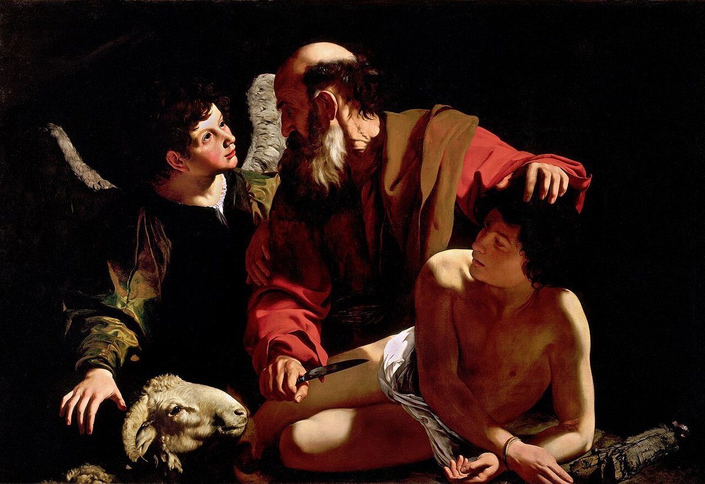

# The binding of Isaac

**Prerequisites:** [Abraham, Isaac, and Jacob](../03-abraham-isaac-jacob.md) and [Genesis](../books/law-torah/genesis.md).

**Key ideas:** Genesis 22, the *Aqedah* in Jewish tradition, is a test in which God commands Abraham to offer Isaac and then stays the knife; the story is brief, severe, and among the most interpreted in the Bible; Jewish, Christian, and later philosophical readings diverge and should be held in view together.

*Binding of Isaac Credit: Caravaggio / Bartolomeo Cavarozzi. License: Public domain. Source: [File:Sacrifice of Isaac-Caravaggio (c. 1603).jpg](https://commons.wikimedia.org/wiki/File:Sacrifice_of_Isaac-Caravaggio_(c._1603).jpg).*
The narrative is only a chapter, and it is almost unbearably spare. "Take your son, your only son Isaac, whom you love… and offer him… as a burnt offering." Abraham rises early, cuts the wood, travels three days, answers Isaac's "where is the lamb?" with "God himself will provide the lamb," binds his son, and takes the knife. An angel stops him. A ram is provided. The promise is repeated. They go down the mountain. Sarah is not mentioned, and Isaac does not speak again in the chapter.

Traditional Jewish reading hears a test of love and obedience, and often also a merit that will stand for later Israel (the shofar of Rosh Hashanah remembers the ram). Some midrashim imagine Isaac as a consenting adult. Christian typological reading has long seen a father's offering of a beloved son, a substitute provided, and a third-day rhythm, and has reread the scene in the light of the [Passion](../../new-testament/stories/06-passion-week.md). Modern moral philosophy, after Kant and especially after Kierkegaard's *Fear and Trembling*, has used the story as a test case for religious obedience against the ethical. Historical-critical readers have asked whether the tale once marked a rejection of child sacrifice in Israel's past, or a polemic, or a later literary composition. Those are not mutually exclusive as questions, and none of them makes the finished chapter less terrible.

A first-principles reading should refuse two shortcuts: explaining the story away as "only a test, so nothing happens," and using it glibly as a proof-text for either blind obedience or for a completed Christian typology that no longer needs to hear the Jewish *Aqedah*. The text itself ends with a name, *YHWH yireh*, "the Lord will provide" or "will see," and with a renewed promise. It does not end with a theory.

The context in Genesis matters. Isaac is the child of the promise, already almost lost in the Ishmael story and in the long wait of Abraham and Sarah. To command this offering is to put the promise itself on the wood. The God of the chapter is the same God who has bound himself by covenant, which is why later readers have found the test so difficult. If you do not find it difficult, you are probably reading too fast.

The geography is "the land of Moriah," later identified in Chronicles and in Jewish tradition with the temple mount, so that the place of the almost-offering becomes the place of later sacrifice. That identification is reception, but it is early and important: it is one reason the story could be lived in liturgy and not only in private dread. Abraham's "here I am," spoken both to God and to Isaac, is the chapter's human refrain. The God of the opening command and the God of the staying angel are, in the book's own claim, one God. Readers who need two gods, or who need no God, are already outside the story's own terms, even if their moral protest is understandable and should not be sneered at.

## Where this leads

- Back to the survey: [Abraham, Isaac, and Jacob](../03-abraham-isaac-jacob.md)
- Book: [Genesis](../books/law-torah/genesis.md)
- Glossary: [Aqedah](../../glossary/terms/aqedah.md), [covenant](../../glossary/themes/covenant.md), [Abraham](../../glossary/people/abraham.md)
