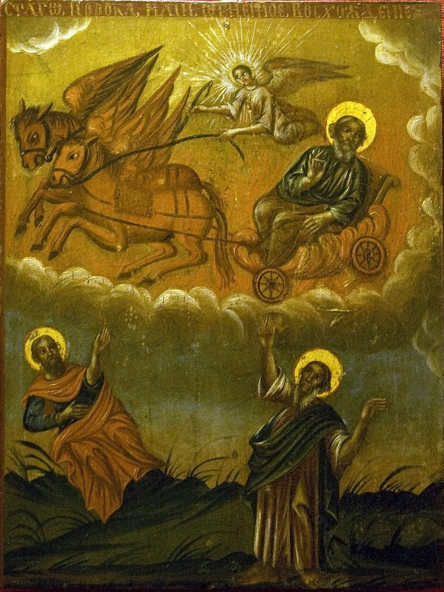
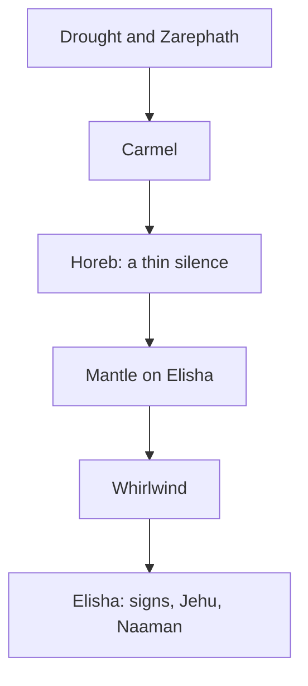

# Elijah and Elisha

**Prerequisites:** [1 Kings](../books/history/1-kings.md), [2 Kings](../books/history/2-kings.md), and [the prophets](../08-prophets.md).

**Key ideas:** The two great northern prophets of the ninth century are presented in a cycle of stories, not in a collected book of oracles; Elijah confronts Ahab, Jezebel, and Baal, and is taken up in a whirlwind; Elisha receives a double share and works a long series of signs, political and domestic.

*Saint Elijah prophet Credit: unknown Serbian. License: Public domain. Source: [File:Prophet Elijah, Serbian painter, 18th c.jpg](https://commons.wikimedia.org/wiki/File:Prophet_Elijah,_Serbian_painter,_18th_c.jpg).*
After Solomon the kingdom splits, and in the north the house of Omri (and Ahab his son) becomes, in the narrator's view, the typical royal problem: a Phoenician marriage, a temple for Baal in Samaria, and a seized vineyard. Elijah the Tishbite appears without a call narrative, announces a drought, is fed by ravens and by a widow of Zarephath, and meets the prophets of Baal on Carmel. The fire falls on a drenched altar; the people cry "the Lord indeed is God"; the prophets of Baal are killed; the rain returns. Immediately afterward Elijah flees from Jezebel, walks to Horeb, and hears not the wind, earthquake, or fire, but a thin silence, and receives a new commission: Hazael, Jehu, and Elisha.

The departure in a whirlwind (2 Kings 2), with a chariot of fire and a dropped mantle, makes Elijah a figure who did not die in the ordinary way, which is why [Malachi](../books/minor-prophets/malachi.md) can promise that Elijah will be sent before the day of the Lord, and why the [Gospels](../../new-testament/books/gospels/README.md) can debate whether John or Jesus is Elijah returned, and can set Elijah on the mountain of transfiguration.

Elisha's cycle is longer and more varied: unsavory jokes and gentle mercies sit side by side (the bears, the poisoned pot, the Shunammite's son, the floating axe-head, the blinding of an Aramean army). Naaman the Aramean general, healed in the Jordan, is a story Jesus will cite. The anointing of Jehu, through a young prophet sent by Elisha, is a political act with a bloody aftermath. These stories keep prophecy close to power, to ordinary hunger, and to the body.

Historically, the ninth-century Omride dynasty is one of the better-attested periods in the archaeological record (the Mesha Stele, the Black Obelisk). The cycles themselves have a folkloric texture and were probably collected and shaped later. Traditional reading takes them as historical acts of the prophets. A first-principles lesson can use the external anchors without flattening the narratives into annals. The theological yield is a picture of the word of the Lord as a counter-kingdom in Israel, sometimes public and fiery, sometimes almost hidden in a widow's house.

Elijah's despair under the broom tree, and his complaint that he alone is left, is answered with a correction: there are seven thousand who have not bowed to Baal, and there is still work. Prophetic loneliness is real in these stories, and it is not quite accurate. Elisha's request for a "double share" is the eldest son's share of an inheritance, not a request to be twice as spectacular; the condition (seeing Elijah taken) is a request for a valid succession. The cycles, read together, are as much about how the prophetic word is handed on as about fire from heaven.

## Where this leads

- Books: [1 Kings](../books/history/1-kings.md), [2 Kings](../books/history/2-kings.md), [Malachi](../books/minor-prophets/malachi.md)
- New Testament: [baptism and temptation](../../new-testament/stories/02-baptism-and-temptation.md), [Luke](../../new-testament/books/gospels/luke.md) 4
- Glossary: [Elijah](../../glossary/people/elijah.md), [Elisha](../../glossary/people/elisha.md), [Baal](../../glossary/terms/baal.md)
