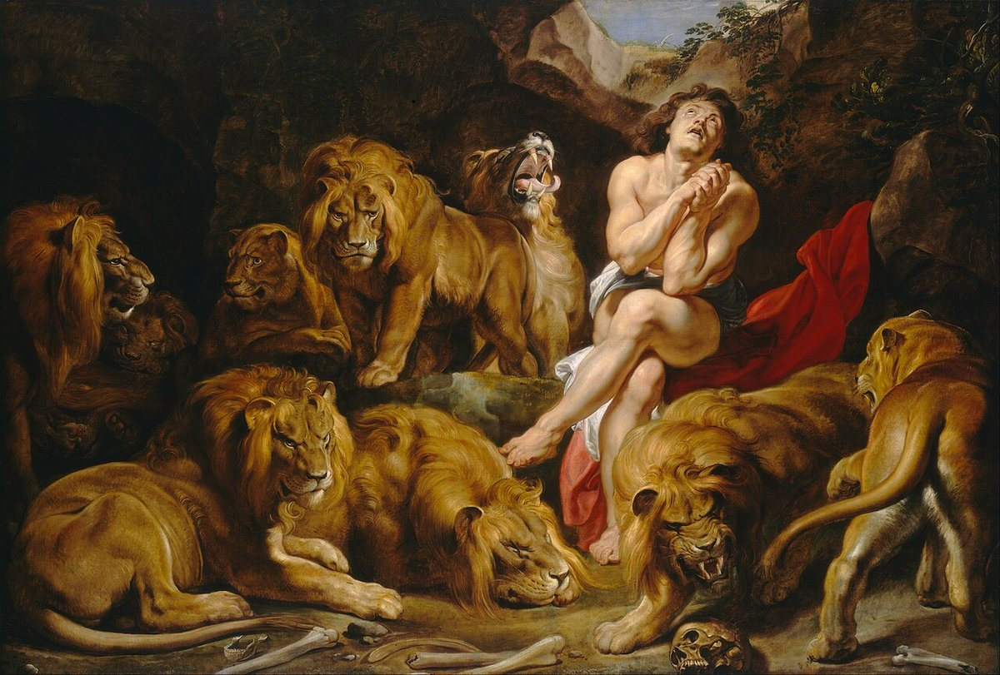
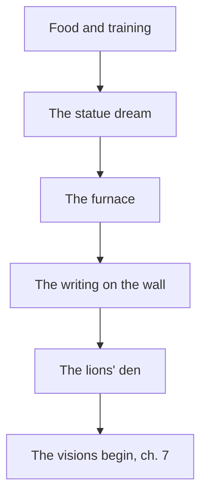

# The court tales of Daniel

**Prerequisites:** [Daniel](../books/major-prophets/daniel.md) and [Exile and return](../10-exile-and-return.md). For the later additions, see [Additions to Daniel](../../deuterocanon/additions-to-daniel.md).

**Key ideas:** Daniel 1–6 is a set of diaspora court stories: fidelity in food and prayer, interpretation of royal dreams, and deliverance from furnace and den; they should be read first as tales, before the visions of chapters 7–12, and they teach a way of living under empire without pretending empire is harmless.

*Daniel in the Lions' Den Credit: Peter Paul Rubens. License: Public domain. Source: [File:Sir Peter Paul Rubens - Daniel in the Lions' Den - Google Art Project.jpg](https://commons.wikimedia.org/wiki/File:Sir_Peter_Paul_Rubens_-_Daniel_in_the_Lions'_Den_-_Google_Art_Project.jpg).*
Daniel and his three companions are taken to Babylon, educated in the literature of the Chaldeans, and given new names. They refuse the king's food and thrive. Daniel interprets a dream of a great statue of four metals, broken by a stone "not cut by human hands." The three companions refuse to bow to an image and are thrown into a furnace; a fourth figure appears with them, and they come out unburned. A second dream (a tree cut down) humiliates Nebuchadnezzar until he blesses the Most High. Belshazzar's feast, with the temple vessels and a hand writing on the wall, ends a king. Darius, in a later tale, is trapped by his own irrevocable law into sending Daniel to the lions, and Daniel is delivered.

The stories are often taught to children, which is fine if the adult edges are not filed off. The companions' line in chapter 3 — our God is able to deliver us, *and even if he does not*, we will not serve your image — is the moral center, not the miracle alone. The writing on the wall is a judgment on the use of holy things as party ware. The lions' den is about a law that cannot be changed and a piety that will not close the windows toward Jerusalem.

Historically, these tales are often dated earlier than the visions, as diaspora folklore later collected into the book whose final form many scholars place in the 160s BCE. Traditional reading takes them as sixth-century events. Either way, their first job is pastoral: they show how to remain Israel (or, later, how to remain faithful) in a palace that can educate you, rename you, and kill you. The New Testament will remember the furnace and the den as examples of faith (Hebrews 11). The [additions](../../deuterocanon/additions-to-daniel.md) will supply prayers and further unmaskings of idols in the same cycle.

Read the six tales straight through, slowly, before entering the beasts and weeks of the second half. The book itself moves from story to vision; a student can do the same.

The four-metal statue, later reread as a scheme of world empires, already teaches that kingdoms succeed one another and that they will not last. The stone that becomes a mountain is not yet the full apocalyptic timetable of chapters 7–12, but it is the same theology in a court-tale key: history is not the king's to define. Belshazzar is weighed and found wanting in a single night; Nebuchadnezzar is given time and a chance to bless the God he had ignored. The tales distinguish those two royal fates on purpose. Empire is not a single cartoon villain. It is a series of tests.

## Where this leads

- Book: [Daniel](../books/major-prophets/daniel.md)
- Deuterocanon: [Additions to Daniel](../../deuterocanon/additions-to-daniel.md)
- Glossary: [exile](../../glossary/themes/exile-and-return.md), [Nebuchadnezzar](../../glossary/people/nebuchadnezzar.md), [providence](../../glossary/terms/providence.md)
