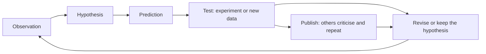

# What science is

**Prerequisites:** none. This is the first lesson of the course.

*Frontispiece of Francis Bacon's Instauratio Magna (1620), showing a ship sailing beyond the Pillars of Hercules. Credit: Credit as given on Wikimedia Commons. License: Public domain. Source: [File:Bacon Great Instauration frontispiece.jpg](https://commons.wikimedia.org/wiki/File:Bacon_Great_Instauration_frontispiece.jpg).*

Every research paper you will ever read is an attempt to persuade you that something is true about the world. Before learning how to judge those attempts, it helps to be clear about what science is trying to do and why it works as well as it does.

## A method, not a body of facts

People often speak of "the science" as if it were a list of settled facts. It is better understood as a **method**: a set of habits for testing ideas against the world so that wrong ideas get caught. The facts in a textbook are the current survivors of that process. Some are extremely secure (the Earth orbits the Sun, germs cause infections), some are provisional, and a few will turn out to be wrong.

The core loop is simple:

1. **Observe** something puzzling.
2. **Propose** an explanation (a hypothesis).
3. **Derive** a prediction: if the explanation is right, what else should we see?
4. **Test** the prediction with new observations or an experiment.
5. **Revise** the explanation in light of the result, and let others check your work.

None of these steps is unique to science. A mechanic diagnosing an engine does all five. What makes science distinctive is that the loop is done *in public*, written down, repeated by strangers, and designed to expose errors rather than to defend a conclusion.

## Where the method came from

Careful observation is ancient. Aristotle catalogued animals and argued about causes; physicians in many traditions recorded what happened to patients. The modern form took shape in seventeenth-century Europe. [Francis Bacon](../../../../philosophy/history/modern/early-modern/thinkers/francis-bacon.md) argued that knowledge should be built from systematic observation and experiment rather than from authority. Galileo combined measurement with mathematics. The Royal Society of London, founded in 1660, took the motto *Nullius in verba*, usually translated "take nobody's word for it". That motto is still the best one-line summary of how to read research: claims should be believed because of their evidence, not because of who made them.

[David Hume](../../../../philosophy/history/modern/early-modern/thinkers/david-hume.md) then raised a problem that has never fully gone away. However many times we have seen the sun rise, nothing in logic guarantees it will rise tomorrow. Generalising from past observations to future ones, called **induction**, cannot be proved; it can only be relied on more or less wisely. Much of statistics, which you will meet in [section 2](../02-statistics/README.md), is a disciplined way of doing induction while measuring how wrong you might be.

## Why it works: error correction

Science does not work because scientists are unusually honest or clever. It works, when it works, because its institutions are built to catch the errors that honest and clever people make. Three features matter most:

- **Testability.** A claim must risk being wrong. "This drug lowers blood pressure" can be checked; "this drug works in ways no test can detect" cannot.
- **Transparency.** Methods are written down so that others can repeat them and find the flaws.
- **Replication.** A finding that holds up when independent groups repeat it is far more trustworthy than a single result.

When any of these breaks down (when methods are hidden, when only successful experiments are published, when no one repeats the work), science becomes much less reliable. A large part of this course, especially [research integrity](../06-research-integrity/README.md) and [funding and conflicts of interest](../08-funding-and-conflicts/README.md), is about exactly those breakdowns.

## Kinds of scientific claims

Research papers make several different kinds of claim, and each needs different evidence:

| Kind of claim | Example | Typical evidence |
|---|---|---|
| Descriptive | "What share of adults in Ontario smoke?" | A survey of a representative sample |
| Associational | "Smokers get lung cancer more often" | Comparing groups ([cohort](../03-study-designs/06-cohort-studies.md), [case-control](../03-study-designs/05-case-control-studies.md)) |
| Causal | "Smoking causes lung cancer" | Many converging studies, ideally including experiments |
| Mechanistic | "Tobacco tar damages DNA in lung cells" | Laboratory work, animal studies |
| Predictive | "This model forecasts next winter's flu peak" | Out-of-sample tests of the model |

A frequent mistake, both by readers and by journalists, is to treat evidence for one kind of claim as if it supported another: an association reported as a cause, or a mechanism in a dish of cells reported as a cure in people. You will see this pattern again in [correlation and causation](../04-causation/01-correlation-and-causation.md) and [animal and in-vitro studies](../09-from-lab-to-headline/03-animal-and-in-vitro-studies.md).

## Science and certainty

Science rarely delivers proof in the mathematical sense. It delivers degrees of confidence that grow as independent lines of evidence agree. That is not a weakness to be embarrassed about; it is what honest knowledge about a complicated world looks like. The practical question for a reader is never "is this proven?" but "how strong is this evidence, how big is the effect, and how could it be wrong?"

## Key ideas

- Science is a method for catching errors, not a list of facts.
- Its core loop is observe, hypothesise, predict, test and revise, done in public.
- It works because of testability, transparency and replication, and it fails when those break down.
- Different claims (descriptive, associational, causal, mechanistic) need different evidence.
- Scientific knowledge comes in degrees of confidence, not proofs.

## Where this leads

- Next: [Falsifiability, hypotheses and theories](02-falsifiability-and-theories.md)
- Related: [Knowledge and opinion](../../../../philosophy/concepts/epistemology/knowledge-and-opinion.md) in the philosophy branch
