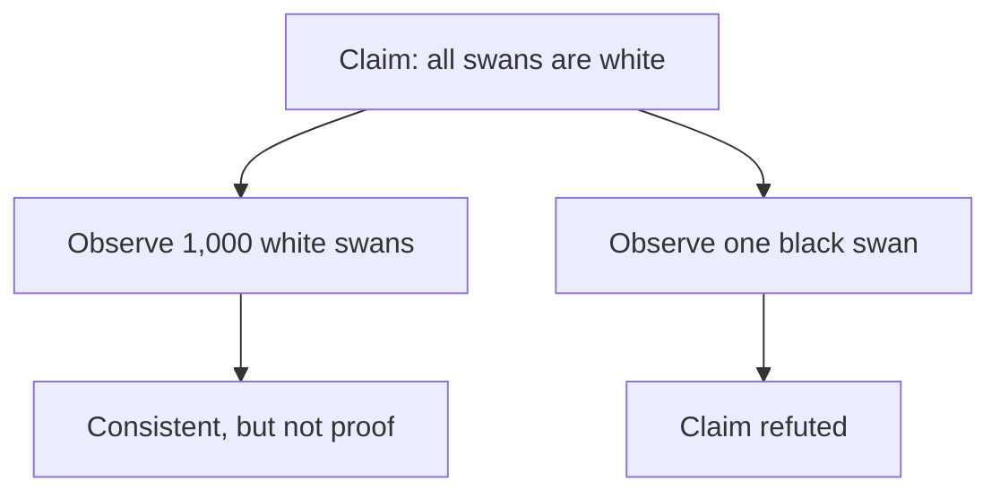

# Falsifiability, hypotheses and theories

**Prerequisites:** [What science is](01-what-science-is.md).

@@IMG@@

Words like *hypothesis*, *theory* and *law* are used loosely in everyday speech. In research they have more specific meanings, and confusing them leads to some of the most common misreadings of science ("it's only a theory").

## Hypothesis, theory, law

- A **hypothesis** is a specific, testable proposal: "people who take drug X will have lower blood pressure after eight weeks than people who take a placebo."
- A **theory** is a broad, well-tested framework that explains many observations and has survived many attempts to knock it down: the germ theory of disease, the theory of evolution, the theory of general relativity. In science, "theory" is a compliment, not a confession of doubt.
- A **law** is a compact description of a regularity, often mathematical: Boyle's law relates gas pressure and volume. Laws say *what* happens; theories try to say *why*.
- A **model** is a simplified representation, usually mathematical or computational, used to reason or predict. Models are tools, judged by usefulness rather than literal truth.

In research papers you will mostly meet hypotheses. A paper typically tests one or a few narrow hypotheses that bear on a bigger theory.

## Popper and falsifiability

The philosopher [Karl Popper](../../../../philosophy/history/modern/twentieth-century/thinkers/karl-popper.md) (1902–1994) asked what separates science from non-science. His answer, set out in *The Logic of Scientific Discovery* (German original 1934, English 1959), was **falsifiability**: a scientific claim must forbid some possible observations. If no conceivable result could count against an idea, the idea is not telling you anything about the world.

Popper's insight rests on an asymmetry. No number of white swans proves "all swans are white", but a single black swan refutes it. So, on his view, science advances not by proving theories true but by trying hard to prove them false and provisionally keeping the ones that survive.

For a reader of research, falsifiability gives a useful test: **what result would have counted against this paper's conclusion?** If the authors would have declared success whatever the data showed, the study was not really a test. You will see this failure in its modern forms in [HARKing](../06-research-integrity/05-harking.md) and [p-hacking](../06-research-integrity/04-p-hacking.md).

## Kuhn and the social side of science

[Thomas Kuhn](../../../../philosophy/history/modern/twentieth-century/thinkers/thomas-kuhn.md)'s *The Structure of Scientific Revolutions* (1962) added a historical correction. Real scientists, Kuhn observed, do not abandon a theory at the first anomaly. They work within a **paradigm**, a shared set of assumptions, methods and exemplary problems, and explain away awkward results until anomalies pile up and a rival paradigm emerges. The shift from Ptolemy's Earth-centred astronomy to Copernicus's Sun-centred one is his classic example.

Kuhn is sometimes read as saying science is merely social fashion. That is not what most philosophers take from him. The lasting lesson is more modest: scientists are people embedded in communities, with careers, loyalties and blind spots, and those communities can resist inconvenient evidence for a time. That is one reason this course spends time on [non-financial conflicts of interest](../08-funding-and-conflicts/06-non-financial-conflicts.md) and on [consensus and dissent](../09-from-lab-to-headline/05-consensus-dissent-and-experts.md).

## Auxiliary assumptions

A further complication, often associated with Pierre Duhem and W. V. O. Quine, is that hypotheses are never tested alone. A test of "drug X lowers blood pressure" also assumes the blood-pressure cuff was accurate, patients took their pills, the randomisation worked, and so on. When a prediction fails, you can blame the hypothesis or one of these **auxiliary assumptions**. This is why a single failed replication rarely settles a debate, and why careful [methods sections](../05-anatomy-of-a-paper/04-methods.md) matter so much: they are where the auxiliary assumptions are written down.

## Strong and weak tests

Not all tests are equally informative. A **strong test** is one where the hypothesis makes a risky, specific prediction that would be surprising if the hypothesis were false. Eddington's 1919 eclipse observations, which checked Einstein's prediction of how much starlight would bend around the Sun, are the textbook example. A **weak test** is one that the hypothesis would pass whether or not it were true, such as finding "some association" among dozens of variables.

When you read a paper, ask how risky its prediction was. Did the authors state in advance exactly what they expected and how they would measure it ([preregistration](../06-research-integrity/01-preregistration.md))? Or did they look at the data and then describe whatever they found?

## Key ideas

- A hypothesis is a testable proposal; a theory is a well-tested explanatory framework; a law describes a regularity.
- Popper: scientific claims must be falsifiable, and confirmation is weaker than refutation.
- Kuhn: science happens inside communities and paradigms that can resist anomalies.
- Every test also tests auxiliary assumptions, so failures and successes need interpretation.
- Prefer risky, pre-specified predictions to flexible ones.

## Where this leads

- Next: [Observation, measurement and experiment](03-observation-measurement-and-experiment.md)
- Related: [Karl Popper](../../../../philosophy/history/modern/twentieth-century/thinkers/karl-popper.md) and [Thomas Kuhn](../../../../philosophy/history/modern/twentieth-century/thinkers/thomas-kuhn.md) in the philosophy branch
