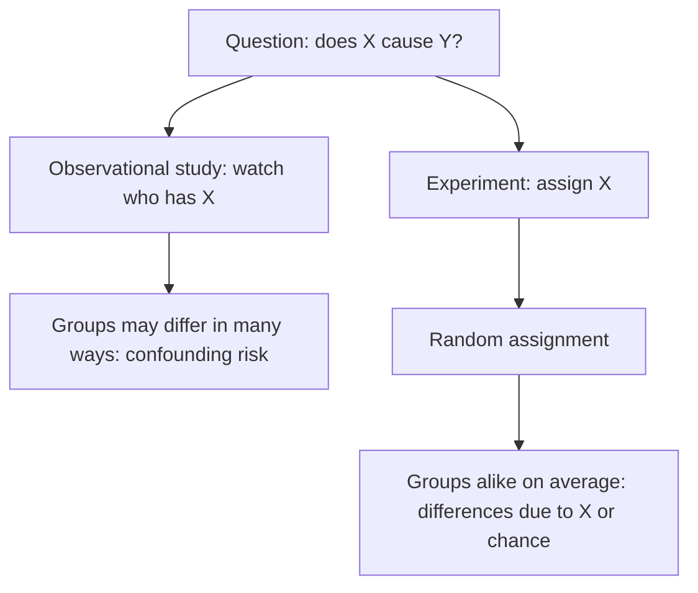

# Observation, measurement and experiment

**Prerequisites:** [Falsifiability, hypotheses and theories](02-falsifiability-and-theories.md).

@@IMG@@

There are two basic ways to learn about cause and effect. You can **watch** the world and compare what happens to different people (observation), or you can **intervene**, deliberately changing one thing and seeing what follows (experiment). Almost every study design in this course is a variation on one of these two, and the difference between them is the single most important idea for judging a causal claim.

## Measurement comes first

Before you can compare anything, you have to measure it. Measurement sounds trivial but hides many problems:

- **Validity:** does the measure capture what you care about? A questionnaire about "wellbeing" may mostly measure mood on the day it was filled in.
- **Reliability:** does the measure give the same answer when repeated? A bathroom scale that varies by two kilograms between readings is unreliable even if it is right on average.
- **Precision and accuracy:** precision is how tightly repeated measurements cluster; accuracy is how close they are to the truth. A rifle can group shots tightly (precise) but off-target (inaccurate).
- **Operationalisation:** researchers must turn an idea ("depression") into a concrete measurement (a score on a named rating scale). Two studies of "depression" using different scales may not be measuring the same thing.

When a paper's conclusion surprises you, check how the key outcome was measured before anything else. Many disagreements between studies turn out to be disagreements about measurement. You will meet this again in [measurement and recall bias](../04-causation/07-measurement-and-recall-bias.md) and [surrogate endpoints](../09-from-lab-to-headline/02-surrogate-endpoints.md).

## Observational studies

In an **observational study**, researchers record what people do and what happens to them, without assigning anything. John Snow's investigation of the 1854 cholera outbreak in London's Soho is a famous example. By mapping deaths and tracing where victims drew their water, Snow showed that cases clustered around the Broad Street pump, supporting his view that cholera spread through contaminated water rather than "bad air".

Observational studies are often the only ethical or practical option. Nobody can randomly assign people to smoke for thirty years. Their weakness is that the groups being compared may differ in many ways besides the one of interest. Smokers in the 1950s also differed from non-smokers in occupation, alcohol use and diet. Those other differences are called [confounders](../04-causation/02-confounding.md), and much of [section 4](../04-causation/README.md) is about them.

## Experiments

In an **experiment**, the researcher controls who gets the intervention. The decisive refinement, developed in agriculture by Ronald Fisher in the 1920s and brought into medicine in the 1940s, is to assign the intervention **at random**. Randomisation means that, on average, the groups are alike in every respect, measured or unmeasured, except the intervention. Any difference in outcome can then be attributed to the intervention or to chance, and statistics can estimate how much chance alone might produce.

An early forerunner is James Lind's 1747 scurvy experiment aboard HMS *Salisbury*, in which he gave pairs of sailors different supposed remedies and found that those given citrus fruit recovered quickly. It was not randomised and involved only twelve men, but it compared treatments side by side under similar conditions. The 1948 Medical Research Council trial of streptomycin for tuberculosis is usually cited as the first modern randomised controlled trial in medicine. You will study the design properly in [randomised controlled trials](../03-study-designs/07-randomised-controlled-trials.md).

## Controls and comparison

Both designs need a **comparison**. "Patients improved after taking the drug" means little on its own, because people often improve anyway: illnesses run their course, symptoms fluctuate, and extreme measurements drift back toward average ([regression to the mean](../02-statistics/17-regression-to-the-mean.md)). The question is always *improved compared with what?* The comparison group, or **control**, can receive nothing, a placebo, or the current standard treatment. Which control is chosen shapes what the study can tell you.

## Internal and external validity

Two kinds of validity frame every study:

- **Internal validity:** is the result correct for the people studied? Randomisation, blinding and complete follow-up protect it.
- **External validity** (generalisability): does the result apply to other people, places and times? A trial in healthy 40-year-old men may not tell you much about frail 85-year-old women.

The two often trade off. Tightly controlled trials with narrow eligibility rules have high internal validity but may describe an unusual population. Large observational databases describe real-world patients but are harder to interpret causally.

## Key ideas

- Measurement must be valid and reliable; always check how the outcome was measured.
- Observational studies watch; experiments intervene.
- Randomisation makes groups comparable on average, including on factors nobody measured.
- Every claim needs a comparison group.
- Internal validity asks whether the result is right for the study population; external validity asks whether it travels.

## Where this leads

- Next: [The norms of science](04-norms-of-science.md)
- Deeper: [The evidence hierarchy](../03-study-designs/01-the-evidence-hierarchy.md) and [randomised controlled trials](../03-study-designs/07-randomised-controlled-trials.md)
