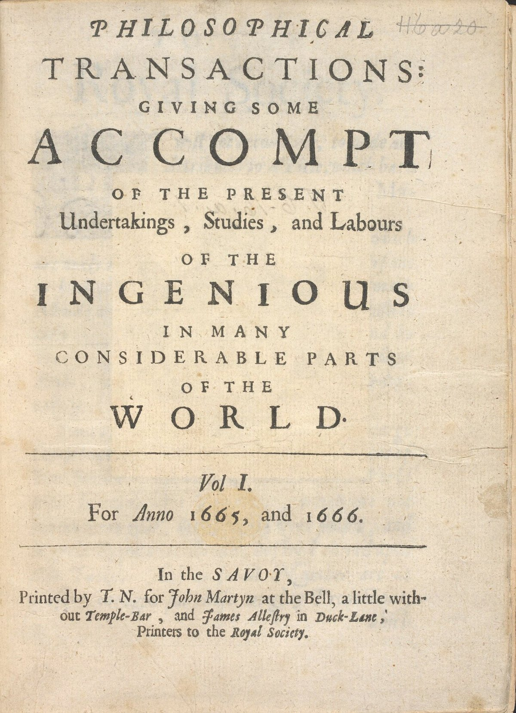
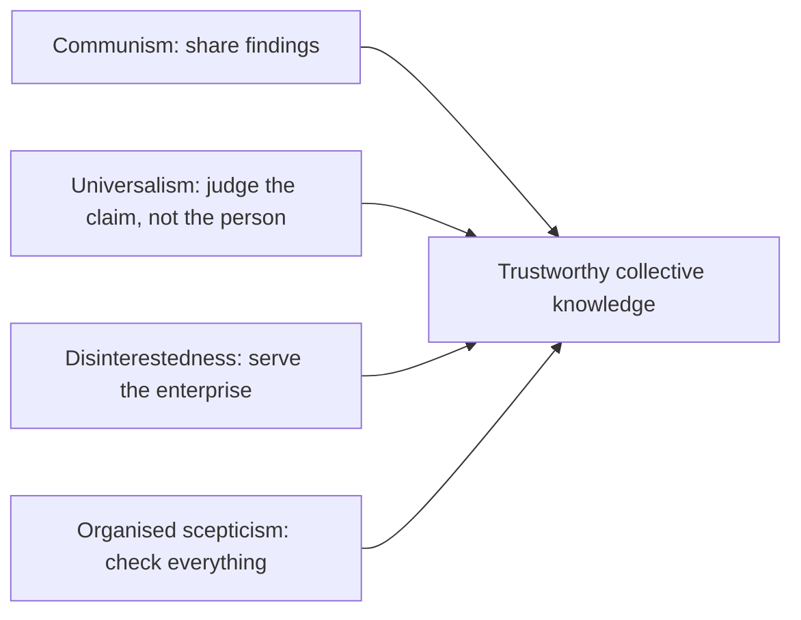

# The norms of science

**Prerequisites:** [Observation, measurement and experiment](03-observation-measurement-and-experiment.md).

*A cover of the Philosophical Transactions of the Royal Society, published since 1665. Credit: AnonymousUnknown author. License: Public domain. Source: [File:Philosophical Transactions of the Royal Society cover.jpg](https://commons.wikimedia.org/wiki/File:Philosophical_Transactions_of_the_Royal_Society_cover.jpg).*

Science is carried out by people working in institutions: universities, companies, government agencies, journals and funders. Those institutions run on shared expectations about how scientists should behave. Knowing the ideals, and how far practice falls short of them, helps you understand why some results deserve more trust than others.

## Merton's four norms

In 1942 the sociologist Robert K. Merton described the "ethos of science" as four institutional norms, often remembered by the acronym **CUDOS**:

- **Communism** (in Merton's sense of common ownership): findings belong to the community and should be shared openly, not kept secret.
- **Universalism:** claims are judged by impersonal criteria (evidence and logic), not by the nationality, race, religion or status of the person making them.
- **Disinterestedness:** scientists should act for the benefit of the shared enterprise, not personal gain, and institutions should reward that.
- **Organised scepticism:** every claim, including cherished ones, should be scrutinised before it is accepted.

These are ideals. Merton did not claim scientists always live up to them; he claimed that the institutions of science are built to encourage them.

## Where practice departs from the ideal

Each norm has a familiar modern failure:

| Norm | Common failure | Where in this course |
|---|---|---|
| Communism | Data and trial results kept private; negative results never published | [Publication bias](../06-research-integrity/06-publication-bias.md), [Tamiflu](../10-case-studies/08-tamiflu-and-hidden-trial-data.md) |
| Universalism | Prestige of authors or journals substitutes for evidence | [Impact factors](../07-publishing/03-impact-factors-and-metrics.md) |
| Disinterestedness | Financial and career incentives shape what is studied and reported | [How funding shapes results](../08-funding-and-conflicts/03-how-funding-shapes-results.md) |
| Organised scepticism | Peer review misses errors; replication is rare and poorly rewarded | [Peer review](../07-publishing/02-peer-review.md), [replication crisis](../06-research-integrity/07-the-replication-crisis.md) |

The point is not cynicism. Scientific institutions have correction mechanisms, and many of the problems above were discovered by scientists applying organised scepticism to their own fields. But as a reader, you should know which safeguards were in place for the particular study in front of you.

## Incentives: "publish or perish"

Academic careers depend heavily on publications, especially in prestigious journals, and on grants. Journals have historically preferred novel, positive, striking results over careful replications or null findings. This creates a quiet pressure on researchers, nearly all of them honest, to frame and analyse their work in ways that produce publishable results. In 2016, Paul Smaldino and Richard McElreath published a paper titled "The natural selection of bad science", arguing that when incentives reward publication counts, labs using weaker methods can out-compete careful ones over time. You do not need to accept every detail of that argument to see the mechanism.

Industry research faces different incentives: a company that has spent heavily developing a product has a strong interest in favourable results, and regulators rely partly on studies the company funds. Section 8 looks at [who pays for research](../08-funding-and-conflicts/01-who-pays-for-research.md) and what evidence shows about the effects.

## Trust, but calibrated

Ordinary readers cannot repeat every experiment, so some trust in experts and institutions is unavoidable. The sensible stance is neither blind deference nor blanket suspicion but **calibrated trust**: more confidence where results have been replicated, data shared, methods registered in advance, and conflicts disclosed; less where those safeguards are missing. The [checklist lesson](../11-practice/02-a-step-by-step-checklist.md) at the end of the course turns this into concrete questions.

## Ethics in research

Norms also govern how research treats people. After the abuses of Nazi medical experiments, the Nuremberg Code (1947) set out the requirement of voluntary consent. The World Medical Association's Declaration of Helsinki (first adopted in 1964 and revised since) elaborated principles for medical research. In the United States, revelations about the Tuskegee syphilis study, in which Black men were left untreated for decades, led to the Belmont Report (1979). Today, human studies normally require approval from a research ethics board (called an institutional review board, or IRB, in the US) and informed consent. A paper's methods section should say which ethics body approved the study.

## Key ideas

- Merton's norms: share findings, judge claims impersonally, serve the enterprise, scrutinise everything.
- Real incentives (publication pressure, funding, commercial interest) push against these norms.
- Many known problems in science were uncovered by scientists themselves.
- Calibrate trust to the safeguards actually present in a given study.
- Human research is governed by consent and ethics review, rooted in the Nuremberg Code and the Declaration of Helsinki.

## Where this leads

- Next: [How a claim becomes knowledge](05-how-a-claim-becomes-knowledge.md)
- Deeper: [Funding and conflicts of interest](../08-funding-and-conflicts/README.md)
