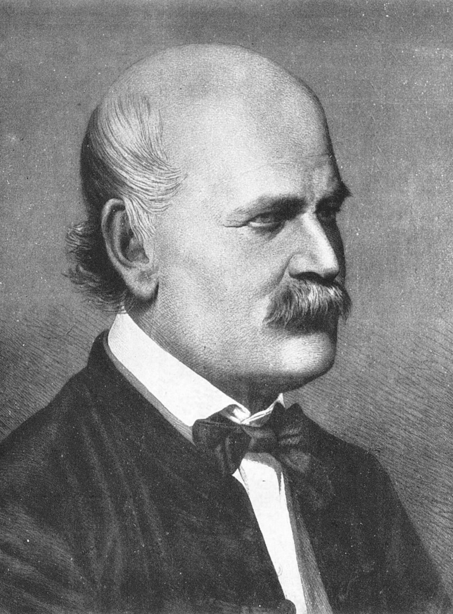
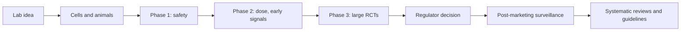

# How a claim becomes knowledge

**Prerequisites:** [The norms of science](04-norms-of-science.md).

*Ignaz Semmelweis, whose evidence that handwashing reduced childbed fever was resisted for years. Credit: After Jenő Doby's engravig. License: Public domain. Source: [File:Ignaz Semmelweis 1860.jpg](https://commons.wikimedia.org/wiki/File:Ignaz_Semmelweis_1860.jpg).*

A new medical claim usually travels a long road between a researcher's hunch and a fact your doctor relies on. Knowing the stages of that road tells you how much weight a given study can bear. A finding at the start of the road is interesting; a finding at the end has been tested many times by many people.

## The typical pipeline

Take a new drug as an example. The stages are roughly:

1. **Idea and mechanism.** Laboratory work identifies a molecule that blocks some biological process thought to matter in a disease.
2. **In-vitro and animal studies.** The molecule is tested in cells and then in animals. Most candidates fail here. See [animal and in-vitro studies](../09-from-lab-to-headline/03-animal-and-in-vitro-studies.md).
3. **Phase 1 trials.** Small studies, often in healthy volunteers, test safety and dosing.
4. **Phase 2 trials.** Moderate studies in patients look for signs of benefit and refine the dose, often using [surrogate endpoints](../09-from-lab-to-headline/02-surrogate-endpoints.md) such as a lab value.
5. **Phase 3 trials.** Large [randomised controlled trials](../03-study-designs/07-randomised-controlled-trials.md) test whether the drug improves outcomes that matter to patients, compared with placebo or standard treatment.
6. **Regulatory review.** Agencies such as Health Canada, the US Food and Drug Administration (FDA) and the European Medicines Agency weigh the evidence and decide whether to approve.
7. **Post-marketing surveillance.** Once millions of people use the drug, rare harms can surface that trials were too small to detect. See [surveillance and pharmacovigilance](../03-study-designs/13-passive-surveillance-and-pharmacovigilance.md).
8. **Synthesis.** [Systematic reviews](../03-study-designs/14-systematic-reviews.md) and [meta-analyses](../03-study-designs/15-meta-analysis.md) pool all the trials, and guideline panels turn the pooled evidence into recommendations.

Non-drug claims (about diets, exercise, schooling, policies) follow a looser version of the same path: early observational associations, then better observational studies, sometimes trials, then reviews.

## Attrition along the way

Most promising ideas do not survive. Estimates vary by field and method, but analyses of drug development consistently find that only a small minority of compounds entering human trials are eventually approved, and many failures happen in phase 2 and phase 3, after encouraging early results. A 2006 study by Daniel Hackam and Donald Redelmeier in *JAMA* followed 76 highly cited animal studies and found that only about a third were later replicated in human randomised trials.

The practical lesson is that the *stage* of a finding is itself evidence. A news story about a mouse study or a phase 2 trial is reporting on something that, statistically, will usually not pan out.

## Single studies versus bodies of evidence

A single study, however good, is one draw from a noisy process. Its result can be inflated by chance, by flexible analysis, or by the fact that surprising results are more likely to be published ([publication bias](../06-research-integrity/06-publication-bias.md)). In 2005 John Ioannidis examined highly cited clinical research in *JAMA* and found that of 45 highly cited studies claiming an intervention was effective, 7 were later contradicted and another 7 had found effects stronger than later studies did; 20 were replicated. Contradictions were more common for non-randomised studies and small trials.

This is why careful readers look for **convergence**: different research groups, different methods, different populations, all pointing the same way. The lesson on [single studies and the weight of evidence](../09-from-lab-to-headline/06-single-studies-and-the-weight-of-evidence.md) develops this.

## Who decides when something is "known"?

There is no single moment when a claim becomes accepted. In practice, several things happen together: replications accumulate, systematic reviews pool them, professional bodies and regulators issue guidance, and the claim enters textbooks. Each of these steps involves human judgement, and each can go wrong, as the [hormone replacement therapy](../10-case-studies/04-hormone-replacement-therapy-and-the-whi.md) story shows: an observational consensus held for years before a large trial overturned it.

Equally, real knowledge can be resisted for a long time. Ignaz Semmelweis showed in the 1840s that hand-washing with chlorinated lime sharply cut deaths from childbed fever in a Vienna maternity clinic, but his colleagues largely rejected the idea until germ theory provided a mechanism decades later.

## Key ideas

- Claims travel a pipeline: lab, animals, phased human trials, regulation, surveillance, synthesis.
- Most early-stage findings do not survive later stages.
- The stage of a finding is itself information about how much to trust it.
- Single studies are noisy; look for convergence across independent studies.
- Consensus is built by human judgement and can lag or overshoot the evidence.

## Where this leads

- Next: [Why reading research is hard](06-why-reading-research-is-hard.md)
- Deeper: [The evidence hierarchy](../03-study-designs/01-the-evidence-hierarchy.md)
