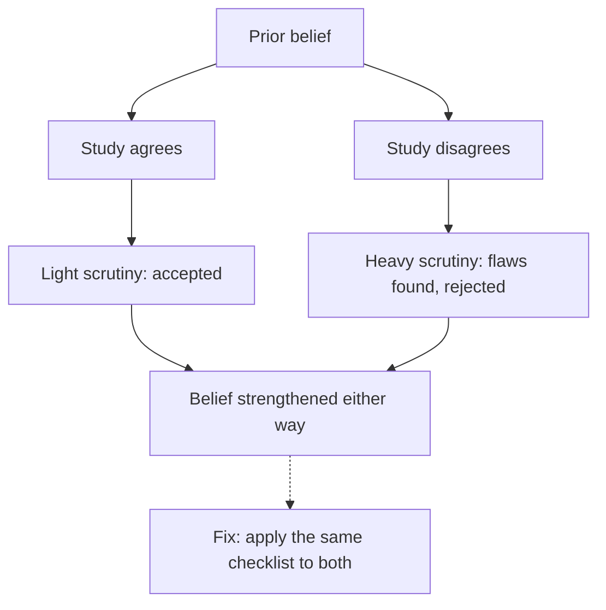

# Why reading research is hard

**Prerequisites:** [How a claim becomes knowledge](05-how-a-claim-becomes-knowledge.md).

@@IMG@@

The hardest part of reading research is not the statistics. It is the reader. Everyone comes to a paper with prior beliefs, loyalties and hopes, and the human mind is very good at finding reasons to accept what it likes and reject what it dislikes. This lesson names the main traps so you can watch for them in yourself.

## Confirmation bias and motivated reasoning

**Confirmation bias** is the tendency to seek, notice and remember evidence that fits what we already believe. **Motivated reasoning** is the broader tendency to reason toward a conclusion we want. A classic 1979 study by Charles Lord, Lee Ross and Mark Lepper gave supporters and opponents of the death penalty the same mixed evidence about whether it deters crime. Both groups rated the studies supporting their own view as more convincing, and both groups came away *more* confident in their original position.

In practice this shows up as asymmetric scrutiny: we hunt for flaws in studies we dislike and wave through studies we like. The flaws we find may be real, but if we only look on one side we end up more biased, not less. A useful habit is the **symmetry test**: "If this study had found the opposite, with exactly the same methods, would I accept it?" The economics branch covers these biases in more depth in [heuristics and biases](../../../../economics/microeconomics/09-behavioural-economics/03-heuristics-and-biases.md).

## Tribal signals

Many research topics are entangled with political, religious or cultural identity: nutrition, climate, guns, vaccines, drugs, education. On such topics, accepting a finding can feel like switching sides. Psychologists such as Dan Kahan have studied how people's reading of scientific evidence on contested topics tracks their group identity. The defence is to separate the empirical question ("what does this study show?") from the policy question ("what should we do about it?"). A study can be correct and the policy conclusion still debatable, or the study weak and the policy still sensible on other grounds.

## Authority and its opposite

Two opposite shortcuts both mislead:

- **Deference to authority**: believing a claim because it comes from a famous scientist, a prestigious journal or an official body. These are real signals of quality, but [peer review](../07-publishing/02-peer-review.md) misses errors, prestigious journals retract papers, and agencies sometimes reverse themselves.
- **Reflexive contrarianism**: assuming that whatever the establishment says must be wrong, or that a lone dissenter is a suppressed genius. Most dissenters are wrong; a few are right; the only way to tell is to look at the evidence.

The [consensus and dissent](../09-from-lab-to-headline/05-consensus-dissent-and-experts.md) lesson discusses how to weigh expert agreement without surrendering your judgement.

## The pull of a good story

A vivid anecdote, a sympathetic patient, a dramatic before-and-after photo: these move us far more than a table of numbers. Yet stories are selected precisely because they are striking, and the people for whom nothing happened do not appear on the news. Keep asking: *how many people were studied, and what happened to the ones in the comparison group?*

## Technical barriers

Research papers are written for specialists. They use jargon, assume statistical knowledge, report results in forms like odds ratios and hazard ratios, and bury key details in supplements. Many are behind paywalls. These barriers are real, and most of this course exists to lower them. The [finding and accessing papers](../11-practice/01-finding-and-accessing-papers.md) lesson covers legal ways to get the full text.

## Intellectual humility

The goal is not to become a person who can debunk any study. It is easy to find *some* flaw in any piece of research; every study has limitations. The skill is to judge which flaws matter, how much they could change the answer, and whether the overall body of evidence still points somewhere. Sometimes the honest conclusion is "the evidence is weak and I don't know", and saying so is a strength.

## Key ideas

- Confirmation bias and motivated reasoning make us scrutinise unwelcome studies harder than welcome ones.
- Apply the symmetry test: would I accept this method if it gave the opposite answer?
- Separate empirical questions from policy and identity questions.
- Neither deference nor contrarianism replaces looking at the evidence.
- Every study has flaws; the skill is judging which ones matter.

## Where this leads

- Next section: [Probability and statistics basics](../02-statistics/README.md), starting with [variables and data](../02-statistics/01-variables-and-data.md)
- Related: [Overconfidence and other biases](../../../../economics/finance/07-behavioural-finance/03-overconfidence-and-other-biases.md) in finance
