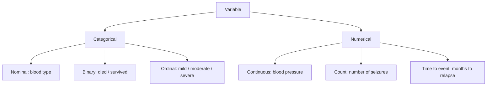

# Variables and data

**Prerequisites:** [[why-reading-research-is-hard|Why reading research is hard]]. No mathematics beyond arithmetic is assumed.

@@IMG@@

Statistics is the language research papers are written in. You do not need to be able to calculate everything yourself, but you do need to know what the words mean and which questions to ask. Everything starts with **variables**: the things a study measures.

## What a variable is

A **variable** is any characteristic that can differ between the units of a study (usually people, but also hospitals, countries, mice or days). Age, blood pressure, smoking status, whether someone was vaccinated and whether they died are all variables. A **dataset** is a table where each row is a unit and each column is a variable.

## Types of variables

The type of a variable determines how it can be summarised and analysed:

- **Categorical (nominal):** categories with no natural order, such as blood type or country of birth.
- **Binary (dichotomous):** a categorical variable with two values, such as alive/dead, vaccinated/unvaccinated. Many medical outcomes are binary, which is why you will meet *risks* and *odds* so often.
- **Ordinal:** ordered categories where the gaps are not equal, such as pain rated "none, mild, moderate, severe", or cancer stage.
- **Continuous (interval or ratio):** numbers on a scale with equal gaps, such as weight, temperature or cholesterol level.
- **Count:** whole numbers of events, such as the number of seizures in a month.
- **Time-to-event:** how long until something happens, such as months until relapse. These need special methods because some people are still event-free when the study ends; see [[kaplan-meier-curves|Kaplan-Meier curves]].

A common trick, sometimes reasonable and sometimes not, is to turn a continuous variable into a binary one: "high blood pressure" defined as above some cut-off. This throws away information, and the choice of cut-off can change results. If a paper uses an unusual cut-off, ask why.

## Exposure, outcome and covariates

In most health research, variables play distinct roles:

- The **exposure** (or intervention, or independent variable) is the thing whose effect is being studied: a drug, a diet, a vaccine, an environmental chemical.
- The **outcome** (or dependent variable, or endpoint) is what might be affected: death, heart attack, test score, symptom score.
- **Covariates** are other variables that may influence the relationship, especially [[confounding|confounders]], which affect both exposure and outcome.

A paper's [[methods|methods section]] should state the exposure and the primary outcome clearly and in advance. Studies that measure dozens of outcomes and report whichever looks best are a serious problem, discussed in [[multiple-comparisons|multiple comparisons]] and [[outcome-switching|outcome switching]].

## Primary and secondary outcomes

Well-designed studies name one **primary outcome**, the main question the study was designed and sized to answer, and several **secondary outcomes**. The primary result deserves the most weight. Secondary results are useful but more likely to be chance findings, especially if they are highlighted only because the primary result disappointed.

## Data quality

Variables are only as good as their measurement (see [[observation-measurement-and-experiment|observation and measurement]]). Several data problems recur:

- **Missing data:** people drop out, skip questions or have incomplete records. If those who drop out differ from those who stay (for example, sicker patients leave a trial), results can be biased.
- **Self-report:** questionnaires about diet, exercise, alcohol or past exposures are prone to forgetting and to people giving socially acceptable answers.
- **Administrative data:** billing records and registries are large and cheap but were collected for other purposes, so diagnoses may be coded inconsistently.
- **Outliers:** extreme values may be real or may be data-entry errors. Decisions about removing them should be made before looking at results.

## Units and denominators

Always check the units and the denominator. "500 cases" means nothing without knowing out of how many people and over what period. Rates such as "per 100,000 person-years" combine both: a **person-year** is one person followed for one year, so 1,000 people followed for two years contribute 2,000 person-years. Comparing raw counts between groups of different sizes is one of the most common errors in news reporting.

## Key ideas

- Variables can be categorical, binary, ordinal, continuous, counts or time-to-event, and each needs different methods.
- Studies distinguish exposures, outcomes and covariates.
- The pre-specified primary outcome deserves the most weight.
- Missing data, self-report and administrative coding can all bias results.
- Always ask "out of how many, over how long?"

## Where this leads

- Next: [[probability|Probability]]
- Related: [[path:economics/finance/01-foundations/08-probability-and-expected-value.md|Probability and expected value]] in the finance course
